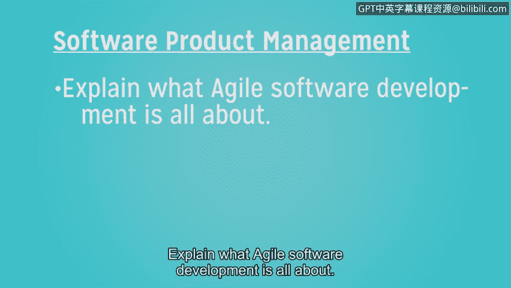

# 019：《软件产品管理简介》 🚀

在本课程中，我们将学习软件产品管理的基础知识。这是软件产品管理专项课程的第一门课，也是最短的一门。通过本课程，你将了解软件产品经理的角色、敏捷开发的核心概念，并为后续深入学习打下基础。

## 课程目标与结构 📋

上一段我们介绍了课程概况，本节中我们来看看课程的具体目标与安排。

本课程是软件产品管理专项课程的第一门课，也是课时最短的一门。

在最初的两周里，我们将达成以下目标：

以下是本课程的核心学习目标：
*   描述软件产品经理的角色。
*   展示对软件产品经理及其行业同事的访谈。
*   解释敏捷软件开发的核心内容。

同时，本课程会让你对专项课程后续将涵盖的主题有一个整体的认识。

在本入门课程结束时，你将能判断这个专项课程是否符合你的个人学习目标。

## 课程难度与受众 🎯

了解了课程目标后，本节我们来讨论课程的难度设置及其面向的受众。

如果你具备软件开发背景，你可能会觉得本入门课程中介绍的技术信息比较基础。

但对于软件领域之外的学习者，本课程将提供一些关键术语和概念，这些内容对学习后续课程至关重要。

如果你在学习本课程后感到意犹未尽，请继续学习我们专项课程中的下一门课。

## 优秀产品经理的特质 👂

前面我们讨论了课程本身，现在让我们聚焦到软件产品经理这个角色本身应具备的关键特质。

一名高效的软件产品经理必须是一名优秀的倾听者。

他需要能够从可能无法完全表达或理解自身需求的用户那里，构想出有价值的产品。

成为一名好的倾听者，就如同成为一名主动的学习者。当你对学习持开放态度时，即使只学到一件新事物，也可能极大地改变你对世界的理解。

## 总结与展望 🌟

本节课中我们一起学习了软件产品管理入门课程的目标、结构、适宜人群以及优秀产品经理的核心特质。

我们希望你在深入探索软件产品管理专项课程的过程中能学到许多东西。

我们期待在论坛中听到你的观点。