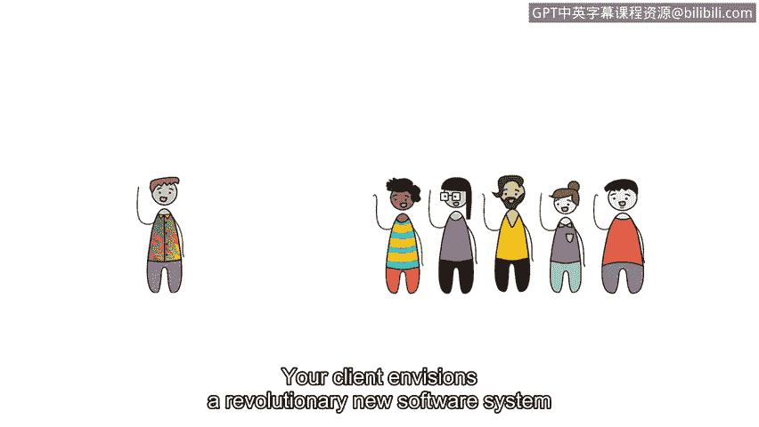
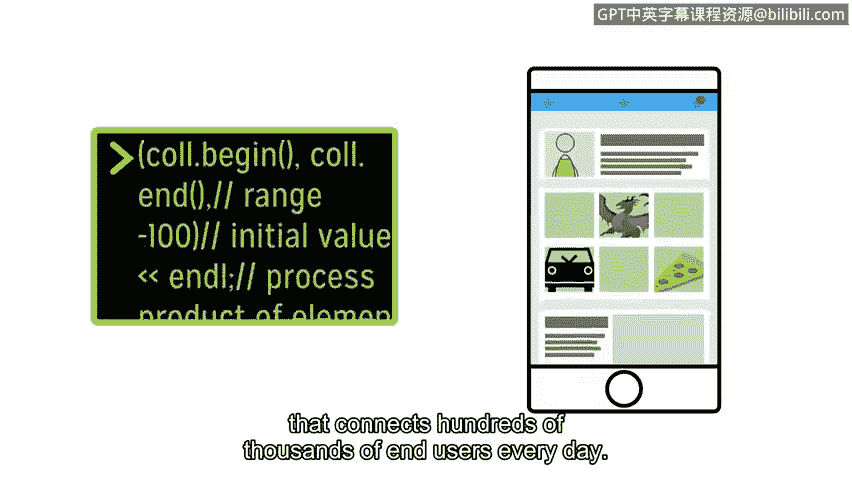
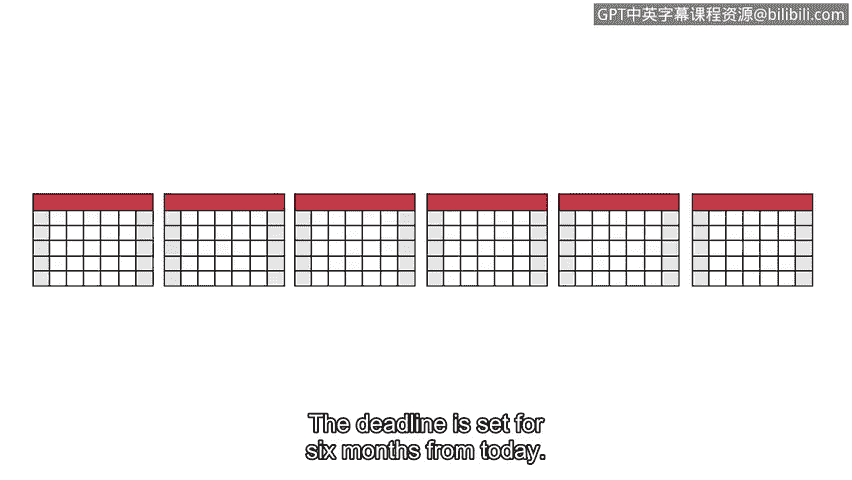
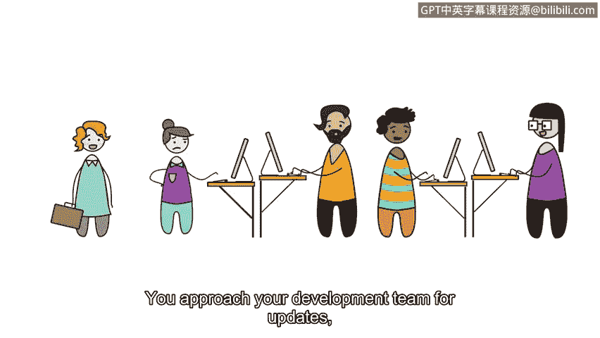
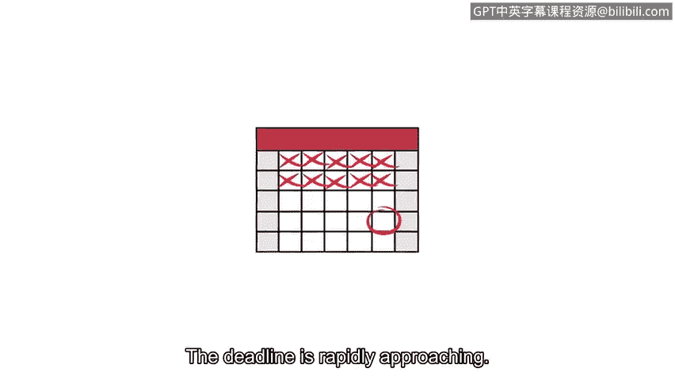
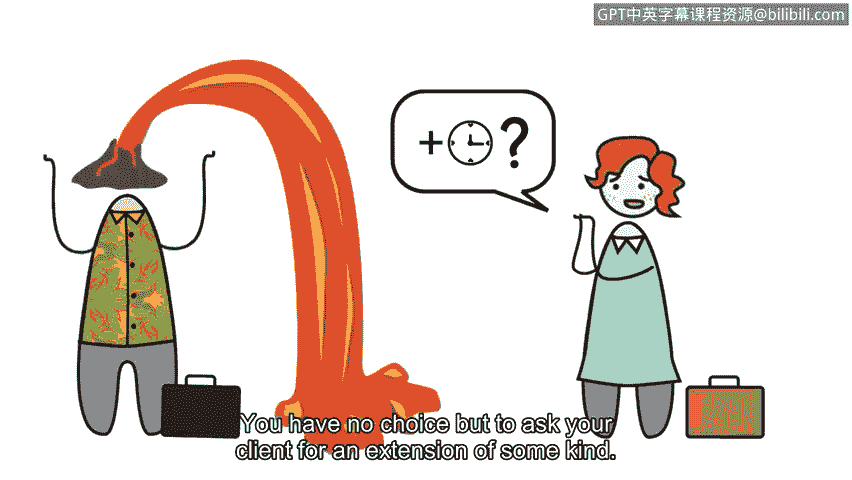

# 021：3_01_1-1-2-为什么需要软件产品管理

## 概述
在本节课中，我们将通过一个虚构的、失败的软件项目故事，来理解为什么我们需要专业的软件产品管理。这个故事将揭示在没有有效管理的情况下，项目如何走向混乱与失败。

## 一个失败的项目故事
为了更好地理解为什么需要软件产品管理，让我们从一个关于软件产品管理如何彻底失败的故事开始。

你刚刚担任了软件产品经理的角色，领导自己的软件开发团队，任务是为一位新客户构建一个产品。

你的客户设想了一个革命性的新软件系统，每天要连接数十万终端用户。

项目截止日期定在六个月后。

你非常兴奋，这是一个展示你能力的大好机会。

你已经组建了团队，合同已经签署，一切准备就绪。接下来该做什么？

为了掌控局面，你认为最好的做法是明确规划出客户的需求。因此，你安排了一次会议，与客户面对面坐下，询问他们希望最终产品包含什么。

客户快速给出了一份非常有趣的想法清单，然后你就离开了。

你的开发人员热烈讨论着如何解决问题。他们各自选择了一些功能进行开发，然后分头行动。

项目似乎有了一个非常高效的开端。

时间快进到三个月后。

客户发邮件给你，要求亲自会面，演示到目前为止的成果。

突然间，你意识到，他们根本不清楚项目的实际进展。

你向开发团队询问进度更新，他们兴奋地告诉你各自正在做什么，并保证他们的部分会按时完成。

你告诉他们，客户想要一个演示。这时，气氛突然变成了恐慌。

他们说：“我们还没有集成任何功能。”，“我至少还需要一周才能完成我代码中的这部分。”，“我不知道我们有演示安排。”

现在，你也开始恐慌，因为你不得不告诉客户你没有任何可以演示的东西。

你的客户肯定会理解的，毕竟软件开发更像一门艺术，而不是一门精确的科学。

一半的项目资源已经消耗，事情似乎进展缓慢，你几乎看不清下周能完成什么，更不用说在演示日到来时能为客户提供什么了。

又两个月飞逝而过。你现在距离交付截止日期只有四周了。

团队完全处于恐慌模式。你的一位开发人员已经两周没来上班了，而他的代码成了整个系统的瓶颈。

你试图指派另一名团队成员来处理，但他们几乎看不懂原始的代码，认为不可能完成任何有意义的工作。

现在，你正在弥补从一开始就不存在的时间。距离产品的首次演示还有两周，你的团队承受着巨大的压力。

每个人都在通宵工作，编写和测试代码。为了节省时间，你把所有最佳编码实践都抛到了脑后，并且希望客户不会发现那几个你已无力让人花时间去修复的漏洞。

截止日期正在迅速逼近。你别无选择，只能请求客户延长一些时间。他们不会高兴的。

但他们除了同意，还有什么其他选择呢？你为自己争取到了一些额外时间。然而，他们仍然想看看你到目前为止的成果。

两周后，演示日。

在模糊的视线和咖啡因刺激的打字声中，你的团队拼凑出了一个粗糙的产品演示。每个人都很紧张，他们唯一的安慰是想着项目很快就要结束了。

直到客户开始彻底否定整个演示。客户说：“我从来没要过这个功能。”，“这个功能的目的是什么？”，“你为什么决定把这个元素放在这里？”，“我不能把这个展示给我的客户看。”

这令人心碎。他们的要求将带来更多的工作量。为什么他们一开始不能更具体一些？产品已经够晚了。你真的能再撑四个月吗？

现在，你没有按计划与家人共度美好的假期，而是被困在办公室里，把头撞在键盘上，希望有更好的方法。

## 解决方案：软件产品管理专业化课程
卡尔加里大学和阿尔伯塔大学可以提供帮助。大约只需一门大学课程的费用，你就可以访问整个按需提供的计算机科学专业化课程。

欢迎来到软件产品管理专业化课程，欢迎来到更好的软件世界。

在这个专业化课程中，我们的专家讲师团队将引导你完成所有步骤，释放你内心的项目管理“忍者”潜能。

你将学习如何从一开始就掌控你的项目，这样，像忍者一样，没有任何事情会悄悄接近你。

你将学习如何高效、协作地管理你的项目，这样，像忍者一样，团队中的每个人都知道正在发生什么。

你还将了解行业当前的最佳实践，这样，像忍者一样，你将成为自己技艺的大师。

## 软件产品管理的重要性
当今商业运行在软件之上。每家公司都有用于控制日常运营的内部应用程序，并且越来越多的公司通过网站和移动应用与外部客户建立联系。

为了成功实现商业目标，公司需要能干的软件项目管理专业人员，他们能够交付在21世纪运营所必需的数字资产。

欢迎来到软件产品管理的世界。这将是一段激动人心的旅程，我们希望你能在此过程中学到很多。我们非常期待你的加入。

## 总结
本节课中，我们一起学习了一个因缺乏有效管理而失败的软件项目案例。这个故事清晰地展示了，如果没有清晰的规划、持续的沟通、进度跟踪和风险管理，即使是最有才华的团队也可能走向失败。软件产品管理正是为了解决这些问题而存在，它通过系统化的方法，确保项目从开始到交付都处于可控状态，最终满足客户需求并实现商业目标。