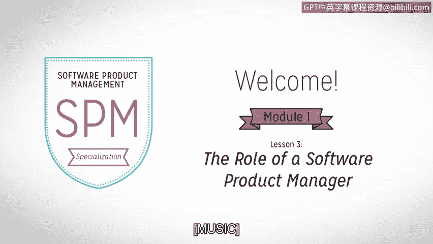

# 022：软件产品经理的角色

## 概述
在本节课中，我们将要学习软件产品经理这一核心角色的具体职责、所需技能以及其重要性。我们将通过定义和行业专家的见解，来全面了解软件产品经理的工作内容。

---

在上一节中，我们探讨了软件产品管理的重要性。本节中，我们来看看担任软件产品经理这一角色具体意味着什么。

软件产品经理是一个核心的管理职位。这个角色类似于电影的制作人和导演，但没有红毯上的名气。你负责一个软件产品的成功。

但这个角色远不止是管理一个项目。它需要你真正理解产品，这意味着你必须像真实用户一样，知道产品能做什么以及它独特的优势。

你还必须了解商业案例，即该产品能为客户带来的价值，以及该软件将如何改变客户的业务格局。

优秀的软件产品经理精通多个领域。他们能用客户和开发人员各自的术语进行交流。他们能倾听并构想客户的愿景，与开发团队成员有效沟通，并激励团队取得最佳成果。他们还能管理客户期望，并且知道如何让开发团队发挥出最佳水平，他们关心自己的团队成员。

产品的成功也依赖于稳固的团队合作。程序员、测试员、用户体验设计师、图形艺术家必须协同工作。你的角色是赋能他们，让他们为你的项目贡献最佳努力。

软件产品管理是一个领导角色。让我们通过几个访谈，看看行业内的从业者如何看待这个角色。

以下是一些行业专家对软件产品经理角色的看法：

*   “我的角色实际上是领导软件开发团队之一。但我确实将自己视为产品领导者，并且鼓励团队中的每个人都视自己为产品领导者。”
*   “我的团队中有一位软件产品经理，我们紧密合作。产品经理负责将需求带给我，并帮助我理解客户的需求，然后我则与团队一起努力满足这些需求。”
*   “我的很多工作是定义产品愿景、产品战略、产品路线图，以及为开发团队和体验设计团队制定规范。”
*   “让我兴奋和感到挑战的是，让工程师、测试团队、文档团队明确无误地理解我们试图解决的问题是什么，这让我感到满足。”
*   “产品经理与客户会面，他们获得一个想法，一个关于某物如何实现的愿景。他们向工程团队和相关利益相关者阐述这个愿景，然后他们看到它被实现为可工作的软件。看到它最终交付并看到它对客户及其现实产生的影响，这对产品经理来说是极大的满足。”
*   “看到客户对成品的反应，阅读相关评论，看到它在商店里，这是非常有回报的。”
*   “让团队围绕问题团结起来。如果人们来上班只是把它当作一份工作，他们不会创新。他们会做你告诉他们的事，然后回家。如果他们内化了你要解决的问题的使命，奇迹就会发生。”
*   “模糊性是一个巨大的挑战。客户并不总是有能力准确解释他们到底想要什么。因此，我们倾向于采用许多不同的策略来发现他们想要什么，即使他们无法告诉我们。我们可能会观察客户，可能会坐下来看他们工作一段时间，以帮助他们克服表达的模糊性，找出他们实际需要什么。”
*   “人们可能有10种不同的解决方式。所以对我来说，实验和快速迭代的方法确实是解决这个问题的关键。这意味着承认意见分歧和缺乏共同愿景，然后说，好吧，我们到底要做什么来解决它，以及我们如何确定这是否是正确的行动方案。”
*   “作为领导者，首先，你需要能够做三件事：你需要能够用你的愿景激励他人，你需要能够组织需要完成的工作，你需要能够创新。”
*   “坦率地说，如果你自己不能创新，你的工作就是雇佣能帮助你创新的人。他们需要能够倾听客户在说什么，并将其转化为需求，最终转化为工程团队可以构建和交付的规范。其次，你需要能够沟通。作为一个在组织内各个层面（向高管、工程团队、销售团队、营销团队）沟通或推销你愿景的人，你需要能够理解这些层面各自处于什么‘高度’，以及什么信息能引起他们的共鸣。”
*   “建立真正良好关系的能力。进行战略性思考，同时在需要时也非常注重战术。这不是关于你。作为产品领导者，这从来不是关于你，而是关于客户的问题。你的工作，我的工作，是爱上客户的问题。”

软件产品经理的背景多种多样。以下是进入这个领域的几种常见路径：

*   有些人从业务端起步，意识到自己对软件有兴趣和技能，并且大致了解软件是如何构建的，然后他们会获得更多技术能力，并开始从那一侧参与进来。
*   有些人拥有计算机科学背景，从程序员做起，逐渐迁移到产品领导角色。
*   也有人看到拥有音乐学位的人成为了出色的产品领导者。
*   拥有计算机科学学位的人和拥有音乐学位的人的共同点，首先是领导力。如果你能激励人、组织人并能创新，你就能在产品管理方面做得好。
*   另一些人从工程侧进入，他们曾是优秀的工程师，但可能决定对愿景、规划方面以及协作而非实现更有热情。
*   很多产品经理是在工作中学习的。

对于有志成为产品经理的人，专家们给出了以下建议：

*   “申请它。上网寻找，申请它。但要明白这一点：我们是来领导人的。你是来领导一个流程的。你是来解决客户问题的。如果你从自我认知的角度相信那就是你，那就申请它。”
*   “他们应该了解他们的工程师。他们应该与工程师面临的问题、工程师能带来的机会保持高度一致。并且真正、真正专注于这种伙伴关系。”
*   “我认为客户和客户研究至关重要。这是产品经理的基本技能，所以这是基本要求。除此之外，我认为要真正擅长与自己的团队以及利益相关者团队建立伙伴关系。”
*   “对我来说，就是要痴迷于客户。立足于客户，非常非常了解他们，因为你的工作就是代表他们。如果你从这一点开始并且做得很好，如果你能深入理解你的客户，那么你某种程度上就已经领先了。”

正如你所看到的，软件产品经理的职位可以是一条充实的职业道路。优秀的产品经理能赢得客户和团队成员的尊重。出色的产品经理因其成功的产品交付记录而备受追捧。

无论你是想从开发者转向产品经理，还是你理解业务方面并希望更直接地参与塑造软件，或者也许你想寻求职业转变，更多地从事软件产品管理工作，无论你开始这条道路的原因是什么，本专业课程都将逐步指导你成为一名有能力、有信心的软件产品经理。

## 总结
本节课中，我们一起学习了软件产品经理的核心角色。我们了解到，这个角色是产品成功的中心，需要兼具对产品的深刻理解、商业洞察力以及卓越的领导与沟通能力。它要求从业者能够连接客户与开发团队，激励团队围绕共同目标努力，并最终交付能解决客户问题、创造商业价值的软件产品。这是一个充满挑战但也极具成就感的领导职位。