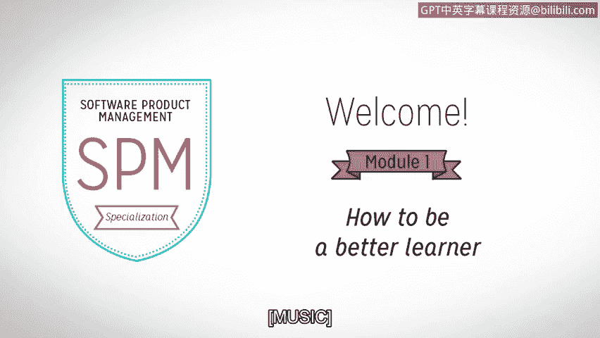
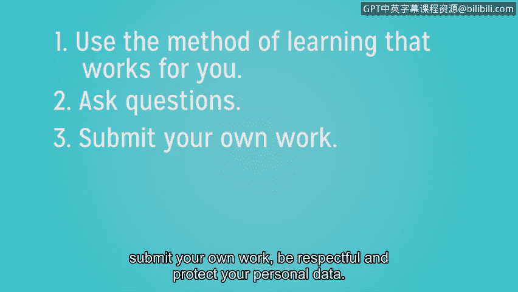

# 023：如何成为更高效的学习者 🧠

在本节中，我们将介绍一些在本专项课程中取得成功的具体方法，帮助你更有效地学习。这些建议旨在优化你的学习体验，确保你能够充分掌握课程内容。

## 概述
我们将提供五个关键建议，涵盖学习方法选择、互动参与、学术诚信、社区礼仪与个人信息安全。遵循这些建议，你将能更好地投入到课程学习中。

---

### 1. 采用适合你的学习方法
首先，我们建议你采用最适合自己的学习方法。我们提供了视频讲座和课程笔记两种形式，它们完整覆盖了课程内容，你可以选择对你最有效的方式。

以下是具体选择建议：
*   **如果你通过阅读材料学习效果更好**，请使用我们的课程笔记。
*   **如果你更偏向视觉或听觉学习**，观看视频讲座可能让你更成功。
*   视频讲座也配有字幕和文本稿可供阅读。因此，结合使用课程笔记和视频讲座或许对你最有效。

### 2. 积极提问
上一节我们介绍了如何选择学习材料，本节中我们来看看如何通过互动深化理解。我们建议你积极提问。如果你对课程材料有疑问，很可能其他人也有同样的问题。

请在论坛中发布你的问题。我们拥有一个强大的学习社区，其他学习者和课程助教都非常乐意为你提供帮助。

### 3. 提交自己的作业
我们的评估旨在帮助你练习课程中涉及的许多概念。但是，如果你不亲自完成作业，就无法获得评估所能提供的全部益处。

这不仅意味着错失学习机会，而且抄袭他人作业可能导致负面后果。根据Coursera荣誉准则，**抄袭**是指你在未给予适当署名的情况下，复制他人来源的文字、观点或任何其他材料。

适当署名应通过规范的引用方式给出。抄袭在学术环境中是不可接受的，并且严重违反了Coursera的荣誉准则。抄袭可能导致作业不及格、被移出课程，甚至被逐出Coursera社区。

### 4. 保持尊重态度
这是一个为全球众多学习者提供的学习环境。请尊重你的同学，并记住他们可能来自不同的文化、说不同的语言，并且背景与你不同。

你还需要注意自己书写的语气。在书面文字中准确解读语气并不总是容易的，因此某些内容可能会被误解或曲解。任何煽动性言论都是不被容忍的。

### 5. 保护个人数据
最后，为了成为更高效的学习者，我们建议你保护个人数据。我们鼓励你在课程中与其他学习者交流，但建议你不要在讨论论坛中分享你的个人住址、电话号码或电子邮件地址。

---

## 总结
本节课中我们一起学习了成为更高效学习者的五个核心方法：**选择个性化学习方法**、**在论坛中积极提问**、**独立完成并提交作业**以杜绝抄袭、**在多元社区中保持尊重**、以及**谨慎保护个人数据**。遵循这些建议，你将能更顺利、更有效地完成本课程的学习。