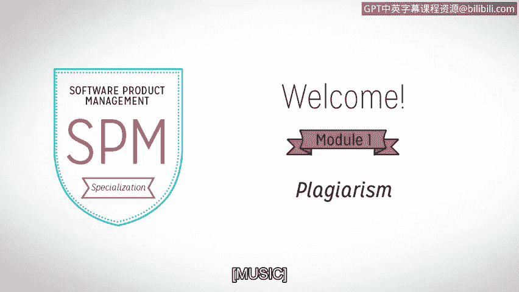
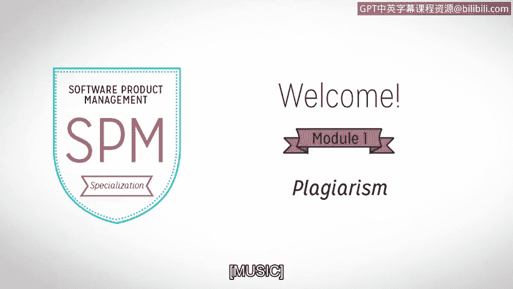

# 024：学术诚信与抄袭指南

在本节课中，我们将学习学术诚信的核心概念，特别是关于抄袭的定义、表现形式及其严重后果。理解并遵守这些规则对于顺利完成本专项课程以及未来的职业生涯都至关重要。

## 什么是抄袭？

根据课程荣誉守则的定义，抄袭是指**在未注明出处的情况下，复制他人作品中的文字、观点或任何其他材料**。

抄袭在任何学术环境中都是不可接受的，它严重违反了课程的荣誉守则。

## 抄袭的后果

以下是抄袭行为可能导致的后果：
*   作业被判不及格。
*   被移出课程。
*   甚至被 Coursera 学习社区除名。

## 抄袭的具体表现形式

上一节我们介绍了抄袭的定义和后果，本节中我们来看看哪些具体行为会被认定为抄袭。以下是几种常见的抄袭情况：

**1. 复制粘贴他人文字**
如果你复制粘贴了他人撰写的文字，这即被视为抄袭，除非你正确地注明了出处。即使你调整了语序或更改了部分词语，也必须为其原创工作署名。例如，在作业、测验或讨论区中复制粘贴其他学员或工作人员的文字，并将其作为自己的成果提交，是被禁止的。

**2. 提交他人创建的文件**
在本专项课程的一些课程中，你可能会被要求提交图片或图表作为作业。提交由其他学员创建或提交的图片，并声称是自己的作品，这被视为抄袭且被禁止。

**3. 窃取观点创意**
某些作业可能需要一些创造性。窃取他人的创意观点，即使提交的文档是由你自己创建的，也被视为抄袭。在学术或商业环境中，两个或更多人可能产生相同的想法是常见情况。为了保护自己不被指控为窃取（不仅在本课程中，在你的职业生涯中也同样重要），记录你的修订过程或以某种方式记录你的思考过程是一个好习惯。例如，你可以维护一个日志来记录每个想法或概念的起源时间。

## 总结与行动指南

本节课中我们一起学习了学术诚信中关于抄袭的核心内容。请确保在整个专项课程中提交你自己的原创作品。

如果你在课程中发现抄袭行为，请标记相关作业并提请课程工作人员注意。