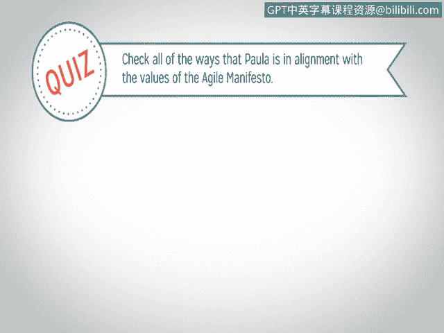

软件产品管理：1：敏捷宣言详解 🚀

在本节课中，我们将学习敏捷软件开发的核心思想——敏捷宣言。我们将了解其诞生的背景、四大核心价值，并通过一个案例来理解如何在实际项目中应用这些价值。

---

欢迎来到敏捷基础实践的探索。我相信你将看到这些指导原则如何提升你项目的成功率。

之前的内容已经表明，使用敏捷实践优于使用杂乱无章的管理方法。现在你可能会问，到底什么是敏捷？

敏捷宣言诞生于17位软件专家在一次滑雪胜地的聚会，他们旨在找到更好的方法来管理优秀软件的生产过程。由于每个重要团体都需要一个酷炫的名字，这些创始人后来被称为“敏捷联盟”。他们确立了关于软件开发中最重要事项的四大核心价值声明。

为了进一步阐述这些核心价值，联盟还达成了12条支持性原则。接下来，我们看看他们提出了什么。

以下是敏捷宣言的四大核心价值：

*   **个体和互动** 高于 流程和工具。
*   **可工作的软件** 高于 详尽的文档。
*   **客户合作** 高于 合同谈判。
*   **响应变化** 高于 遵循计划。

这意味着，虽然右侧项仍有价值，但我们更重视左侧项。当敏捷联盟说他们更重视左侧项时，并非建议你忽略流程、工具、文档、合同或计划。他们是在建议，左侧项是更值得关注的重点。

---

为了理解这些价值如何应用，让我们看一个案例。

保拉一直在为“真北航空系统”管理一个新数据库系统的开发。每两周，她都会邀请客户参加周五下午的会议，开发团队在会上演示最新的产品原型。

本周的会议促使客户和开发团队讨论了一个新的用户界面功能，该功能将允许用户轻松地向数据库输入信息。保拉记录了新需求，并提醒自己安排与法律团队及客户的会议。签署修订后的合同是必要的，以便团队获得新功能的书面规范。

请判断保拉的哪些做法符合敏捷宣言的价值观：
A. 定期演示新原型。
B. 开发团队与客户有面对面交流时间。
C. 随着新需求的识别，产品不断演进。
D. 更新合同以明确新功能。

答案A符合“交付可工作软件”的敏捷价值。答案B符合“客户合作”和“个体与互动”的敏捷价值。答案C符合“响应变化”的敏捷价值。

保拉的做法不符合“客户合作高于合同谈判”的敏捷价值。尽管她鼓励与客户频繁、开放的沟通，但开发团队仍需通过修订合同来获知已达成一致的功能规范。

---

上一节我们通过案例分析了敏捷价值的应用，现在让我们详细解读宣言中的四大核心价值。

**价值一：个体和互动高于流程和工具。**
你的开发人员和客户在协作关系中会更高效、更有成效。作为产品经理，你不是信使，你需要促进想要产品的人与生产产品的人之间的沟通。

**价值二：可工作的软件高于详尽的文档。**
回顾宣言，它指出右侧项仍有价值。因此，文档仍应在整个项目中持续创建。但当面临艰难抉择时，一段**可工作的软件**远比一份描述软件应做什么的**文档**更有价值。

**价值三：客户合作高于合同谈判。**
这意味着你需要与客户培养一种积极的关系，更关注他们想要什么，而不是过分拘泥于合同条款。客户是设计的中心，确保他们的愿景得以实现至关重要。

**价值四：响应变化高于遵循计划。**
软件在不断变化，以易于响应变化的方式来开发软件非常重要。在后续的基础课程中，你将学到许多敏捷实践，它们将使你的项目更能适应变化。

现在你可能会想，在你的项目中实施其中一项或多项价值可能不切实际。这没关系，敏捷是灵活的。重要的是，你去实施那些确实行之有效的价值。

---

在本节课中，我们一起学习了敏捷宣言的起源、其四大核心价值（**个体与互动 > 流程与工具**、**可工作软件 > 详尽文档**、**客户合作 > 合同谈判**、**响应变化 > 遵循计划**），并通过案例分析加深了对这些价值观在实际场景中应用的理解。记住，敏捷的核心在于灵活性和以人为本，选择适合你团队和项目的实践才是关键。