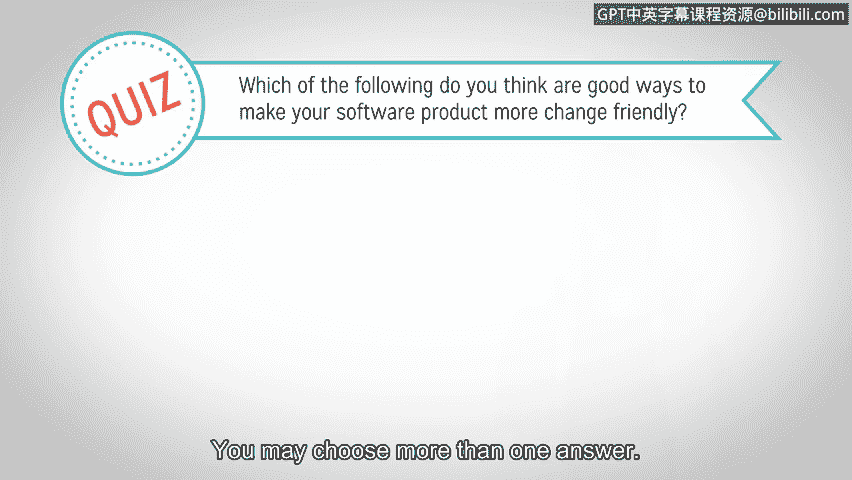

# 028：交付可工作的软件

在本节中，我们将深入探讨敏捷宣言的12条原则，特别是聚焦于“交付可工作的软件”这一核心理念。我们将了解为何频繁交付有价值的软件是满足客户的关键，以及如何将其作为衡量项目进展的主要标准。

上一节我们介绍了敏捷的价值观，本节中我们来看看支撑这些价值观的具体原则。敏捷宣言的12条原则对价值观进行了详细阐述，提供了更具体的指导方针。敏捷方法论则通过应用各种工具和实践来确保这些原则得以实现。

现在，让我们逐一审视这12条原则。为了便于理解，我将这些原则分为了三个类别：**交付可工作的软件**、**灵活设计与适应变化**以及**协作沟通与组织**。接下来，让我们一起探讨第一类原则。

## 聚焦于交付可工作的软件

“可工作的软件”是敏捷方法的一个关键方面。当团队专注于交付可工作的软件时，它能有效驱动开发进程。即使在开发的早期阶段，每一次可工作软件的交付都成为一个可运行的原型，并将在下一轮开发中得到改进。一段可工作的软件能让客户满意，因为他们可以在整个过程中看到其产品的演示。

以下是与此类别相关的几条原则：

**原则一：我们最重要的目标，是通过尽早和持续地交付有价值的软件来满足客户。**

> 在这条原则中，“有价值的”一词至关重要。你需要询问客户他们认为什么是有价值的。客户最看重的功能应成为你开发团队的最高优先级。

**原则二：欢迎不断变化的需求，即使是在开发后期。敏捷过程利用变化为客户创造竞争优势。**

> 这条原则是关于交付频率的：**频繁地交付可工作的软件，周期从几周到几个月不等，且倾向于较短的周期**。可以这样思考：你的软件交付越频繁，客户就有越多的机会对开发提供反馈。

**原则三：可工作的软件是衡量进展的主要标准。**

> 既然你的团队将专注于交付可工作的软件，那么你的进展就应该以此为标准来衡量。当我提到“可工作的软件”时，它意味着一种完成度。在敏捷中，一个功能只有在所有代码都已编写、测试并归档后，才能被视为完成。你需要确保你的开发团队是在完成功能，而不是开了很多头，但实际完成的却很少。

## 构建易于变更的软件产品

我已经提到过，软件是不断变化的，这是你必须准备好面对的事情。拥有一个对变更友好的项目，意味着你的项目能够轻松适应变化。

那么，你认为以下哪些是使你的软件产品更易于变更的好方法？（可选多项）

*   A. 频繁的客户沟通
*   B. 未注释的源代码
*   C. 持续审查和改进你的项目
*   D. 持续更新的、已排定优先级的特性列表
*   E. 对变更持开放态度的开发团队

以上所有选项都是使你的项目更易于变更的方法。我们将在整个专项课程中更详细地回顾这些实践。

---

本节课中，我们一起学习了敏捷原则中关于“交付可工作的软件”的核心部分。我们明确了以满足客户为最高优先级，通过**频繁交付有价值的软件**来实现，并将**可工作的软件**作为衡量进度的首要指标。同时，我们也初步了解了构建一个能灵活适应变化的项目环境所需的一些关键实践。下一节，我们将继续探讨关于灵活设计与适应变化的敏捷原则。