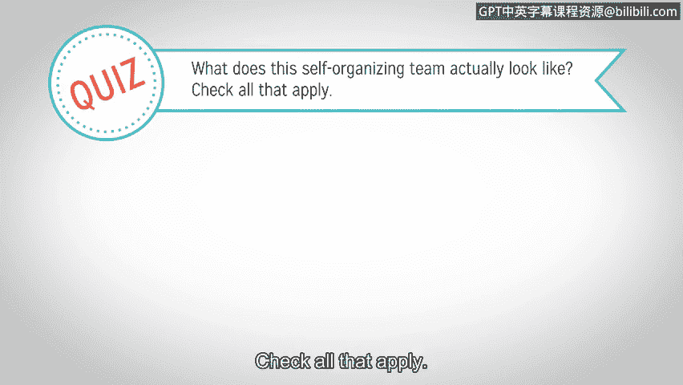

# 030：12_04_1-2-2c-协作沟通与组织

## 概述
在本节课程中，我们将学习协作沟通与组织相关的敏捷原则。这些原则对于任何希望开发优秀软件的团队都至关重要，它们指导我们如何构建团队、促进沟通并持续改进。

---

## 协作沟通与组织原则

团队的组织方式可以促进更好的沟通，并推动优秀的软件开发。让我们从第八条原则开始，它关乎信任。

### 原则八：信任与赋能
**围绕积极主动的个体构建项目。为他们提供所需的环境和支持，并信任他们能够完成工作。**

这意味着，作为产品经理，有时需要退后一步。这或许很难做到，但重要的是更多地扮演团队促进者的角色。乔治·S·巴顿将军曾说过：“告诉人们去哪里，但不要告诉他们怎么去，你会对结果感到惊讶。”

### 原则九：自组织团队
**最好的架构、需求和设计出自自组织团队。**

敏捷鼓励团队自组织。这意味着团队共同决定如何组织项目，包括分配任务和选择使用的工具等事项。

### 原则十：紧密协作
**业务人员和开发人员必须在整个项目期间每天一起工作。**

再次强调，作为产品经理，你将扮演促进者的角色，而绝非双方之间的传话筒。

### 原则十一：面对面沟通
**向开发团队及团队内部传递信息的最有效、最高效的方法是面对面交谈。**

能够直接与项目团队成员交谈可以减少误解的机会，并提高工作推进的速度。如果团队具备同地办公的条件，请充分利用这一点，进行频繁而简短的面对面会议。当团队分布在全球时，使用视频会议等沟通工具。虽然效果不如面对面沟通，但尽力而为非常重要。

### 原则十二：定期反思与调整
**团队定期反思如何能变得更高效，并相应地调整自身行为。**

你的流程与你正在创造的产品非常相似，你需要测试你的流程，审查它们并进行改进。敏捷培训师兼作者亨德里克·克努伯格说过：“重要的不是你的流程，重要的是你改进流程的流程。”流程与编写代码非常相似，一个首次就完美的流程相当于一个首次编译就没有错误的程序，这是不可能的。

---

## 自组织团队实践案例

你在一家为航空公司开发应用程序的全球性公司工作。你最新的项目是管理一个取代航空公司电视屏幕的娱乐应用程序的开发。你的开发团队在开发和敏捷实践方面都经验丰富，他们实现了团队自组织。

那么，这个自组织团队实际上是什么样子的？以下是可选的描述，请选出所有适用的选项：

*   A. 产品经理无事可做。
*   B. 他们商定了要遵循的某些实践。
*   C. 他们决定在完成任务时自行分配任务。
*   D. 他们任命了一位负责团队的领导者。

**B**和**C**是团队实现自组织的绝佳方式，也是正确答案。自组织团队旨在鼓励沟通、团队合作、高效开发、积极性和相互尊重。任命某人为领导者并不能让每个人都处于同等的尊重水平，也不鼓励平等的责任。自组织团队也并不意味着你无事可做；你需要在团队选择的实践中管理和指导他们。

---

## 总结与应用

现在你已经了解了敏捷宣言的原则，你可能会想，我已经给出了所有这些原则，但没有提供应用它们的方法。在本专业课程中，你将学习到的大多数概念和实践都将与一条或多条敏捷原则相关。到本课程结束时，你将掌握工具和知识，能够自信地将这些原则应用到你的项目中。

如果你能重温敏捷宣言，并将后续课程中学到的内容与本课介绍的原则和核心价值观联系起来，你将能从本课程中获得最大收益。如果你有兴趣了解更多关于敏捷宣言的信息，可以访问 Agilemanifesto.org。

我曾作为开发者和产品经理参与过许多团队，经历过使用和不使用敏捷实践的开发过程。我的一个非敏捷产品在交付时，只有三分之二的功能真正完成。请注意，我并非全盘否定非敏捷方式，我也经历过偏离轨道的敏捷项目。区别在于，我们很早就注意到敏捷项目正在失败，并且我们能够挽救它。而对于那个非敏捷产品，直到我们交付时，我才知道项目失败了。

敏捷原则是否在你的某次经历中让你受益？你是否参与过一个本可以采用敏捷方式的项目？欢迎在课程讨论中分享你的经验。请记住，这些经验不一定特定于软件开发，我意识到我们的学习者来自许多不同的行业。让我们看看这些行业如何相互关联，以及敏捷如何应用于软件之外的许多事物。

现在你了解了敏捷原则，你需要将它们应用到具体事务中。每一个优秀的项目都有一个流程。在下一课中，你将学习为什么流程对产品管理和开发如此重要。我们下节课见。