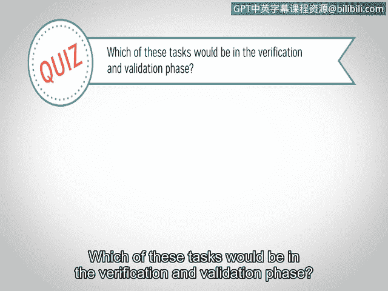

# 031：为什么需要流程

在本节中，我们将探讨为什么在软件开发中需要一个明确的流程。我们将了解流程的定义、其核心阶段，以及它如何帮助团队避免混乱、提高效率并最终交付成功的产品。

我们已经讨论了项目成功的要素，并介绍了敏捷宣言。你可能在思考如何将敏捷的价值观和原则实际应用到项目中。一个定义良好的流程是应用这些原则的良好基础。流程将人员的工作组织成不同的阶段或步骤，以开发软件产品。

当你想到软件开发时，脑海中会浮现出一些阶段。以下是几个例子：
*   项目规划
*   编写代码
*   测试软件
*   产品维护

这些只是一些例子，但组织开发流程的方式可以有很多种。在后续的“软件流程与敏捷实践”课程中，你将探索几种组织软件开发流程的模型。

为了帮助你理解“阶段”的概念，让我们思考一个简单的问题：如果你要为制作披萨创建一个流程，你认为阶段可能是什么？
A. 面饼、酱料、奶酪、意大利辣香肠。
B. 规划、准备、组装、烹饪。
C. 拨打、订购、吃、剩菜。
D. 制作、烘烤、吃、吃剩菜。

A不正确，因为这些更像是原料而非可执行的阶段。C可能正确，但前提是我们创建的是“订购”披萨的流程，而不是“制作”披萨的流程。D不正确，因为它包含的是低层次的具体动作，而非高层次阶段。因此，B是正确答案，因为它包含了规划、准备、组装和烹饪这些高层次阶段。

尽管在产品生命周期中组织工作的流程多种多样，但它们通常共享“阶段”这一高层概念。常见的阶段包括：
*   **规格说明**：构思产品创意的阶段。当你能明确软件将要做什么时，就完成了规格说明阶段。
*   **设计与实现**：找出构建软件的最佳方式，以便开始有效的设计和编码。
*   **验证与确认**：测试软件中的缺陷，并确保系统交付了客户所需的功能。

流程对于组织开发、确保工作按逻辑顺序完成是必要的。它们还能确保步骤不被遗漏或忽视。当你不知从何开始时，软件开发会令人望而生畏。流程也明确了项目应该从哪里开始。

现在，让我们通过一个练习来巩固对阶段的理解。假设你是一个开发新视频游戏项目的产品经理，你的团队负责角色选择界面。团队需要完成的任务包括：
1.  编写选择角色的测试
2.  规划角色的外观
3.  编写多人选择功能的源代码
4.  执行更改角色颜色的测试

那么，哪些任务属于“验证与确认”阶段？
A. 编写选择角色的测试
B. 规划角色的外观
C. 编写多人选择功能的源代码
D. 执行更改角色颜色的测试

编写选择角色的测试和执行更改角色颜色的测试都有助于评估产品是否按预期工作。因此，答案A和D属于验证与确认阶段。

接下来，让我们思考没有流程的软件开发会是什么样子。想象你有一个很棒的应用创意，如果你仅仅凭想象就开始编码，这就像坐在键盘前，指望一部伟大的小说能从你的指尖自动打出来。这通常被称为“临时性”开发。你按时生产出好产品的几率非常渺茫，甚至可能是不可能的。

临时性开发会带来许多问题，一个主要担忧是糟糕的设计。如果你的编程只是随着脑中冒出的想法进行，你可能会花费大量时间开发构思不佳的功能，结果却在开发中途改变主意。时间是宝贵的，而推倒重来的代价是高昂的。

相反，通过一个设计良好且人人遵循的流程，你将能够监控项目的所有方面。这种可见性将帮助你有效地设定工作预期、管理风险、避免浪费资源，并交付一个经过深思熟虑的产品。当开发者理解流程时，他们也能更好地在开发早期发现缺陷或糟糕的设计。朝着共同目标协同工作将节省时间和金钱。

一个定义明确的软件流程还为开发团队中的每个人规定了角色和职责。采用软件流程似乎是产品开发的自然步骤，甚至流程会自然出现也是直觉使然，但遵循一个定义好的流程模型能让每个人都知道该期待什么。随着你在专业课程中的深入，你将熟悉许多行业标准的软件流程模型。一个稳健的软件开发流程是你构建优秀软件的发射台。

所有开发流程的第一步都是理解你要创造什么，也就是我们下一课的主题：初始软件需求是什么。

在本节中，我们一起学习了软件开发流程的重要性。我们明确了流程是将工作组织成阶段（如规格说明、设计与实现、验证与确认）的基础，它能防止临时性开发的混乱，提高团队协作效率，并确保产品按计划交付。记住，一个好的流程是项目成功的起点。