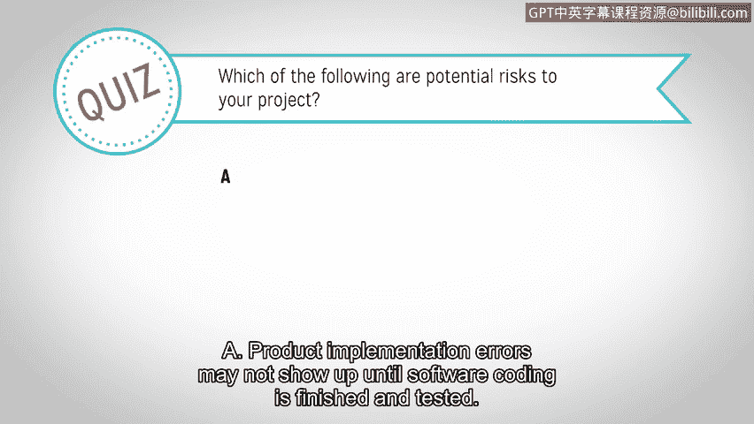

# 032：为什么需要需求？📋

在本节课中，我们将探讨在软件项目中，需求为何如此重要。我们将从几个主要原因入手，并举例说明当忽视需求时会发生什么。

## 概述

需求是对客户需求的一系列具体描述。客户是最初希望构建软件产品的人或群体。需求与流程相结合，是任何成功软件项目的支柱。

## 为什么需要需求？

以下是需求至关重要的几个关键原因。

### 1. 定义产品功能

需求决定了软件产品的功能。例如，一个优秀社交网络应用的需求列表可能包括：
*   用户可以在其数据中存储用户档案。
*   向其他用户发送消息。
*   查看其他用户的档案。
*   创建状态更新。
*   查看其他用户的状态更新。

这个简单的例子表明，需求直接生成了软件产品的特性。

### 2. 消除歧义，避免混淆

模糊的请求会导致开发人员产生巨大困惑。例如，一个看似简单的请求“用户可以通过应用相互交谈”应该如何转化为需求？是指发送语音便签、文本消息还是其他方式？这种模糊性需要通过获取更多细节来澄清，从而精确地确定需求。

在软件开发中，避免混淆至关重要，这始于知道如何正确地获取和表达需求。

### 3. 提前发现潜在错误

通过花时间细化需求，你可以在产品构建之前就发现潜在的错误。澄清想法能使开发工作变得专注且高效。

让我们看一个例子。假设一位开发人员开始开发这个社交网络应用，并遇到了这个需求：“用户必须能够以访客身份发送消息。”开发人员可能会据此设计一个系统，让用户可以选择登录自己的账户或使用一个访客账户。

一个单一的访客账户满足了需求，但是当许多不同的用户都能访问同一个访客账户时，是否会产生意想不到的后果？根据开发人员对需求的理解，这个访客账户变成了一个大账户，任何人都可以在其中相互发送消息并看到对话记录。

这个不幸的设计错误是需求定义不清的结果。想象一下，构建一个考虑不周的功能会投入多少时间和精力——实现成本高昂，修复成本更高。

## 知识测验

现在，我们来看看你是否能找出需求在软件开发中重要的关键原因。

**情景**：你正在与客户合作，为软件产品获取一套需求。客户拿出一张餐巾纸，上面勾勒了一个具有几个概要功能的应用草图。他说：“这就是我们想要的产品。”

**问题**：如果你接受这份文档作为最终需求集，而不是与客户一起细化它们，以下哪些是你的项目的潜在风险？

A. 产品实现错误可能直到软件编码完成并测试后才会显现。
B. 产品可能无法满足最终用户。
C. 客户对产品的外观和感觉有过多输入。
D. 相关人员缺乏协作，士气下降。

**答案**：A、B 和 D。

客户对产品外观和感觉有过多输入并不是产品风险。实际上，客户在过程中参与越多，事情往往进展越顺利。但这并不意味着你应该让客户完全控制开发，你们应该协作以创造最佳产品。协作也有助于提高士气，快乐的团队往往工作效率更高。

## 总结

本节课我们一起学习了需求在软件项目管理中的核心重要性。需求是定义产品功能、消除开发歧义以及在早期发现潜在设计错误的基础。忽视或接受模糊的需求会导致实现错误、产品无法满足用户以及团队协作问题。

要了解更多关于如何确保充分利用需求的知识，建议你学习本专项课程中的“客户需求与软件需求”课程。

在下一节课中，Morgan 将讨论为什么需要花时间规划你的项目。

感谢观看。