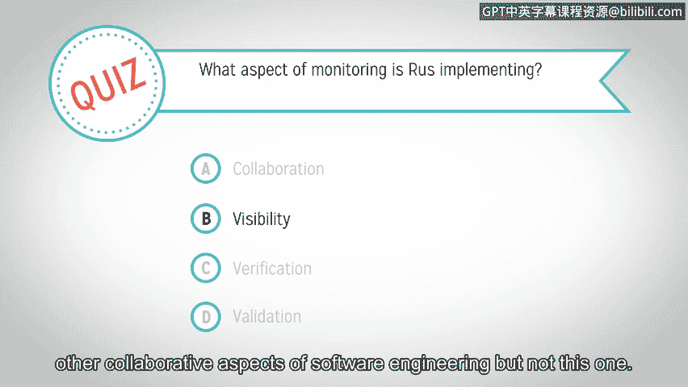

# 034：为何需要监控 🎯

在本节课中，我们将要学习软件产品管理中一个至关重要的环节：项目监控。我们将探讨为什么仅仅完成计划是不够的，以及持续监控如何帮助你确保项目按时、按规格交付，并避免常见的开发陷阱。

上一节我们介绍了项目规划的重要性，本节中我们来看看当规划完成后，进入实际开发阶段时，产品经理需要做什么。

你知道在项目中建立流程以确保不偏离轨道是必要的，摩根在之前的课程中已经详细阐述过这一点。你也知道以有效的方式从客户那里获取需求非常重要，我们曾一起讨论过这个话题。你还学习了为何需要持续为开发制定有用的计划，这由摩根在上节课中进行了讲解。

在本节课中，我将告诉你，当所有规划都完成后，你开始实际构建软件项目时会发生什么。作为产品经理，你不能只是退后一步，看着开发团队自行其是。为了确保项目按计划进行，你必须积极地**监控**、**分析**和**评审**你的进展。

设想这样一个场景：你正在为客户委托的一个项目工作。你已经建立了开发流程，明确了需求，并完成了所有规划。你的开发团队正愉快地为项目编写代码，一切似乎都按计划进行。几周过去了，然后是几个月，现在距离截止日期只有两周了。你看了看项目结束时仍需开发的内容，然后慌了神——你至少还有一个月的开发工作要做。你将不得不告诉客户你无法按时交付。突然间，你的开发团队开始加班加点赶工。办公室里散落着空罐子和咖啡杯。你的开发人员开始生病、精疲力尽。产品质量一落千丈。现在你焦头烂额，因为客户正在指责你没有遵守先前约定的截止日期。当一切看起来都进展顺利时，你是如何陷入这种境地的？

遗憾的是，这种情况在软件开发中非常普遍。个人忙碌并不足以确保有效的进展。仅凭“感觉良好”来衡量项目的真实进度是不可靠的。如果你有过软件开发经验，很可能对“赶工”现象再熟悉不过——当项目截止日期意外临近，而仍有大量工作未完成时就会发生。如果你从一开始就监控项目的进展，或许就能完全避免这种情况。

但不必担心，几十年来，软件开发社区已经建立了一套行之有效的实践方法来避免我刚才描述的问题场景。现在你了解了监控进展为何重要，让我们看看你是否还记得一些原因。

以下是关于监控原因的一个思考题：
斯科特是一名软件产品经理。由于客户不断改变对产品功能的要求，并且他的开发团队工作速度不够快，他将要错过一个重要的截止日期。他对客户在项目中的“多管闲事”感到沮丧，并认为跟踪开发人员的个人工作将使他能够在他们表现不佳时采取纠正措施。

请选择斯科特通过监控能解决的问题：
A. 适应不断变化的产品需求。
B. 避免解雇效率最低的开发人员。
C. 不受客户干扰地工作。
D. 满足项目计划截止日期。

**监控帮助我们适应变化并满足截止日期。** 虽然监控进展允许你跟踪开发人员的生产力，但这不应被视为评估他们职业发展的方式。它也不应替代与客户的良好沟通。因此，正确答案是A和D。

**速度**只是我们监控进展的方式之一。它只是让你能轻松识别何时出现问题，并做出适当调整以解决问题的一种方法。你也可以识别项目中进展顺利的部分，并庆祝这些小小的胜利。这不仅能让你的项目保持在正轨上，并在交付给客户时提高其质量，还能提升团队的士气，并在项目内部提供高度的透明度。

我需要澄清一点：透明度并不意味着跟踪开发团队的进展却对他们保密。透明度意味着团队中的每个人（而不仅仅是管理层）都知道项目的状态。当开发团队和产品经理以积极的目标驱动和团队合作的心态共同监控进展时，监控项目可以成为一种凝聚团队的方式。没有人喜欢赶工，而监控是团队可以用来互相帮助、避免熬夜和长时间加班的一种方法。

现在你已经看到了监控如何影响团队，让我们测试一下你的知识。
罗斯是一名产品经理，正与他的开发团队一起进行一个项目。他选择分享他在整个项目中所跟踪的细节，以便让整个团队都了解情况。
他正在实施监控的哪个方面？
A. 协作
B. 可见性
C. 验证
D. 确认

**可见性**是我们用来描述团队中每个人都知道项目状态的词语。这使得B成为正确答案。虽然监控通常会因更多的讨论而促进开发团队内部的协作，但罗斯在这里并非专门实施这一点。验证和确认用于描述软件工程的其他协作方面，而非此处的场景。

所以，监控进展的核心在于**按时、按规格交付产品**的理念。当然，这有助于开发出更好的软件，并最终让客户更满意。但监控的意义远不止于在紧张的时间表下创造出色的产品。如果做得好，监控可以成为一种极好的方式，来建立共同的目标感，并让你的开发人员感受到自己是紧密团结的团队的一部分。

如果你想了解更多关于这方面的内容，我鼓励你加入本专业课程的最后一门课程。在那里，我将更深入地探讨你可以用来监控和评审项目的具体方法。

你已经完成了第一门课程，恭喜你！希望你已经对软件产品管理专业课程后续内容有了很好的了解。我们在短时间内涵盖了大量材料，还有更多内容等待探索。

以下是我们在第一门课程中涵盖的内容概述：
*   **第一模块**是课程介绍。肯泛泛地谈了为什么软件产品经理很重要，以及我们可以做些什么来帮助开发团队创造更好的软件。然后他概述了本专业课程的结构以及你可以从中期待什么。
*   **第二模块**，我们深入细节。我们探讨了为什么你需要拥有流程、需求、规划和评审技术才能取得成功。

我真诚地希望你能从这些课程中学到一些东西，并希望你能将其应用到未来的项目中。我们设计了这个专业课程的后两门课程，你可以按任意顺序学习。它们将为你学习规划课程做好准备，我们设计规划课程在你完成这两门入门课程后学习。无论你最终先学习哪门课程，我们都非常期待与你一同踏上这段旅程。

再见。