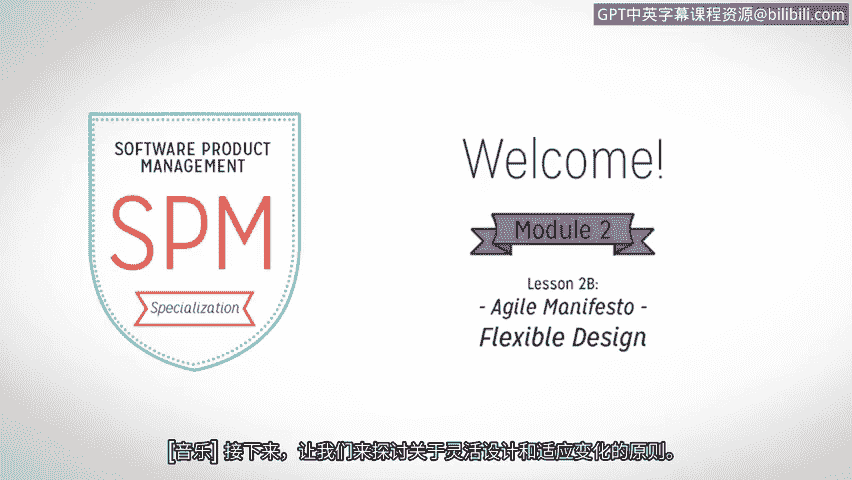
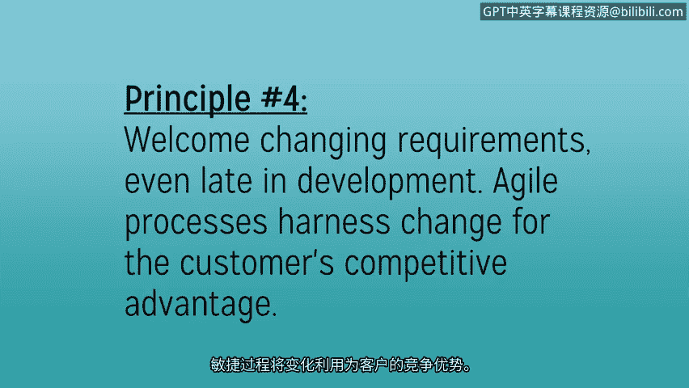
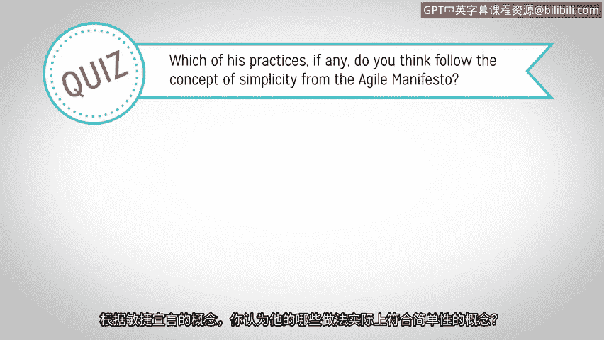

# 艾伯塔大学软件产品管理课程1：《软件产品管理简介》｜introduction-to-software-product-management｜ - P12：11_第1.2.2b节 灵活的设计.zh - GPT中英字幕课程资源 - BV1K84y1S7qz

🎼。😊。

Next， let's examine the principles that focus on flexible design and adapting to change。

As I've said before， change is inevitable in software development。

 You need to plan your project in such a way that change is not detrimental。

A good way to make your product more responsive to change is to have a flexible design and an adaptable process。

I'll start off this category with the fourth principle， it is about changing requirements。

 this will be discussed in more detail in the clientient needss and Soft requirements course。😊。

It states，Welcome changing requirements even late in development。

Agile processes harness change for the customer's competitive advantage。

Change will ultimately create a better product， it'll satisfy your client。

 and it'll give your product that competitive edge。The next principle speaks to good development。

 It states continuous attention to technical excellence is and good design enhances agility。😊。

Having readable， simple code， and more flexible designs will allow changes to be easily implemented。

Having a good design can let you know what components are dependent on each other。

The next principle you and I will examine is about sustainable development， it states。

Agile processes promote sustainable development。 The sponsors。

 developers and users should be able to maintain a constant pace indefinitely。😊。

If you have ever worked in software development， you are probably familiar with the unfortunate development push to get things completed just before a deadline。

This inconsistent pace leads to burnt out development teams。

This will have a negative impact on project success。And we've made it to the halfway mark。

 let's keep moving forward and talk about the seventh principle， which refers to simplicity。

It states simplicityimp， the art of maximizing the amount of work not done is essential；

 This does not mean that agile is about delivering less。

 it means that agile is about delivering what is essential and reducing unnecessary work。

This means writing less code and documentation and focusing on delivering a high impact product that is as simple as it can be。

Sam is one of the developers on your development team。

He is obsessed with the agile concept of simplicity。The software code， he writes， is very minimal。

It does the work it is supposed to do， but without any unnecessary or complicated code。

He also doesn't add comments to document his code。Sam thinks that the team should only develop the essential features that make the product function。

And they shouldn't waste their time on the flashy features that the client believes will add value to the product。

 but that he deems as useless。He refuses to participate in elaborate documentation。

 but will write notes on how he developed the feature。

 any key notes and a brief training document for the end user。Which of his practices， if any。

 do you think， actually followed the concept of simplicity from the agile manifesto。😊。

A minimal code that satisfies the desired functionality。B， no comments in the code。

 C only developing essential features and or D， essential documentation over elaborate documentation。

Sam's view of simplicity is not exactly what the manifesto suggests。But he's right， in some aspects。

Minimal code is a great way to focus on simplicity。

Comments in the code are useful to explain the rationale for a particular solution。

Using comments can make code easier to share with other developers。

It is an easy way to add a small but effective amount of documentation to a project。Also。

 the team should develop features not based on their own criteria of what is important。

 but what is going to satisfy the client。If the features will add value to the product and it's what the client needs。

 then it should get implemented。As a product manager。

 you may need to explain why certain features add value。However。

 his documentation style is a great way to get the essential information to the right people。

There may not be a need for comprehensive documentation。

Short and simple documentation might encourage people to actually read it。Therefore。

 A and D are the correct answers。