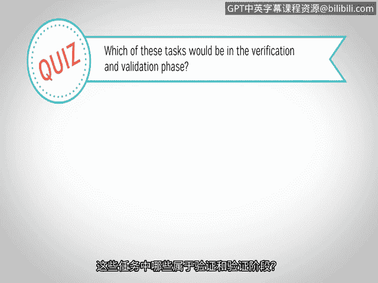

# 艾伯塔大学软件产品管理课程1：《软件产品管理简介》｜introduction-to-software-product-management｜ - P14：13_第1.2.3节 为什么要流程.zh - GPT中英字幕课程资源 - BV1K84y1S7qz

🎼。😊。

🎼不不。I have already covered what makes project successful and I have introduced you to the Agile manifestifto have you been thinking about how agile values and principles can be applied in practical ways to a project？

😊，A process is a good foundation to apply these principles a process organizes the work of people into distinct phases or stages to develop a software product。

Here are some phases that come to mind when you think of software development。Planning the project。

 writing the code， testing the software， maintaining the product。These are some examples。

 but there could be many ways that you could structure a development process。

When you get to the softwareft Prosses and Agile Practices course。

 you will explore several models for organizing software development processes。

If you are going to create a process for making a pizza， what do you think the phases might be？

A crust， sauce， cheese， pepperoni。B， planning， preparation， assembly， cooking。C， dial， order， eat。

 leftovers。Or D， make， bake， eat， eat leftovers。A is not correct since these are more ingredients than actionable phases C may be correct if we are creating a process for ordering a pizza and not making a pizza。

D is not correct since it consists of low level actions and not phases。

 therefore B is the correct answer because it has high level phases for planning， preparing。

 assembling and cooking。Although there are many different processes for organizing the work on a product through its lifetime。

 they generally share the high level notion of a phase， Ex of phases are specification。

 design and implementation， and verification and validation。

Specation is where the idea for the product is conceived。

 you will know the specification phase has been achieved when you can find what the software will do。

😊，Design and implementation is figuring out the optimal way to structure the software。

 which allows effective design and coding to begin。Finally。

 verification and validation is where you test the software for bugs and ensure that the system is delivering what the client needs。

Processes are necessary to organize your development and make sure that you are completing things in a logical order。

They also ensure that steps are not missed or overlooked Soft development is pretty daunting when you don't know where to begin processes also provide clarity as to where you should start your project。

You are the product manager for a project that is developing a new video game your team is responsible for the character selection screen。

Some of the tasks your team needs to complete are writing test for selecting a character。

 planning what the characters look like， writing the source code for multiplayer selection。

 and executing tests for changing the color of characters。

Which of these tasks would be in the verification and validation phase？

A， writing tests for selecting a character， B， planning what the characters will look like， C。

 writing the source code for multiplayer selection and or D。

 executing tests for changing the color of characters。

Writing tests for selecting a character and executing tests for changing the color of characters both help to assess whether the product works the way it is intended to。

Therefore， answers A and D are part of the verification and validation phase。

What do you think software development is like without a process？

Imagine you have a great idea for an app when you simply start coding straight from your imagination。

 it's like sitting at a keyboard and expecting a great novel to type itself out from your fingertips。

This is commonly referred to as ad hoc development。

The chances of you actually producing a good product on time are pretty slim， in fact。

 it may even be impossible。You will encounter many different issues with ad hoc development a primary concern would be poor design。

If you program as ideas pop into your head， you will be spending many hours developing ill conceived features only to end up changing your mind midway through development。

Time is valuable and starting over is costly。Through a well designed process that everyone follows。

 you'll be able to monitor all aspects of your project。

This visibility will help you to effectively set work expectations， manage risks。

 avoid wasting resources， and deliver a well thought out product。

Developers are also in a better position to weed out bugs or poor design early in the development when they understand the process。

Working together towards a common goal will save time and money。

A welldefined software process also lays out roles and responsibilities for everyone on the development team Ading a software process may seem like a natural step for your product development。

 it may even seem intuitive that a process would naturally emerge。

 but following a defined process model enables everyone to know what to expect。

As you progress through to specialization， you'll become familiar with many industry standard software process models。

A robust software development process is your launchpad for building great software。

The first step in all development processes is to understand what you are creating。

 what are the initial software requirements that will be the subject of our next lesson。

