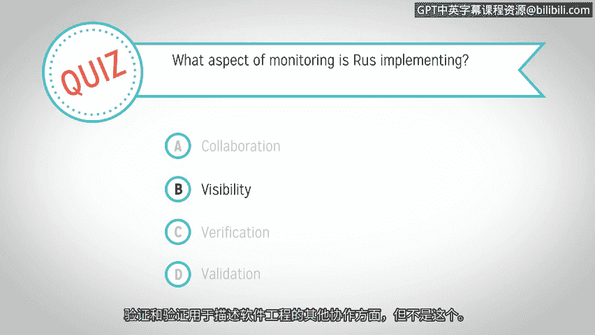

# 艾伯塔大学软件产品管理课程1：《软件产品管理简介》｜introduction-to-software-product-management｜ - P17：16_第1.2.6节 为什么要监控.zh - GPT中英字幕课程资源 - BV1K84y1S7qz

🎼。All right so you know that you need to have processes in place within your projects to ensure that you're staying on track Morgan told you all about that a few lessons ago。

You know that it's important that you elicit requirements from your clients in meaningful ways。

 we talked about that together。You also learned why you need to consistently create useful plans for development that was covered by Morgan in the previous lesson。

In this lesson， I'm going to tell you about what happens after all the planning is done and you engage in actually building your software project。

As a product manager， you don't just step back and watch the development team do their thing。

In order to ensure that you're on track， you must actively monitor， analyze。

 and review your progress。Consider this。You're working on a project commissioned by your client。

You've established a development process， you have your requirements nailed down。

 and you've done all your planning。Your development team is happily coding away at the project and everything seems to be going according to plan。

A few weeks pass， then a few months， and now you're two weeks away from your deadline。

 you look at what still needs to be developed by the end of the project and you panic。

 you still have at least a month's worth of work to do。

 You're going to have to tell your client that you won't be meeting their deadline。All of a sudden。

 your development team is working overtime to get things done quickly。

 The office floor is littered with empty and cans and coffee cups。

 Your developers are getting sick and burnt out。 Your product quality is going down the drain。

 Now you're pulling your hair out because your client has blaming you for not meeting the previously agreed upon deadline。

 How did you get to this place when everything seemed to be going so well。😊，Sadly。

 this situation is very common in software development。

Being individually busy is not enough to ensure effective progress。

 A gut feeling of being on track can be an unreliable way to measure your project's real progress。

If you have experienced software development before。

 you're likely all too familiar with the crunch time phenomenon that happens when project deadlines creep up unexpectedly。

This happens often with a great deal of work still remaining。

If you had been monitoring the progress of your project since the beginning。

 you might have been able to avoid the situation entirely。But not to worry， over the decades。

 the So development community has established proven practices to avoid the problematic scenario that I just described。

Now that you know a bit about why monitoring your progress is important。

 let's see if you can remember some of the reasons。

Scott is a softer product manager because his client kept changing what they wanted the product to do。

 and because his development team didn't get their work done fast enough。

 he is about to miss a major deadline。 He is frustrated with how nosy his client is being with a project。

And thinks that tracking his developer' individual efforts will allow him to make corrective action if they're not performing well。

Please select the problems Scott will solve through monitoring。A。

 adapting to changing product requirements。B， avoiding having to fire his least productive developer。

C， working without interruptions from the client and or D， meeting project plan deadlines。

Monitoring helps us to adapt to changes and meet deadlines。

While monitoring your progress allows you to track developers productivity。

 it should not be seen as a way to assess their career progress。Keep it light。

It should also not be a substitute for good communication with your client， therefore。

 the correct answers are A and D。Fhielocity is just one of the ways in which we can monitor our progress。

It is just one of the ways in which you can easily identify when something is going wrong and make the appropriate changes to address the problem。

You can also identify when something is going right within the project and celebrate those small victories this will only keep your project on track and improve its quality when delivered to the customer。

 it will also boost your team's morale and give them a high degree of transparency within the project。

I want to be clear， though。Transparency doesn't mean tracking your development team's progress and keeping them in the dark。

 Transparency means that everyone on the team knows the status of the project and not just management。

When the development team and the product manager work together to monitor their progress with a positive goal driven and team based mentality。

 monitoring your project can become a way to bring the team together。

 nobody likes crunch time and monitoring is a method which the team can use to help each other avoid late nights and long hours。

Now that you've seen how monitoring can affect teams， let's test your knowledge。

Ross is a product manager working on a project with his development team。

He has chosen to share the details of what he is tracking throughout the project in order to keep his whole team in the loop。

What aspect of monitoring is RE implementing？A collaboration， B， visibility， C， verification。

 or D validation。Visibility is the word we use to describe when everyone on the team knows the project status。

That makes B the correct answer。Although monitoring often leads to increased collaboration within development teams due to a greater amount of discussion。

 Russ is not specifically implementing this here。Ferification and validation are used to describe other collaborative aspects of software engineering。

 but not this one。

So at the core of monitoring your progress is this idea of delivering your product on time and to specification？

Of course， this helps with making better software and ultimately happier clients。

But monitoring can be so much more than just creating amazing things on tight schedules。If done well。

 monitoring can be a fantastic way to build a sense of common purpose and give your developers a sense of being part of a tightly knit team。

If you want to learn more about this， I encourage you to please join me in the last course of this specialization there I'll be diving deeper into the specific ways in which you can go about monitoring and reviewing your projects。

You made it to the end of the first course， congratulations。Hopefully。

 you've gotten a good taste of what's to come throughout the rest of our software product management specialization。

 We've covered a lot of material in a short amount of time， and there is so much more to discover。

 Here's what we covered in this first course。😊，The first module was our introduction to the course。

 Ken talk generally about why software product managers are important。

As well as what we can do to help development teams create better software。

 he then went into an overview of how this specialization is structured and what you can expect out of it。

In the second module， we dolve right into the details。We covered why you need to have processes。

 requirements， planning， and review techniques to be successful。

I really hope that you took away something from these courses。

 and I really hope that you can apply that to your future projects。

We have designed the next two courses of this specialization to be taken in whichever order you please。

They will set you up for the planning course， which we have designed to be taken after you complete both introductory courses。

Whichever course you end up taking first， we're really looking forward to having you with us on this journey。

See you soon。

