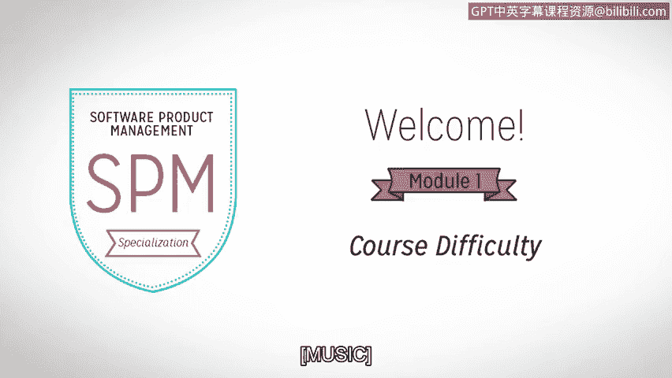
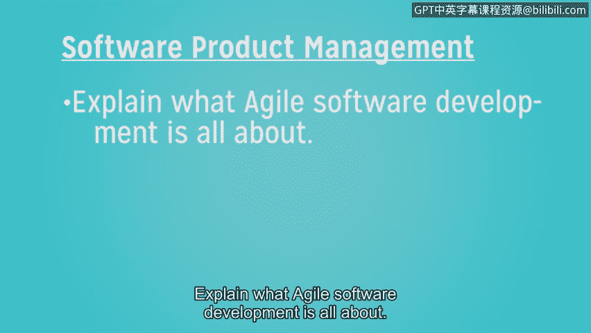

# 艾伯塔大学软件产品管理课程1：《软件产品管理简介》｜introduction-to-software-product-management｜ - P19：1_02_course-difficulty.en_subtitled - GPT中英字幕课程资源 - BV1K84y1S7qz

Welcome to an introduction to softwareft Pi Management。

This is the first course in the software Pri management specialization， and's also the shortest。

In these first two weeks， we will。Describe the role of a sufferpri manager。

Show interviews with software product managers and those who work with them in the software industry。

Explain what agile software development is all about。

And give you a sense of the topics that be covered as you progress through the specialization。

By the end of this introductory course， you will know that this specialization will meet your personal learning goals。

If you have a background in software development， you may find the technical information presented in this introductory course as basic。

But for those outside the software field， provide some key terms and concepts that will be fundamental to the remainder of the specialization。

If you find yourself hungry for more ahead of this course。

 please continue on to the next course in our specialization。

An effective software Pri manager is a good listener。

 someone able to imagine a valuable product from users who may not fully express or appreciate their own needs。

Being a good listener is like being an active learner when you're open to learning。

Even one new thing could dramatically transform your understanding of the world。

We hope you will learn many things as you delve into the software Pi management specialization。

And we look forward to hearing your viewpoints in the forums。

