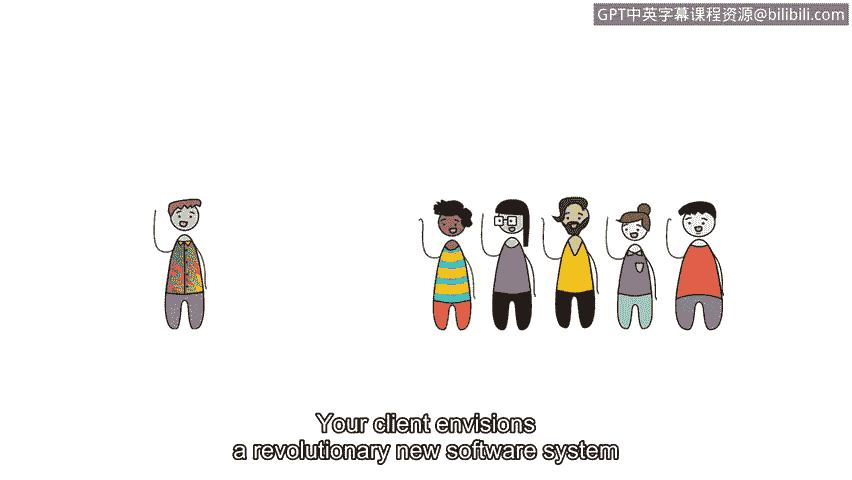
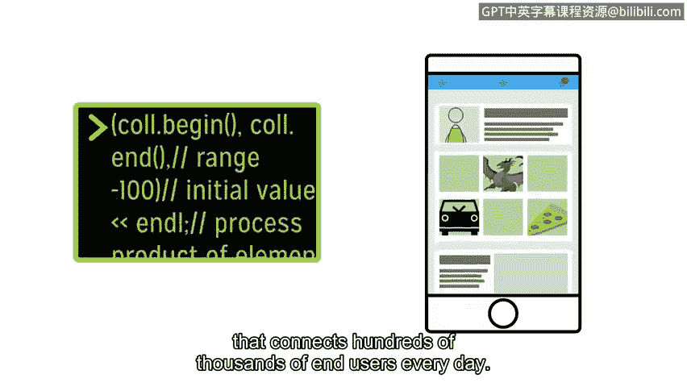
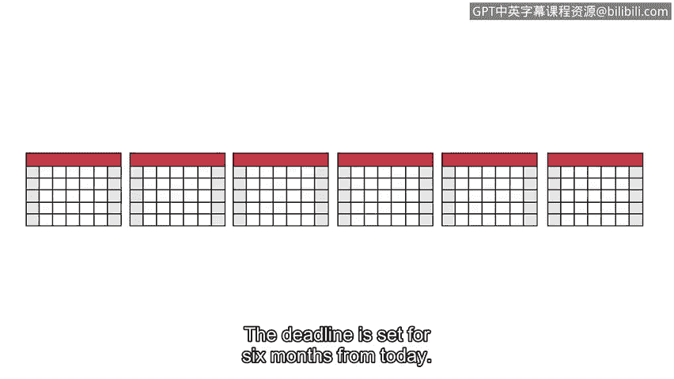
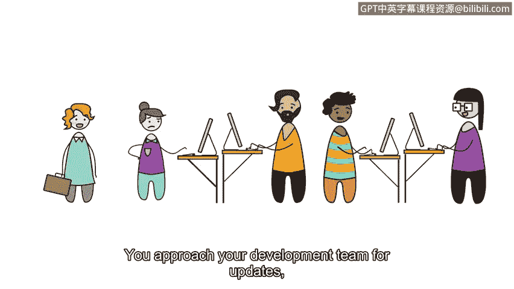
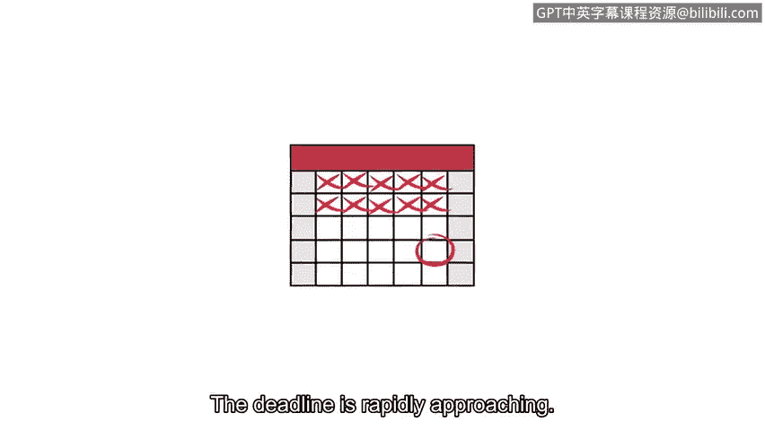
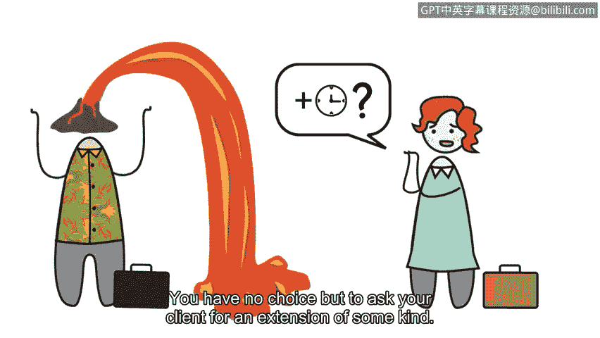

# 艾伯塔大学软件产品管理课程1：《软件产品管理简介》｜introduction-to-software-product-management｜ - P21：3_01_1-1-2-why-software-product-management.en_subtitled - GPT中英字幕课程资源 - BV1K84y1S7qz

🎼。To better understand why we need software product management。

 let's begin with a story about how software product management can go terribly wrong。

You just took on the role of a software product manager leading your own software development team though with building a product for a client you just met。

Your client envisions a revolutionary new software system that connects hundreds of thousands of end users every day。

The deadline set for six months from today。

You're excited， it's a big chance for you to really show off what you can do。

You've made your team， contracts have been signed and everything has been sent into motion。

 what's next？Ting control of the situation， if figure the best thing to do would be to map out exactly what your client needs。

 so you schedule a meeting， sit down with them face to face。

 and ask them what they would like to see in a file product。

The client gives you a quick list of really interesting ideas and you're on your way。

Your developer speak at a buzz about how they'll tackle the problem。

They each choose a few features to develop， and everyone goes off to do their own thing。

The project seems to be off to a really productive start。Frest forward， three months。

B clientin emails you， asking to mean in person for a demo of what you've done so far。

All of a sudden， dawns in you， they have no real idea where you are in the project。

Approach your development team for updates， they excitedly tell you what they're working on。

 they reassure you that their part will be done on time。

You tell them， though， that the client will like a demo， or once the mood changes to panic。

 they say we haven't integrated any of our functionality yet。😊。

It's going to take at least a week for me to finish thebu in my code。

I didn't know we had demo coming up。Now， you panic came because you have to tell your client you have nothing ready to demo。

Surely your club will understand， after all， soccer development is more of an art than a science。

With half the project resources spent， things seem to be going nowhere fast you can barely see what would be completed next week。

 let alone what you'll have very for the client when it definitely comes around for the demo。

Another two months fly past。You're now just four weeks away from the delivery deadline。

The team is in full on panic mode。And one of our developers hasn't been on work for two weeks。

 and their code's become a balneck for your entire system。

You try to assign another team member to work on it。

 but you can barely understand the original code work。

 and they think meaningfulful is going to happen。Now you're making out for lost time you never had in the first place is' two weeks until the first demonstration of your product and your team is under incredible pressure。

Everyone's working through the night writing a testing code。

 you're throwing out all the best coding practices out of the window just to save time。

 and you're hoping the client won't discover those few bugs。

 you just can't afford to have anyone spend any more time trying to fix。

The deadline is err rapidly approaching。 You have no choice but to ask your client for an extension of some client。

 They're not going to be happy， I think。

But what other choice do they have， but other than' to say yes？You buy yourself just some extra time。

 however， they still want to see what you've done so far， two weeks later， demo day。

Through foggy eyes and caffeine induced typing， your team has slapped together a rough demo of the product。

 Everyone' is nervous， and their only relief is to think that project will soon over That it is until the client starts tearing this whole thing apart。

 The client says， I never asked for this。😊，What's the purpose of this feature。

 why did decide to put this element here？I can't show this to my customers。It becomes heartbreak。

What they are demanding is going to create much more work。

 Why couldn't they be more specific from the beginning？The product is late enough already。

 Can you really survive another four months， Can you really survive another four months？Now。

 instead of taking that great vacation you had planned with your family。

 you're stuck in your office banging your head against the keyboard， wishing there was a better way。

Ksera and the University of Alberta can help for about the price of one university course you can access an entire computing science specialization delivered on demand as you need it。

Welcome to Software Product management specialization and welcome to the world of better softwareware。

Throughout this specialization， our expert team of instructors will walk you through all the steps to unleash your inner project management。

 Ninja。You'll learn how to take control of your projects from the very beginning， so like a Ninja。

 nothing creeps on you。You'll learn how to manage your project efficiently and collaboratively。

 so like an Ninja。Everyone on your team is aware of what's going on。

And you'll learn about what's currently being done in industry so that like A Ninja。

 you become a master of your craft。Business today runs on software。

 Every company has internal applications for controlling day to day operations。

 and a growing number of companies are reaching externally to customers through websites and mobile apps。

😊，To be successful in meeting business goals， companies need competent software project management professionals that can deliver the digital assets necessary to operate in the 21st century。

Welcome to Software product management， This could be an exciting journey and we hope you'll learn a lot along the way。

 We're really looking forward to having you with us。😊。

