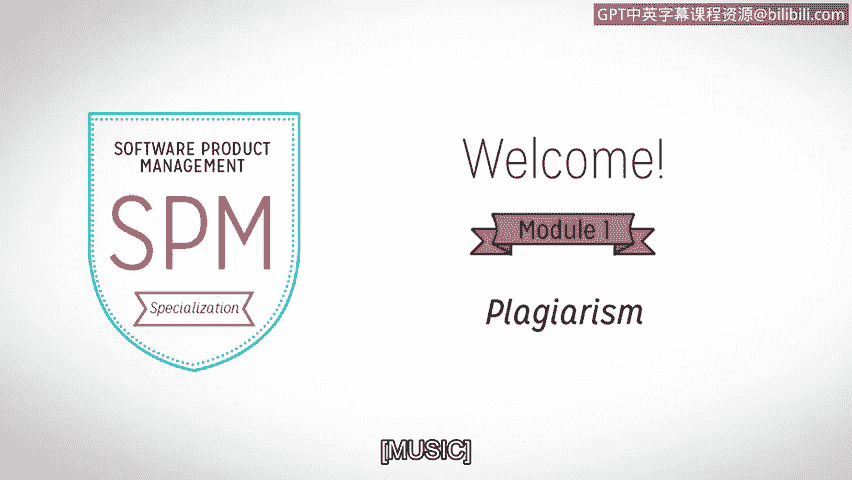
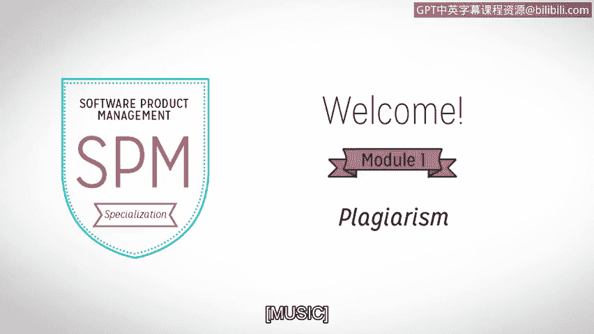

# 艾伯塔大学软件产品管理课程1：《软件产品管理简介》｜introduction-to-software-product-management｜ - P24：6_02_1-1-5-plagiarism.en_subtitled - GPT中英字幕课程资源 - BV1K84y1S7qz

🎼。😊。

Plagiarism as defined the CRrysor honornor code， is when you copy words， ideas。

 or any other materials from another source while a giving credit。

Plagiarism is unacceptable in any academic environment is a serious violation of cursor's honor code。

Playgiarism may result in failing assignments。Removal from the course or even dismissal from the coursesera community。

So what does this look like and whats considered plagiarism？Copy and pasting someone else's words。

If you're copy and pasting words written by another person， then this is considered plagiarism。

Unless you credit them properly。Even if you change the order or change specific words。

 you must still give them credit for their work。For example。

 copying and pasting words written by another learner or a staff member in an assignment。

 quiz or discussion forum and submiting them as your own is prohibited。

Even though it's work has been copied， please flag the assignment or assignments。

Submitting a file cr by someone else。In some courses in the specialization。

 you'll be asked to submit images and charts for assignments。

Submitting an image that's been created at submitmit by another learner and submitting it as your own is considered plagiarism and is prohibited。

Stealing ideas。Some assignments may require some creativity。

Its considered plagiarism to still the creative ideas of another。

 even if you create the document for submission yourself。

It is common in an academic or business environment that two or more people may come up with the same ideas。

To protect yourself from being accused of stealing。Not just in this course but your career。

 it's good practice to track your revisions or to document your thinking in some way。

You may want to maintain a journal of when idea or concept originated。

Please make sure you're submitting your own work throughout the specialization。

If you see plagiarism happening in the specialization。

 please flag the assignment and bring it to the attention of the course staff。

