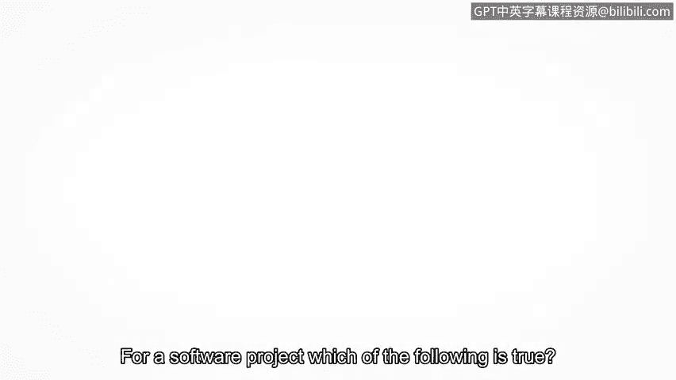

# 艾伯塔大学软件产品管理课程1：《软件产品管理简介》｜introduction-to-software-product-management｜ - P25：7_03_1-1-6-specialization-overview.en_subtitled - GPT中英字幕课程资源 - BV1K84y1S7qz

🎼。😊。

So are you excited， we are too。Here's how the software product management specialization is going to be structured。

There will be six courses for you to take， including the course introduction。

 which you're watching right now and ending with a capstone course。

This intro course has two modules you've already gone through most of the first。

 which introduces why we need software product management to begin with。In the next module。

 Morgan Bradley will talk much more about the specific skills which our software product manager must possess and elaborate on why they're necessary to the profession。

After you finish this course you'll be ready to move on to the next four courses these four courses will be structured a little differently than this one in these courses you'll be starting with a big picture view of the concepts followed by a deep dive into skills and practices that make a software Pri manager a valuable asset to any development team。

Each of these four courses then will be larger than this one， you have four modules， per course。

 each ending with an end of course exam， which would be grade towards your overall specialization grade。

The way we have designed a specialization is that each course builds upon a knowledge gained at last。

So we encourage you to start the beginning and work your way through sequentially。However。

 our software Pro Natural Pra course and our client needs and software requirements course have been designed so that you may take them in whichever order you'd like。

Given that we're from a Canadian university， I want to share part of our heritage with you。

You might recognize the image of a Nooksh from the 2010 Winter Olympics in Vancouver。

And Noakehoake is a manm landmark resembling a human used by the Inuit peoples of the Arctic to mark paths。

So traditional meaning of thenoksha says，" you're on the right path。

Not only is this an excellent metaphor for the journey you're about to embark on in this course。

 but it also represents the way we structure our specialization。

We want you to think about a specialization like an nookshook。

This introductory course is like the ground in which our structure will be built。

Organizing activities for producing software is important。

 also figuring out the way Ka needs is also crucial。

Our software processes and software requirements course then are like the stone legs of our structure。

That'll be what holds everything else up。Beyond this are the project needs to plan work adaptively and review progress regularly。

 so next on our structure will be our body and our arms。

 the software planning and project review courses。And looksshake without legs。

 its just a pile of rocks， likewise， learning only planning and reviewing a project without fundamentally understanding the importance of process and requirements will create a management style that chases moving targets and generates much busy work that accomplishes very little。

Lastly， every noshake needs a head。In this specialization。

 the final piece of the puzzle will be a specialization capstone。

 this would be where you'll apply all the concepts that you learned in the previous courses。

The capstone is a six week long project in which you'll evaluate and make decisions for a simulate team of software developers。

In a quest to create a product for a challenging client。In order to participate in a capstone。

 you'll need to have taken all the prerequisite courses。

After you've completed all the preresite courses and the capstone。

 you'll earned your software project management certificate。

This certificate is your proof of having done all the work required to be certified。

Each module will have the workload of two to four hours。

 and the content of each module should be about weeks' worth of work。Because the workload is small。

 that doesn't really mean that there's not a lot to learn this course。

This estimate is based on the amount video time we have for you。

 as well as all our readings and assessments。We will post additional reading resources for your reference。

We recommend that you take a look at those as often as you can so that you can make the most of your time with us。

The more you point to this course， the more you get out of it。

We're here to give you every resource possible， so it's easy for you to get the most of this specialization。

However， there will be a course discussion in which you can write any questions or comments you have above the course。

 please use it。Your fellow classmates， as well as the course TAs。

 will be more than willing to help you with something that's not quite clear to you。

Throughout your courses， you'll be asked to fill out periodic quizzes。

These are designed to help you stay focused and on track。

As well as to give you the opportunity to check on the knowledge that you've just been taught。

Unlike the end of course exams， these will be not counted on your final specialization grade。

So we've already talked a little bit about what we hope to gain from the specialization in previous lessons。

It's worth reiterating that we want to give you confidence in your skills as a software product manager。

We'll provide you with all the resources。You will need to gain those skills。

 but if there's anything you're not clear on， please don't hesitate to address that issue on the course discussion forum。

For a software project， which of the following is true？

A， the features for a software product must be determined all ahead of time and not change once development starts。

B。The client sees the software product only after development is fully finished。C。

Once a project management plan is decided， it should be fought without further changes。Or D。

Agile software development is like hacking and does not require planning。

None of these answers are true。For software products。

 change happens constantly to address new needs and opportunities， so answers A and C are false。

The client should be involved during the development process to provide feedback not only at the end。

 so answer B is false。And finally， Agile soft development is a disciplined set of practices with planning and specific rules so answer D is false。

 so with that let's move on to our first assignment。

It is a great place to introduce yourself to the class and reflect on what you've covered so far。

Please make your way to the course discussion and write a brief introductory message about yourself。

Tell a class about yourself， your background， and your reason for taking this specialization。

Read some of your classmates introductions as well， it's build a strong learning community。

And that's it for our first module。When you come back。

 we'll be jumping into more specifics of software product management and why we might need them in the first place See you later。

