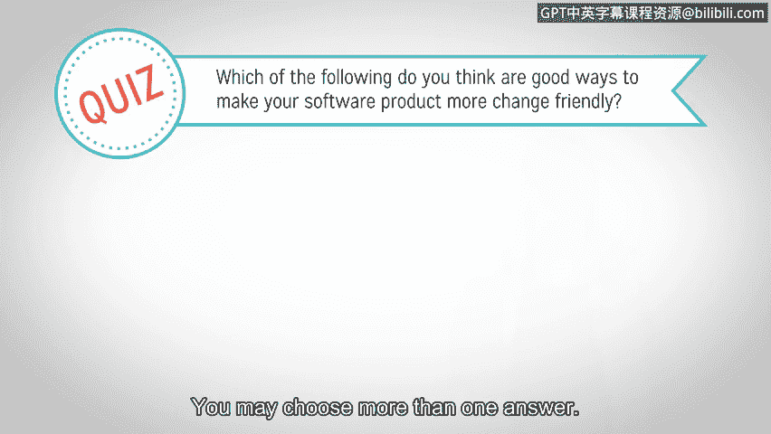

# 艾伯塔大学软件产品管理课程1：《软件产品管理简介》｜introduction-to-software-product-management｜ - P28：10_02_1-2-2a-delivering-working-software.en_subtitled - GPT中英字幕课程资源 - BV1K84y1S7qz

🎼。😊。

🎼不不不。The Agile value statements are broad， so the manifesto outlines 12 principles that elaborate on the values and give you some more specific guidelines to follow。

Agile methodologies apply tools and practices to ensure that these principles occur。

So now let's look at each of these 12 principles individually。

I've grouped the principles into three categories， they are delivering working software。😊。

Flexible design and adapting to change。And collaborative communication and organization。

 So let's look at these principles together。Our first category contains principles focused on delivering working software。

Working software is a key aspect of Agile when teams focus on delivering working software。

 it drives development。Even in the early phases of development。

 each delivery of working software becomes a working prototype that will be improved upon in the next round of development。

A working piece of software satisfies the client because they get to see a demonstration of their product throughout the entire process。

So let's begin with our first principle， It states our highest priority is to satisfy the customer through early and continuous delivery of valuable software。

😊，In this principle， the term valuable is important。

 you need to ask your client what they determine as valuable。

The features that your client values the most become the highest priority for your development team。

The second principle is about frequency of deliveries。

 it states delivering working software frequently from a couple of weeks to a couple of months with a preference to the shorter time scale。

Think about it this way， the more frequent your software deliveries。

 the more opportunity your client has to provide input on development Now let's look at our third principle。

 it statesWorking software is the primary measure of progress Since your team will be focused on delivering working software。

 your progress should be measured by that。😊，When I mentioned working software。

 it implies a sense of completeness。In Agile， a feature should only be considered complete when all the code has been written。

 tested and documented。You need to make sure that your development team is completing features instead of having many started。

 but few that are actually done。I have already mentioned that software is constantly changing。

 this is something that you must be prepared to face having a change friendly project means that your project is easily adaptable to change。

😊，Which of the following do you think are good ways to make your software product more change friendly？

You may choose more than one answer。

A， frequent client communication， B， Ne commented source code， C。

 continuously reviewing and improving your project， D， updated prioritized list of features。

 and or E development team that is open to change。These are all ways that you can make your project more change friendly。

 we will be reviewing these practices in more detail throughout the specialization。

