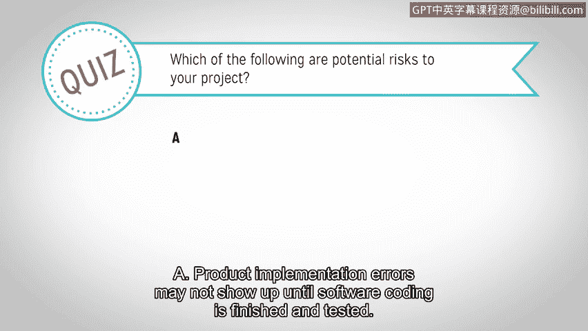

# 艾伯塔大学软件产品管理课程1：《软件产品管理简介》｜introduction-to-software-product-management｜ - P32：14_01_1-2-4-why-requirements.en_subtitled - GPT中英字幕课程资源 - BV1K84y1S7qz

🎼。

Hi， I'm Bradley Puulette， I have worked as a project manager on many software projects in the past and have studied a broad range of techniques relating to the field here at the University of Alberta。

I am incredibly passionate about software product management。

 and I'm excited to share that passion with you。😊，In this lesson。

 I'm going to cover why requirements are important when working on software projects。

I'm going to start by outlining some of the main reasons why we need requirements。

 as well as some examples of what happens when you lose focus on those requirements。

So let's begin with why we need requirements。Requirements are a set of specific descriptions of your client's needs。

I'll cover this in more detail in the clientient Needs and software requirements course， but for now。

 the client is the person or group of people who want the software product built in the first place。

Requirements combined with processes are the backbone of any successful software project。

 so what makes them so important， here's an example of a list of requirements for a great social network app the user could store user profiles on their data。

😊，Send messages to other users。View other users' profiles。Create status updates。

And view other user status updates。This is a pretty simple example。

 but you get the picture requirementsquiments generate the features of a software product。

So what happens if you get a seemingly simple request。

 like users can talk to each other through the app？How does that translate into requirement？

Are users supposed to be able to send voice notes to one another， text messages， brain waves？

What about that word can are users only able to talk to one another at certain times of the day？

This sort of ambiguity can lead to an enormous amount of confusion for developers。

 especially if most of the user requirements are similarly unclear。

You'll need to get more details in order to really nail things down。

Avoiding confusion is incredibly important in software development。

 This starts by knowing how to properly elicit and express requirements。😊。

By spending the time to refine requirements， you can also detect potential errors in your product before it's even built。

By clarifying ideas， development becomes focused and efficient。Here's an example。

One of your developers has begun developing this social network app and has come across this requirement。

Users must be able to send messages as a guest。The developer might take this requirement and design a system in which users have the ability to either log in to their own account or use a guest account。

A single guest account fulfills the requirement， but will there be unintended consequences when many different users have access to one guest account？

As a result of the developer's understanding of the requirement。

 this guest account became one big account in which anyone could message anyone else and see the conversation。

This unfortunate design error is a result of a poorly defined requirement。

Imagine the amount of time and effort that could have gone into building an ill thought out feature。

 it would have been expensive to implement and even more expensive to fix。

Let's see if you can pull out the key reasons why requirements are important in software development。

In this quiz， please select the options that you think best fit the reason why you want requirements。

You're working with your client to elicit a set of requirements for a software product。

The client produces an napkin on which he has sketched an app with a few outline features。He says。

 this is the product we want。If you accept this document as your final set of requirements。

 rather than refining them with your client。Which of the following are potential risks to your project。

A product implementation errors may not show up until software coding is finished and tested。

B， the product may not satisfy the end users。C， the client has too much input over the look and feel of the product。

And or D， the people involved are not collaborative， and morale drops。The answers are A， B and D。

Your client having too much input over the look and feel of your product isn't a product risk。

The more involvement your client has in the process， the more smoothly things tend to go。

That's not to say that you should allow your client to control development entirely。

 You should collaborate to create the best product possible。

Collaboration also helps to increase morale， and things tend to get done faster with a happy team。

To learn more about how to ensure you get the most out of your requirements。

 I encourage you to take the client needs and So requirements course。

 part of the specialization here on Coursera。In the next lesson。

 Morgan is going to talk about the reason why you want to spend time planning your projects。

 Thanks for watching。