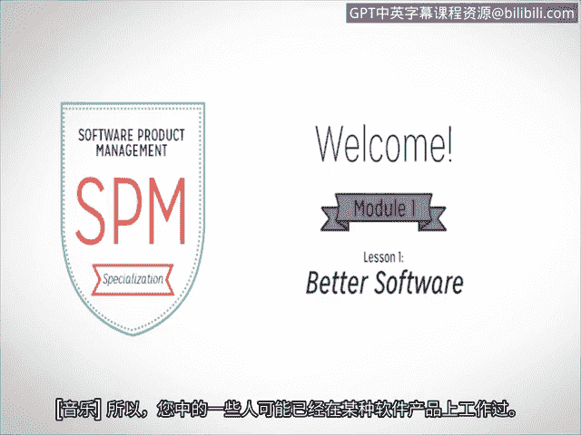
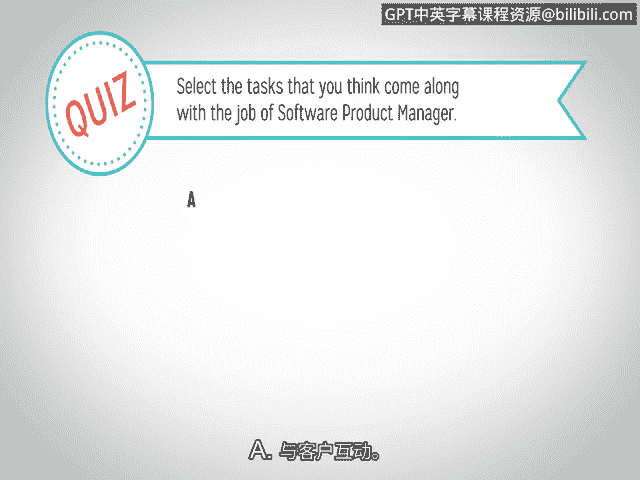

# 艾伯塔大学软件产品管理课程1：《软件产品管理简介》｜introduction-to-software-product-management｜ - P3：2_第1.1.1节 更好的软件.zh - GPT中英字幕课程资源 - BV1K84y1S7qz

🎼。😊，🎼不不不。🎼，Hi， welcome to Cosera specialization on Soware Project management I'm Ken Wong。

 associate professoror in Comp science at the University of Alberta。

And my expertise in software engineering。Over the course of this specialization。

 it's my goal to turn you into a confident certified software product manager。

If you're already a software Private management specialist。

 well then I'm here to make you even more awesome at what you do。🎼。

🎼呜不。So some of you may have already been working on a software product of some kind。

Thinking backing our experience was it a success， could the project have been done better？

I bet most of you thinking， yes。This specialization will show you how to work with your clients and organize a team of developers to make better software products。

So you already know projects can be done better， think a bit for a moment about what you might want to improve in yourself as a software product manager。

Sure， there could be plenty of technical skills you can be bare at， like specific platforms。

 languages and tools。But there's so much more。Let's explore that together。

I've already mentioned that you'll be working with a development team。

We'll be talking about this a lot more throughout the specialization。

Select the people who you think typically compose a software development team。

 you may select more than one answer。A， programmers， coders or developers。B， clients。C。

 each interface specialists and graphic designers。D， quality assurance specialists or testers。

Every development team that you will work with will be different and unique。

Normally a development team is made up of coding muscle， crve designers and testing personnel。

 so that means the most correct answers are A， C and D。

 although you and your development team will be working very closely with clients they are not normally considered part of the development team。

 so that would exclude answer B。Today it takes the sustained work of many people with different skill sets to make great software products。

 but how should they be organized， what practices can teams follow to make the work more disciplined and less ad hoc。

We are beginning to enter the realm of the software product manager。

Let's think about some other questions that should interest you。

Okay work not just harder but smarter。There are various issues。

Where have there are many team members to coordinate， where there are lots of features to develop。

 wherever have the projects intended to last several years， how do we manage all that？

And we can't forget what the problem we're actually trying to solve。 that is。

 what does the customer really want in a software product， well about its quality。

What did they expect。What processes and practices can we put in place to ensure that？

Playing all this can be pretty tricky， especially with resource constraints。

Otherwise we handle the scope when time is limited。

And how we deal with changes or avoid the scope of the project gaining off of hand。For the clients。

 their needs might be uncertain and change over time。For developers。

 the array of work could vary over time， there could be huge differences between the productivity of one developer versus another。

 how do we adapt to such variation？Questions like these are always on the mind of a software product manager。

In this personalization， I'll teach you effective managed fatigueiques to deal with just these sorts of issues。

These techniques will help you help your team produce better software。

 in particular you'll learn about Agile software development。

Key factors for a great product are the people and process involved。

You'll hear more about topics like agile practices and planning， plus topics like requirements。

 reviews， and retrospectives。To start off， this introductory lesson has two modules。

 The first module highlights the importance and role of software product management。

It also gives an overview of the whole specialization with its goals， structure and expectations。

The second module introduces topics that will be covered in the courses as you move deeper into the specialization。

Now， imagine yourself as a hot shot software product manager。

 You've got a good desk next to the window。Select the tasks that you think come along with a job。A。

 interacting with clients。

B， managing and track and development。C， collaborating with the development team。D。

 revealing information between the client and development team。E， and product quality。

As a software project manager， you'll be interacting with a lot of different people。

 including clients and development teams。You will also be tasked with managing and tracking progress development。

It is also your duty to ensure the product works the way it's supposed to and validate that the product meets the needs of the client。

However， as a prime manager， you do not have to act as a messenger between the client and development team。

 you want to encourage them to communicate frequently。Therefore， answers A， B， C。

 and E are the correct answers。Okay， let's start talking about making better software。

A software project manager needs to understand a number of viewpoints to achieve better software。

One viewpoint aims to provide the right software product for the clients。

What does it mean to be the right product。This can mean a mix of many things。It meets their needs。

It's easy to learn and easy to use， it doesn't waste their time。And maybe it looks nice。Basically。

 the clients are happy with it。If true， we say the software project is validated。

In this specialization， you'll learn about understanding users。

 how to elicit their needs and how to express software requirements。

The second viewpoint aims to have the software product done right。But what does done right mean？Well。

 the software conforms to a specific design， and turn the design satisfies the state set requirements。

If true， we say the software project is verified。Developers can conduct reviews and tests to ensure that the requirements。

 design and implementation line up。Such activities try to catch defects earlier， improve quality。

They want to avoid having the client see any defects in the release product。In this specialization。

 you learn about processes to improve software quality。

A third viewpoint aims to have the project for the product managed right。

But what does it mean to be managed right？Well， ensures that the other viewpoints are met。

The idea is to adopt just the process and civil practices to organize the work of everyone involved。

 if true， we say that the software project is managed。

Such activities ease communication and feedback so that everyone is clear on the next steps。

In this specialization， you'll learn about agile practices。Estimation and planning， and monitoring。

A software Pri manager needs to take a central role in these activities。To summarize。

 I've just explained three viewpoints in achieving better software， those are the right product。

 done right， and managed right。As you proceed through this specialization。

 you'll become more confident in knowing and using these techniques to create better software projects。

These techniques include prices to ease communication and feedback to better understand client needs and organize the work of your development team。

Next， let's talk about the importance of software product management。

