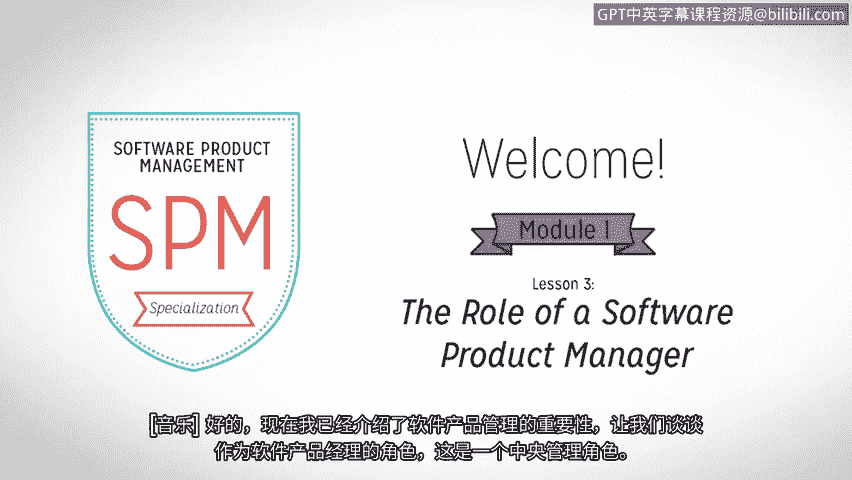

# 艾伯塔大学软件产品管理课程1：《软件产品管理简介》｜introduction-to-software-product-management｜ - P5：4_第1.1.3节 软件产品经理的角色.zh - GPT中英字幕课程资源 - BV1K84y1S7qz

🎼。

Okay， so now that I've covered the importance of software product management。

 let's talk about what your role would be as a software product manager。

 it's a central management role。It someone resembles being a producer and a director for a movie。

 but without the red carpet fame。You're in charge of the success of a software product。

But the role is much more than just managing a project。

 The role involves really understanding the product。

 that is you have to know what it does and its unique benefits like a real user。

You're also going to have to know the business case。

 that is the value that this product will have for the client and the way the software will change the game for this client's business。

Great software product managers have mastered multiple disciplines。

They can speak to both clients and developers in their terms。

They can listen and imagine a client's vision， communicate effectively with their development team members。

 and motivate the team to achieve the best outcomes。They can also manage client expectations。

And they also know how to get the best efforts out of their development team。

 they care about their people。Does that sound like something you'd be good at？

Success of your product also depends on solid teamwork。Programmers， testers， user based designers。

 graphic artists must work together。Your role is to empower them to bring their best efforts to your project。

Software product management is a leadership role。 Let's take a look at a few interviews on what those alreadyian industry feel about this role。

🎼うう。🎼，🎼My role actually is one of the leading software development teams。

 I do see myself though as a product leader and I encourage everybody on the team to see themselves as a product leader。

I have a software product manager on my team， so we work closely together in partnership。

 Product Manager works to bring requirements to me and to help me understand what our customers need。

 and then I work to fulfill those requirements with the team。

So a lot of what I do is kind of define a visioned product strategy， product roadmap。

 and also specifications for the development team as well as our experienced design team。

🎼What excites me， what challenges me is。🎼Getting the engineers， the testing team。

 the documentation team， understanding in no uncertain terms what the problem is we are trying to solve。

 that makes my day。🎼The product manager meets with the customer， they get an idea。

 they get a vision for how something can be。 They articulate that vision back to their engineering team and the associated stakeholders。

 and then they actually see it be produced as working software。

 and it's tremendously satisfying for the product manager to see it actually delivered and to then see the impact that has on the customer and and their reality。

 seeing how customers react to the finished product， reading reviews about it。

 seeing it in the stores is enormously rewarding。

Getting the team to rally around the problem。🎼If people show up for work and it's a job for them。

 they don't innovate。 they'll do what you tell them to do and they'll go home。

If they internalize the mission of the problem you are trying to solve。🎼Magic happens。

🎼Ambiguity is huge。 I think we see that customers don't always have the ability to explain what exactly it is that they want。

 And so we tend to employ a lot of different strategies to uncover what it is they want。

 even if they can't tell us So we might watch a customer。

 we might sit and watch them do their job for a while to help get past the ambiguity of them saying something。

 even and to find out what they actually need。 people can have 10 different ways of solving it right And so this is where for me。

 the approach of experimentation， rapid iteration is really the key to solving that。

 So it's acknowledging the differences of opinion and the lack of shared vision and say， okay。

 what are we going to do to actually solve that and how do we determine whether that's the right course of action or not。

🎼，As a leader， first and foremost， you need to be able to do three things。

You need to be able to motivate with your vision， you need to be able to organize the work that needs to be done and you need to be able to innovate。

🎼Frankly， if you can't innovate yourself， it is your job to hire people who can help you innovate。

 They need to be able to。Hear what somebody is saying， what a customer is saying。

 and turn that into a requirement and ultimately a specification that an engineering team can build and deliver Next thing you need to be able to communicate。

As a person who communicates or sells your vision across the organization at all levels。

 to executives， to engineering teams， to sales teams， to marketing teams。

 you need to be able to understand at what altitude。

 all these things that exist at and what messaging resonates with them the ability to form really great relationships。

Think strategically， also be really tactical when need be， it's not about you。

🎼It's never about you as a product leader， it's about a customer problem， your job， my job。

 fall in love with a customer problem。🎼，People will either start from the business side and realize that they've got some interest and skill at software and they understand kind of the general idea of how software is built。

🎼And so then they'll get a little more technical aptitude and they start to get involved in things from that side Personalally I came from a coite background。

 I grew up as a programmer and slowly I've migrated into a product leadership role。

 but I've also seen people with music majors who have become amazing product leaders。

What we have in common， me who has a Comp science degree and the guy who has。

 a music degree is first and foremost leadership。🎼If you're able to motivate people。

 you're able to organize people and can innovate， you can do well in a product management。

 I think others come at it from the engineering side where they're a great engineer。

 but maybe they decide they've got more passion for that vision in the planning side of things and in the collaboration rather than the implementation。

I think a lot of product managers learn on the job when you get right down to it。🎼Apply for it。

Apply for it， look for it online， apply for it， but understand this， We're here to lead people。

You are here to lead a process。🎼You are here to solve a customer problem。

If you believe that is you from a self awareness perspective。🎼Apply for it。

 They should get to know their engineers。 They should get to be very well aligned with the problems faced by engineers with the opportunities that engineers can bring to the table。

 And to really， really focus on that partnership， I think customers and customer research is critical。

 And that's like a basic skill of a product manager。 So that's just expected。

 I think over and above that， though， to just really be good at building those partnerships with their own team。

 And again， with their stakeholder teams as well。 For me， it's be customer obsessed。

Be grounded in the customer， understand them really really well because it's going to be your job to represent them if you start with that and you can do that really well。

 if you can understand your customers at a deep level。

 then you're already kind of ahead of the game if you will。As you've just seen。

 the position of a software product manager can be a fulfilling career path。

Capital managers earn the respect of both clients and team members。

Greatade managers are sought after for the track record of successful product deliveries。

Whether you want to make a move from developer to product manager。

Or you understand the business side and you want to move to more of a hands on role in shaping the software。

 or maybe you want to look for a career change and work more in software Pri management。

So whatever your reason for starting this path， this specialization will guide you step by step to become a competent。

 confident software product manager。So what you're waiting for。

 check our next lesson to see an overview of this specialization。😊。

