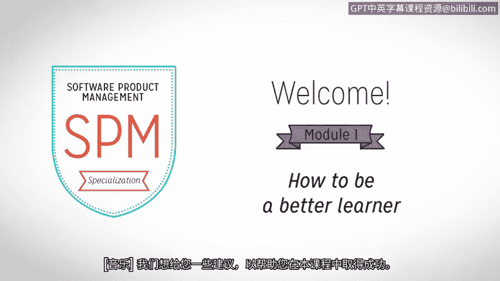
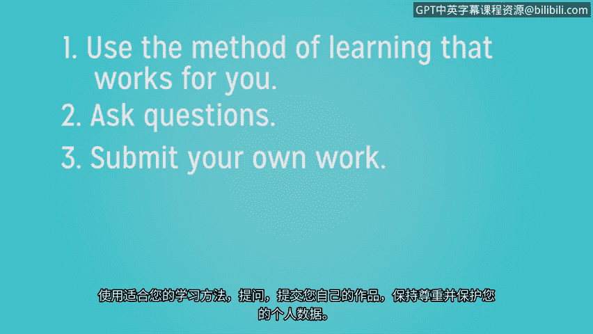

# 艾伯塔大学软件产品管理课程1：《软件产品管理简介》｜introduction-to-software-product-management｜ - P6：5_第1.1.4节 如何成为更好的学习者.zh - GPT中英字幕课程资源 - BV1K84y1S7qz

🎼。😊。

🎼We want to give you some tips on how to succeed in this course。

Here are some ways to be a better learner that have led to success in our specialization。

Use the method of learning that works for you。Ask questions。Submit your own work。Be respectful。

And protect your personal data。First， we suggest that you use a method of learning that works for you。

We provide you with video lectures as well as course button course notes。

Other provides a complete view of a course， so you may choose whichever method is most effective for you。

If you learn better by reading material， then use our course notes。

If you're more of a visual or auditory learner， then you may be more successful by using the video lectures。

😊，Video lectures also have subtitles and transcripts that you can read as well。

So perhaps using both the course notes and via lectures will work best for you Next。

 we suggest you ask questions。If you unsure of the course material， you're probably not the only one。

Please post your questions in the forums。We have a strong community here。

Other learners and the course moderators will be more than willing to help you out。

Our third tip for you is to submit your own work。Our assessments are designed to help you practice many of the concepts that are covered in the course。

However， if you're not completing a sum yourself， you're not reaping the full benefits that the assessment has to offer。

Not only missing out on the learning opportunity， but copying the work of someone else may result in negative consequences。

As per of the Coursera Hoor code， plagiarism is when you copy words， ideas。

 or any other materials from another source without giving proper credit。

Cred should be given by using proper citations。Plagiarism is unacceptable in the academic environment and the serious violation of Cosera's honor code。

Plagiarism could result in failing assignments， remove from the course。

 or even dismissal from the courseseair community。Next。

 we encourage you to be respectful in the course。This is a learning environment for many learners from around the world。

Please be respectful of your peers and keep in mind that they may come from different cultures。

 speak different languages， and come from different backgrounds than you。

You may also be aware of the tone that you write。It's not always easy to properly interpret the tone in written text。

And so something could be misinterpreted or taken the wrong way。

Any inflammatory remarks will not be tolerated。And finally， to be a better learner。

 we suggest you protect your personal data。We encourage you to connect with other learners in the course。

 however， prefer that you do not share your personal address， phone number。

 or email address in the discussion forum。