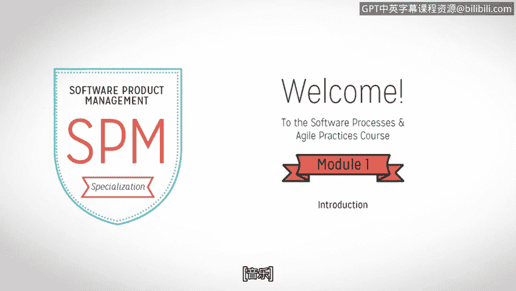

# 002：软件过程与敏捷实践简介

## 概述

在本节课中，我们将学习软件过程与敏捷实践的基本概念。课程将介绍如何通过结构化的过程和有效的实践来组织软件项目，以实现“正确的产品、正确地完成、正确地管理”这三个目标。

## 课程结构与目标

我是 Ken Wang，欢迎来到软件产品管理专项课程中的《软件过程与敏捷实践》课程。本课程是专项课程的基础组成部分，也是描绘我们专项课程结构的重要支柱之一。

在上一系列课程的介绍中，我提到开发更好的软件涉及三个目标。这些目标是：**正确的产品**、**正确地完成**和**正确地管理**。我还提到，开发一个优秀的软件产品需要许多人的协同工作。那么，是什么帮助你将目标与人员联系起来呢？答案是**过程和实践**。

为了避免项目混乱，你需要引入结构和纪律。在本课程中，你将学习如何利用过程来组织软件项目。你还将学习有助于实现更好软件目标的实践。

## 课程模块介绍

本课程包含四个模块。

以下是各模块的简要介绍：

*   **模块一：软件过程基础**。Or Ptzel 将解释什么是软件过程，并描述它如何分解为阶段、活动和任务，以帮助你组织工作。如果你不熟悉软件开发，无需担心，她还将描述制作软件的关键活动。
*   **模块二：软件过程模型**。Ra Pette 将描述一系列软件过程模型。你将学习从早期的线性模型到现代的迭代和并行模型。你们还将讨论不同形式的软件原型设计，这可以帮助你通过更精细版本的循环来交付产品。本模块将帮助你从不同的过程模型和原型策略中进行选择，并为你的项目定制它们。
*   **模块三：敏捷实践**。Morgan 将回来指导你学习特定的敏捷实践，这些实践往往与现代软件过程配合得最好。她将介绍两种流行的敏捷方法论：专注于开发的**极限编程**和专注于管理的**Scrum**。
*   **模块四：精益软件开发**。Brad 将讨论精益软件开发的原则，这将是对敏捷原则的补充。精益将帮助你减少项目中的浪费，并提供提高产品整体质量的解决方案。你们还将讨论**看板**作为一种可视化任务进度的方法。

## 总结

在本节课中，我们一起学习了《软件过程与敏捷实践》课程的概览。到课程结束时，你将掌握广泛的过程和实践知识库。你将能够将它们应用到你的下一个项目中，以组织人员并开发出更好的软件产品。