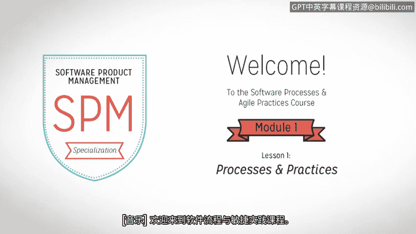
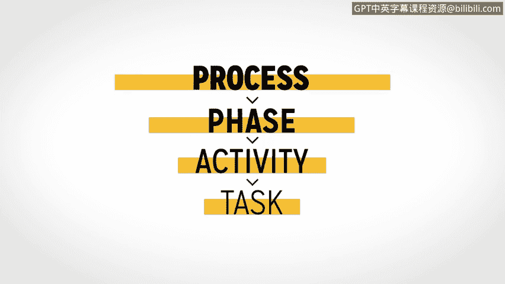

# 003：流程与实践 🧩

在本节课中，我们将要学习软件开发中“流程”与“实践”的基本概念。我们将了解什么是流程，它如何组织工作，以及构成流程的基本元素。课程内容旨在为初学者提供一个清晰、直观的理解框架。

---

## 流程概述

上一节我们介绍了在课程中使用流程的原因。本节中，我们来看看流程具体是什么，以及敏捷实践如何与之相辅相成。我还会在本模块中讨论各种软件工程活动。

流程是软件开发的重要组成部分。事实上，流程往往会自然出现。从高层次看，流程将软件产品的开发组织成不同的阶段。通常，你可以将产品视为从一个阶段进入下一个阶段，每个阶段都有特定类型的工作。

正如我们将在本课程中发现的那样，软件开发的过程并非像从头到尾遵循一个食谱。你需要进行改进、优化想法、尝试实验，甚至可能需要回溯，才能得到一个可接受的、可工作的产品。

软件可以持续很长时间并经历许多变更。想想你的智能手机应用需要更新的频率。每次你收到更新应用的通知，那就是产品发布了一个新版本。由此可见，即使在产品初始发布之后，进一步的开发和测试仍在继续。

我们在本专项课程中讨论的许多流程都是**生命周期流程**。这意味着它们组织了软件从最初构想到最终产品退役的整个生命周期。

然而，流程并不一定代表产品的整个生命周期。在生命周期流程中，可以存在子流程。例如，可以有一个用于查找和修复产品中错误的子流程。

无论是生命周期流程还是子流程，其结构都是相同的。现在让我们来看看这个结构。

---

## 流程的结构

流程被组织成阶段。多年来，人们提出了许多不同的生命周期流程模型。对于生命周期流程，根据流程模型的不同，这些阶段可能有不同的名称。这些阶段可以按顺序、迭代或并行方式组织。

以下是生命周期流程阶段的示例：
*   **规格说明**：构思产品想法、获取和表达需求的阶段。
*   **设计与实现**：进行产品设计和开发的阶段。
*   **验证与确认**：评估产品以确保其按预期工作并满足客户需求的阶段。

### 阶段示例

假设你和你的开发团队受委托为一家大型银行开发数据库。出于显而易见的原因，你的客户非常关注安全性。你和你的团队提出了许多可以集成到产品中的安全功能。

**问题**：这项任务会发生在软件生命周期流程的哪个阶段？
A. 规格说明
B. 设计与实现
C. 验证与确认

**答案**：定义将要集成到产品中的功能属于规格说明阶段的一部分。因此，A是正确答案。

---

## 流程的进一步分解

现在，让我们将流程分解得更细致。阶段由**活动**组成，而活动是相关**任务**的集合。

活动的例子是“创建测试”。所有与创建测试相关的任务都将归入该活动。这些任务可能包括编写测试框架代码，以及设计和编写测试用例。我们将在下一课中详细查看软件工程活动的例子。

正如我刚刚所说，活动是一组相关的任务。那么，让我们具体看看这些任务。

---

## 任务：工作的基础单元

无论使用什么流程，**任务**都是真正完成工作的地方。任务是项目中需要完成的小型、可管理的步骤。它们是完成一项活动，并最终完成流程整个阶段的基石。

所有完成工作的元素都与任务有某种关系。

以下是任务的示例：
*   编写一段源代码
*   设计一个功能
*   编写文档
*   安装一个库
*   测试一个功能

### 任务依赖关系

任务之间可能存在**依赖关系**。也就是说，一个依赖于另一个任务的任务必须等待那个任务完成。依赖关系意味着任务之间存在必要的顺序。

例如：
*   你不能遛狗，除非狗系着狗绳。
*   你不能系上狗绳，除非狗戴着项圈。
*   因此，遛狗依赖于你系上狗绳，而系上狗绳依赖于你戴上项圈。

或者在软件开发的上下文中：
*   你无法通过某个功能的测试，除非源代码已经编写完成。
*   你无法编写源代码，除非该功能已经设计好。
*   因此，通过功能测试依赖于源代码的编写，而源代码的编写又依赖于功能的设计。

---

## 总结

在本节课中，我们一起学习了软件开发流程的基础知识。我们了解到流程将工作组织成**阶段**（如规格说明、设计与实现），阶段由**活动**（如创建测试）构成，而活动则由具体的**任务**（如编写代码）组成。我们还探讨了任务之间的**依赖关系**如何决定工作的顺序。理解这些基本构件是掌握更复杂开发方法和敏捷实践的重要第一步。