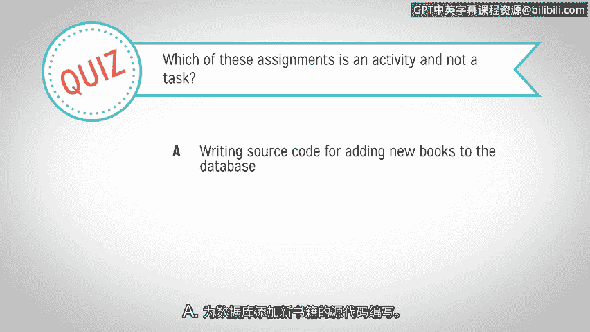

# 004：流程和实践

在本节中，我们将学习软件工程中流程和实践的基本构成元素。我们将逐一介绍活动、任务、角色、工作产品和资源这些核心概念，并理解它们之间的关系。

## 概述

软件流程由一系列相互关联的元素组成，这些元素共同协作以完成软件开发工作。理解这些元素及其关系，是掌握任何软件工程方法的基础。

## 活动与任务

活动是流程中的高层级工作单元，它由一系列更具体的任务组成。任务则是需要执行的具体、低层级的行动。

例如，“设计用户界面”是一个活动，它可能包含“创建线框图”、“选择配色方案”和“设计交互流程”等多个任务。

## 角色与职责

任务也与角色相关联。角色是一个人承担或扮演的职责。

一些软件工程角色的例子包括：程序员、测试员、首席执行官、客户或产品经理。

一个实际的人可以扮演一个角色，并执行与该角色相关的任务。简而言之，**角色执行任务**。团队中的每个人在担任某个角色时，都有特定的职责或任务需要执行。

例如，程序员可能承担为某个功能编写代码的任务。测试员可能被分配去测试该功能。而产品经理则可能在功能完成后进行审查，以确保其工作方式符合客户预期。

你可以看到角色如何帮助根据所涉及的团队成员来组织工作。

考虑一个用户可以分享和查看食谱的应用程序。用户可以选择创建带有个人资料的账户或使用访客账户。账户持有者和访客都可以浏览食谱，但用户必须登录其个人账户才能发布食谱。两种类型的用户也可以从主页浏览和搜索食谱。

以下哪些任务可以由访客角色执行？
A. 向其个人资料添加可选信息。
B. 创建账户。
C. 搜索食谱。
D. 浏览食谱。
E. 发布食谱。

如前所述，用户需要登录账户才能发布食谱。因此，选项E不正确。同样，要拥有个人资料，用户需要拥有账户，因此答案A也不正确。指定了两种用户类型都可以搜索和浏览食谱，这意味着这些任务可以由访客角色执行。此外，访客将能够创建账户以成为账户持有者。因此，正确答案是B、C和D。

## 工作产品

接下来我们将要考察的元素是工作产品。工作产品是任务产生的输出。这个输出可以是开发过程中涉及的任何东西，而不仅仅是最终产品。工作产品确实包括最终产品，但也包括其他中间输出，例如设计、需求、源代码、测试用例和内部文档。

由于工作产品是任务的输出，我们可以说**任务产生工作产品**。

然而，有时任务也会将工作产品用作输入。例如，为某个功能编写源代码的任务会参考该功能的设计。该设计是先前创建设计任务的输出。因此，**任务也使用工作产品**。

## 资源

最后，任何任务要完成，都需要资源。资源是任何能够改进、推进或资助待完成工作的东西。这些可以是时间、金钱、技术、知识或人员等。因此，我们可以说**任务消耗资源**。

为了更直观地理解这个关系图，让我们看一个例子。假设我们正在开发一个应用程序，客户要求用户能够上传个人资料图片、更改姓名和更新个人描述。这些就是我们的需求。

我们必须做的一项任务是为上传个人资料图片编写测试。包含此任务的活动是“创建测试”。这个任务将由测试员角色执行。该任务消耗许多资源，如时间、金钱和技术。该任务产生的工作产品是测试用例。该任务也使用需求文档作为工作产品，因为你希望验证产品是否符合其中指定的需求。在这种情况下，我们希望测试用户能够上传个人资料图片。

## 实践练习

你被分配到一个新项目中。在这个项目中，你的团队正在为当地图书馆开发一个新的数据库和借阅系统。它使用一个移动应用程序将书籍借阅到用户的账户。

西奥多是你的开发团队中的一名程序员。他被分配了以下工作：为向数据库添加新书籍编写源代码、建立数据库、为帮助页面编写文本，以及为创建账户执行测试。

这些分配中哪一项是活动而不是任务？
A. 为向数据库添加新书籍编写源代码。
B. 建立数据库。
C. 为帮助页面编写文本。
D. 为创建账户执行测试。

答案B是最正确的答案，因为建立数据库涉及许多任务。西奥多将不得不执行诸如设计数据库、为数据库编写代码、托管数据库以及将当前数据库迁移到新数据库等任务。任务是指像A、C和D中那样的低层级具体行动。在“建立数据库”这个高层级活动中，可能包含许多低层级的任务。

## 总结

在本节中，我们一起学习了软件流程的核心构成元素。我们明确了**活动**是高层级工作单元，由具体的**任务**组成。**角色**定义了由谁执行任务，而任务会产生或使用**工作产品**。最后，任何任务的执行都需要消耗**资源**，如时间、金钱和人力。理解这些元素及其相互关系，是构建高效软件流程的第一步。