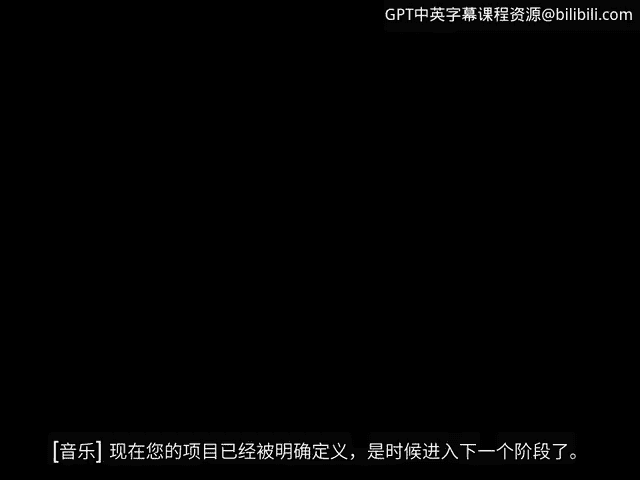
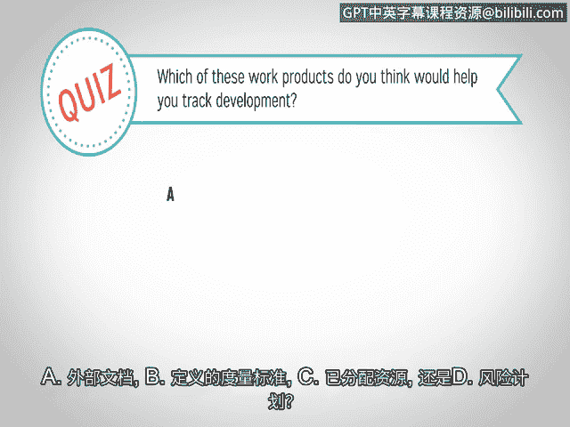

# 008：软件工程活动

在本节中，我们将学习软件项目在完成需求规划后，进入设计与实现阶段所涉及的核心工程活动，以及后续的验证与确认阶段。我们将了解产品经理在这些阶段中的角色与职责，特别是如何跟踪和监控开发进度。

## 🏗️ 设计与实现阶段

上一节我们介绍了项目规划与需求确定。现在，项目已明确，是时候进入下一个阶段：**设计与实现阶段**。这些活动更偏向于开发人员，因此我们不会深入技术细节。作为产品经理，你需要帮助跟踪和监控此阶段的工作。

设计与实现阶段的活动包括：
*   **设计架构**
*   **设计数据库**
*   **设计接口**
*   **创建可执行代码**
*   **集成功能**
*   **编写文档**

这是你的开发团队大显身手的时候。但在他们开始编程之前，你和团队需要设计产品，这包括设计架构、数据库和接口。然后，程序员才能开始工作，创建可执行代码。

你的团队应定期**集成**或组合他们的代码，以确保代码兼容性。

最后一项活动是**编写文档**。你可能会想，敏捷宣言不是说不需要文档吗？宣言确实指出“可工作的软件胜过详尽的文档”。然而，文档仍然是软件开发中非常重要的一部分。

好的文档有助于新成员加入团队，或让开发人员处理他们不熟悉的部分。这类文档称为**内部文档**。

你的团队可能还需要为最终用户开发文档，例如使用手册或培训材料。这类文档称为**外部文档**。

作为产品经理，你负责帮助跟踪和监控开发过程。

---

你的团队刚刚完成了本次迭代的规划，并已开始为产品编写代码。既然规划已完成，你环顾四周寻找可做的事情。你看到桌上有上次迭代某个功能的使用手册，墙上贴着团队决定使用的度量指标列表，邮箱里有老板发来的关于团队资源分配的邮件，书架上则放着最新版本的风险计划。

你决定是时候开始监控本次迭代的开发进度了。

**你认为以下哪项工作成果能帮助你跟踪开发进度？**
A. 外部文档
B. 已定义的度量指标
C. 已分配的资源
D. 风险计划

**答案分析：**
*   **外部文档**是供最终用户使用的，而非用于跟踪。
*   **已分配的资源**用于推进和支持开发。
*   **风险计划**在开发开始后非常有用，但不用于跟踪进度。
*   你的团队决定使用的**度量指标**对于跟踪至关重要。你必须重新计算和评估这些指标，以确保开发有效且项目按计划进行。

因此，**B是正确答案**。

## 🔍 验证与确认阶段

现在，让我们看看开发下一个阶段的活动：**验证与确认阶段**。这个阶段旨在评估你的产品是否实现了预期功能，以及是否满足客户需求。

与其他阶段一样，验证与确认阶段也需要经常进行，而不仅仅是在产品完成时。你需要持续验证和确认产品，以确保开发方向正确。

验证与确认活动包括：
*   **制定测试流程**
*   **创建测试用例**
*   **执行测试**
*   **报告评估结果**
*   **进行评审与审计**
*   **向客户演示**
*   **进行回顾会议**

**测试**是验证与确认阶段的重要组成部分，涉及许多活动，包括制定测试流程、创建测试用例、执行测试和报告评估结果。这些活动有助于**验证**产品是否按预期工作。

为了**确认**产品满足客户和最终用户的需求，你需要完成诸如进行评审、审计和向客户演示等活动。这是你获取反馈以改进产品的机会。如果最终用户或客户不认可你的产品，它很可能会失败。

**回顾会议**是由你的开发团队进行的活动。这些回顾可以反思产品或开发过程。产品和过程总有改进的空间，回顾有助于找出下次可以做得更好的地方。

## 📝 总结与展望

如你所见，软件开发涉及许多活动。重要的是要记住，在敏捷开发中，你需要反复经历这些阶段，并且它们不总是顺序进行的。

通过排序并确定何时以及多久重新进行这些活动，你就创建了一个**流程**。现在，你可以利用刚刚介绍的活动来创建一个适合你团队的流程。

在下一个模块中，你将接触到一些既定的流程模型。