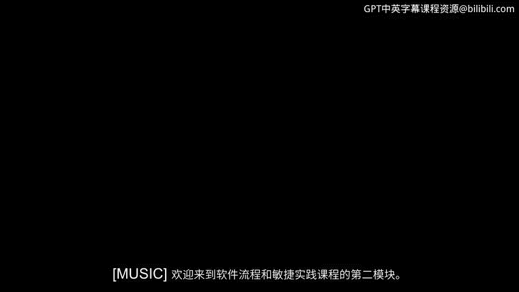
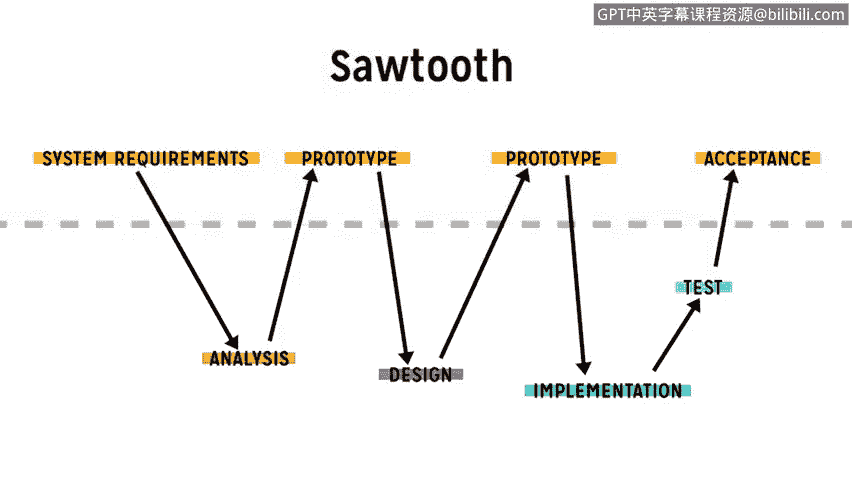

# 009：线性模型 🧱

在本节课中，我们将要学习软件工程发展史上几种重要的线性过程模型。我们将了解它们如何工作，各自的优缺点，以及它们为何在特定历史背景下产生，又为何逐渐被其他模型所补充或替代。

## 概述

在上一模块中，我们了解了什么是流程与实践，以及它们如何帮助组织工作。我们还详细探讨了软件工程中的常见活动。在本模块中，我们将后退一步，回顾一些历史上被证明有用的流程，并看看它们是如何演变成我们今天看到的更常见流程的。

就像使用大锤和打桩机的工人一样，并非更先进、更复杂的流程就一定在所有情况下都是最佳选择。了解所有可用的选项及其利弊至关重要，否则你可能会陷入使用不适合当前任务的流程的陷阱。

线性过程模型遵循一个阶段接一个阶段完成的模式，不会重复之前的阶段。产品在设计、开发和发布过程中，不会重新审视早期阶段。在本课中，我们将深入探讨这些线性生命周期过程模型。

## 理解线性模型

在继续之前，让我们测试一下你对线性过程模型的理解。请从列表中选择线性过程模型。

*   A. 每个阶段顺序发生，当所有阶段完成后循环回起点。
*   B. 每个阶段与其他阶段并行发生，直到产品完成，阶段之间或内部没有重复。
*   C. 每个阶段顺序发生，从不循环或重复。
*   D. 每个阶段可以重复，直到产品完成。

正确答案是 **C**。线性过程模型不支持流程阶段内部或阶段之间的循环。允许循环的模型称为迭代模型。线性模型还要求阶段按顺序完成，阶段之间没有重叠。允许重叠的模型称为并行模型。我们将在本模块后面学习更多关于迭代和并行过程模型的知识。

## 瀑布模型

首先，我们来谈谈你可能听得最多的一个模型：瀑布过程模型。如果你研究过软件工程，很可能听说过它。尽管旧的瀑布模型常因效率低下和限制性强而受到批评，但让我们更详细地讨论它，以便看清它的优势和弱点。

你可能已经在生活的许多方面使用过类似瀑布的流程。本质上，它就是一个基本的线性流程，一件事接一件事地发生。

它之所以被称为“瀑布”，是因为流程的每个阶段都由前一个阶段批准的工作产物来推动。例如，在需求阶段结束时，你会得到一份产品需求文档。这份文档被批准后，就流入下一个阶段——设计阶段。在这个阶段结束时，你将完成一组模型、架构和业务规则。然后，这项工作被签署确认，再流入瀑布的下一个阶段，依此类推。

这个模型允许开发人员快速开始构建产品。它通过早期确定范围并坚持执行，避免了需求变更的问题。瀑布模型非常强调记录需求和架构等内容，以便开发团队对软件达成共同的书面理解。

然而，瀑布模型对变化的适应性不强。也就是说，它不够敏捷。瀑布模型的一个主要缺点是它不允许开发团队审查和改进他们的产品。正如我们之前所说，软件是非常动态的。瀑布模型的设计初衷就不是为了应对中途可能发生的、需要重新审视早期阶段的变化。

因此，存在一些瀑布模型的变体，允许向早期阶段及其活动提供反馈机会，以支持某些变更。但如果你的客户在需求文档批准后需要变更呢？不幸的是，客户直到最后才能看到产品，而这可能是许多个月之后。可以理解，这种缓慢的响应经常导致客户失望。

瀑布模型曾发挥过它的作用，但它无法确保正在进行的工作得到适当验证，这是一个严重的缺陷。

## V模型

为了解决这个问题，软件开发的V模型应运而生。它与瀑布模型非常相似，事情按顺序一件接一件地发生。不同之处在于，它强调验证活动，以确保实现与设计行为相匹配，同时也确保实现的设计符合需求。其理念是将每个验证级别组织到相应的阶段，而不是一次性全部进行。

V模型与瀑布模型的区别在于，V模型明确地将自身分为两个分支，因此得名“V”。与瀑布模型一样，V模型从需求开始，流入系统架构和设计。这个分支由V的左侧代表，从上到下进行。在这个分支的末端，重点从设计转移到实现，这是V的底部。一旦实现完成，模型的重点就转移到验证活动，这由V的右侧代表，从下到上进行。

右侧的每个阶段都旨在检查V左侧的对应阶段。以下是一个例子：在V模型的左侧，你的开发团队计划稍后要实现的单元测试。这些单元测试旨在确保你编写的代码确实解决了你试图解决的问题。当进入V右侧的单元测试阶段时，这些单元测试就在代码中运行，以确保在一切编写完成后，所有代码都能正常运行。测试运行完毕且一切顺利后，流程就进入集成测试阶段。这样，V的右侧就验证了左侧。

V模型具有与瀑布模型相同的优点和缺点。它应用起来很直接，但没有考虑到软件开发的重要方面，比如变更的必然性。然而，V模型确实允许开发团队验证流程构建阶段的工作成果。所以我们取得了一些进展，但客户仍然要等到一切完成、产品最终完成时才能看到成品。

让我们通过一个练习来巩固理解。研究我们描述软件开发V模型的图表。如果你处于集成测试阶段，当你运行测试时，你正在验证哪个阶段？

*   A. 单元测试
*   B. 编码
*   C. 高层设计
*   D. 运行测试

答案是 **C. 高层设计**。当你在高层设计阶段时，你创建了测试，这些测试随后在集成测试阶段运行。你运行的测试不是来自下一个或最后一个阶段，也不是来自编码阶段。

## Sashimi模型（生鱼片模型）

现在我们需要一个流程，允许我们在过程中就与客户互动，而不是只在产品被认为完成时才让客户参与。这就是Sashimi模型（或称“生鱼片模型”）的用武之地。这个模型与前两个非常相似，因为它也是软件开发的线性模型。然而，它也有所改进，因为它在整个过程中为你提供了急需的客户互动。

Sashimi模型的独特之处在于它区分了客户和开发团队。在这个模型中，需要客户在场的任务和仅需要开发团队的任务被明确区分开来。这些客户任务穿插在整个过程中，以便在有意义的时刻收集反馈。

与前两个概念相似，你可能已经猜到我要说什么了。是的，Sashimi模型也遭受与前两个线性模型相同的缺点。它应用起来非常容易，但不能很好地应对变化。

## 总结

在本节课中，我们讨论了软件开发历史上三个重要的敏捷宣言发布前的流程模型：瀑布模型、V模型和Sashimi模型。它们有共同点，也有各自的差异。

这些模型共同的主要特点是，它们都包含按顺序一个接一个发生的阶段。对每个人来说，下一步的预期都非常清晰。这个共同特征是它们共享优点和缺点的主要原因。它们各自允许开发以一种直接的方式进行，但也极大地限制了项目必须适应流程。

本质上，这些早期的线性过程模型遵循一种软件产品的制造观，即软件是根据特定要求机械加工和组装的。一旦生产出来，产品只需要少量的维护保养，有点像家用电器。因此，重点在于前期正确获取需求，之后不再更改。

然而在现实中，开发软件产品是一项创造性的工作，需要进行实验和不断的返工。此外，在过去，计算机时间相对于人力成本是昂贵的，重点在于使编程等任务对计算机高效，但不一定对人高效。对于软件开发来说，从编写代码到看到结果之间的周期可能长达数小时。这不利于开发人员尝试小型编程实验来快速测试他们的想法。但这确实促使人们专注于第一次就做对，并避免返工。线性过程模型符合这种早期的思维方式。

尽管如此，当为新开发人员记录软件产品的内部结构时，你可能仍然会通过阶段和相关文档以线性方式描述项目，即使它可能遵循了其他流程。这提供了一种秩序的表象，使得新开发人员无需重历整个项目就能初步了解其当前实现。这类似于你在教科书中看到的数学证明和科学理论的简洁、理性版本。

在下一课中，我将介绍下一代的软件流程：迭代模型。在那里，我将告诉你一个名为“螺旋模型”的流程及其优势。我们下节课见。