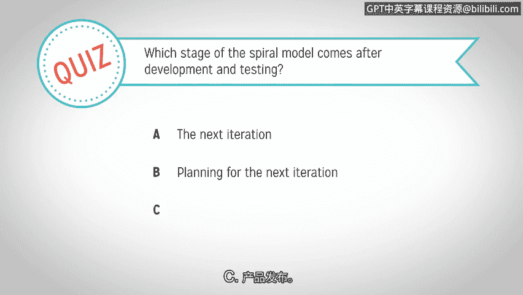
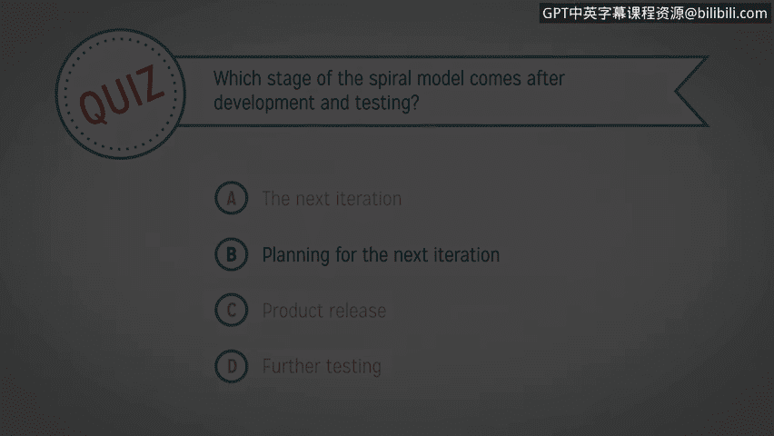

# 010：螺旋模型 🔄

## 概述
在本节课中，我们将学习一种重要的迭代式软件开发过程模型——螺旋模型。我们将了解其基本结构、运作流程、核心原则以及优缺点。

---

在上一节课中，我们介绍了一些最早的线性软件开发过程模型。我举了两个建筑工人使用不同工具修建铁路的例子，并将其与选择不同软件过程进行了类比。在学习本节内容时，请记住这个例子，以提醒自己这些知识的重要性。

在接下来的几节课中，我将介绍一些迭代式软件过程模型。迭代式软件过程模型允许重复过程的某些阶段，它们是循环往复的。迭代模型建立在之前讨论的线性模型基础之上。它们带来的最大优势是增加了回溯到先前步骤的能力。每一次回溯都是一次迭代，因此称为迭代模型。迭代允许在过程中获得反馈。迭代模型可以被视为真正敏捷实践的先驱，但它们也体现了顺序步骤，让人联想到之前的线性过程。当你在下一个模块与Morgan讨论敏捷实践时，请尝试找出敏捷实践与迭代过程之间的兼容点。

## 螺旋模型的基本结构
本节中，我将讨论螺旋过程模型。螺旋模型由Barry Boehm于1986年提出，它概述了一个通过重复访问已完成阶段来设计和实现软件系统的基本过程。

在继续之前，我需要提醒你，其中一些内容可能涉及技术细节。如果你发现某个概念需要澄清，请查阅本课的课程资源。在那里，你会找到我将要讨论的所有内容的参考资料。

好的，以下是对螺旋过程模型的简化解释。你可以立刻明白它为何被称为螺旋模型。从根本上说，该模型由四个象限组成。当你推进这个过程时，理念是从一个象限移动到另一个象限。将这四个象限中的每一个都视为一次迭代的一个阶段，其中一次迭代是指完成一个完整螺旋（即所有四个象限阶段被完成一次）的持续时间。每个阶段都包含Morgan在第一模块中定义的活动。

## 螺旋模型的运作流程
以下是螺旋模型的基本运作步骤：

1.  **确定目标与方案**：首先，为当前迭代确定目标、需求，并生成解决方案。
2.  **评估风险与方案**：接着，识别和评估风险，并对这些解决方案进行评价。
3.  **开发与测试产品**：然后，在本次迭代中开发和测试产品。
4.  **规划下一次迭代**：一旦获得满足目标的产品，便着手规划下一次迭代。

如果每个象限是迭代的一个阶段，那么完成一次迭代后，你就进入下一次迭代。这就是螺旋模型的基本流程。通过重复这个阶段循环，逐步构建产品。

例如，你可以通过确定客户和用户需求来启动一个螺旋模型项目。然后，提出满足这些需求的潜在解决方案。之后，评估提出的解决方案。接着，构建产品的初始原型，并评审下一次迭代需要完成的工作。这便是一次迭代。

在下次迭代中，你可能再次从定义迭代目标开始，例如为你刚刚构建的原型添加功能。然后，评估这些功能，并着手构建你认为合适的功能。接着，评审下一次迭代需要完成的工作，并继续推进，直到项目完成并令客户满意。

因此，与上一课描述的线性模型不同，像螺旋模型这样的迭代模型倾向于在整个过程中重复某些环节。这意味着螺旋模型允许开发团队在每次螺旋迭代结束时评审他们的产品。这样做可以更好地确保产品是按照规格构建的。

## 知识检查
Jonathan正在使用螺旋模型构建他的软件。他在使用穿孔卡编程和瀑布模型方面拥有丰富经验，因此螺旋迭代对他而言是一个巨大的改变。他刚刚完成了产品的开发和测试，但不记得模型的下一个阶段是什么。

**问题**：螺旋模型中，在“开发与测试”之后是哪个阶段？
A. 下一次迭代
B. 规划下一次迭代
C. 产品发布
D. 进一步测试

**答案**：B，规划下一次迭代。因为螺旋模型是迭代的，你会循环回去，再次开始确定目标并完善设计。但只有在迭代结束时首先规划了设计之后，你才会这样做。

## 螺旋模型的不变式
尽管遵循螺旋模型的项目在某些方面可能因项目而异，但有六个条件几乎总是不变的。这些被称为螺旋模型的“不变式”。它们由Boehm在其2000年发表的后续论文中首次描述。有趣的是，在大多数情况下，这些不变式实际上也适用于许多其他过程模型。

现在，这些不变式可能相当技术性，因此我不会详细讨论所有六个，而只介绍几个关键不变式的核心概念。如果你想了解每个不变式的更多细节，请查阅课程资料。在那里，你会找到每个不变式的详细描述。

以下是几个核心不变式：

*   **第一个不变式**：软件项目的所有工作产品应**同时**创建。这看似奇怪，但基本理念是，如果不同时定义事物，就会使项目面临风险。这是因为在通常的瀑布方法中，顺序执行意味着仅基于有限的信息量做出决策。
*   **第二个不变式**：模型的**所有象限都必须被处理**，不能跳过步骤。这是因为模型的每个象限都带来价值，如果跳过一个，就会不必要地使项目面临风险。因为你很可能是在对项目做出假设，而假设当然可能是错误的。你不想基于错误的假设来构建项目。
*   **其他不变式**：最后几个不变式相当技术性，因此我不会深入细节。本质上，它们说明：实施螺旋模型的每个项目，在任何特定活动上花费的时间量，应基于执行该活动所涉及的风险量。它非常注重确保你的决策基于风险数据。其他不变式还提到，螺旋的每次迭代都应产生一个有形的工作产品，并且过程的重点应放在改进整个过程上。

所有这些不变式共同构建了螺旋模型。这有助于定义模型，但你能看出任何问题吗？

## 螺旋模型的优缺点
尽管螺旋模型在许多方面明显优于线性过程，但它也有其缺点。

**缺点一**：规划倾向于在每次螺旋开始时预先进行。根据螺旋的持续时间，这可能使得做出良好估算变得困难。

**缺点二**：该过程所规定的、以计算方式最小化风险的能力，需要大量的分析专业知识。试想一下，为了确切知道在处理一项活动时花费多少时间是过多或过少，你需要多少数据。这类风险评估任务需要消耗大量资源才能正确完成。

如果你所在的组织使用螺旋模型，很可能你正在处理大型项目，并且拥有多年的经验、数据和技术专业知识可供使用。

## 总结
螺旋模型是迭代过程的一个很好的例子。它以允许在特定时间间隔修订产品的方式完成工作。与其他过程模型一样，它也有其缺点。但它显然与我们之前看到的模型不同，对吗？

在下一课中，我将讨论统一过程模型。请尝试将本课所学内容与之进行比较。