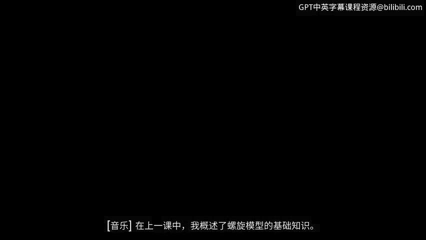
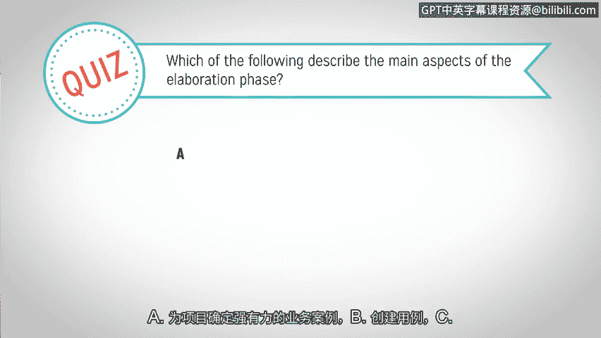

# 011：统一过程 🌀

在本节课中，我们将学习统一过程模型。这是一种迭代式的软件开发模型，强调渐进式开发和并行工作。我们将详细介绍它的四个主要阶段：初始、细化、构建和移交。

---

在上一节课中，我们介绍了螺旋模型的基础知识，讨论了它的优缺点，以及它在软件开发流程演进时间线中的位置。螺旋模型是一种**迭代式**的软件开发模型，意味着产品是通过一系列重复的阶段构建而成的。这与我们在本模块开头介绍的**线性流程模型**（如瀑布模型和V模型）形成对比。

本节中，我们将探讨另一种迭代式软件开发模型——**统一过程模型**，通常简称为统一过程。

正如之前所说，统一过程是一种迭代式软件开发模型。它的基本结构是工作在一系列阶段中，这些阶段会重复进行，直到最终阶段被判定为完成。在大多数统一过程阶段内，开发以小型迭代的方式进行，直到该阶段被判定为完成。通常，当一个**里程碑**达成时，阶段即被视为完成。

统一过程尽可能强调**渐进式开发**。它并非在项目初期就确定软件产品的所有需求，而是注重随着时间推移逐步构建产品架构的重要性。**架构**是构建软件产品所依据的一组设计。因此，在统一过程中，开发团队的重点是开发设计模型，同时构建可工作的产品。

虽然统一过程的一般结构是迭代式构建，但该模型允许一个阶段的任务与另一个阶段的任务重叠。这被称为**并行工作**。因此，开发人员并非仅仅按顺序经历各个阶段，他们实际上可以同时进行多项工作，例如在设计产品架构的同时开发测试。

> 杰夫在设计产品架构的同时，也在为他的代码构建测试。当他遇到问题时，他也会偶尔向客户澄清和获取需求。杰夫使用的是哪种软件开发风格？
> A. 并行开发
> B. 迭代开发
> C. 增量开发
> D. 同步开发

**答案是A，并行开发。** 由于杰夫同时参与了开发的多个阶段，我们称之为并行开发。

---

### 初始阶段

统一过程的第一个阶段称为**初始阶段**。这个阶段旨在简短，只需足够的时间来确保你有一个足够坚实的基础以进入下一阶段。事实上，初始阶段是统一过程中唯一一个开发**不**以迭代方式进行的阶段。如果你的初始阶段很长，这可能意味着你在初始阶段花费了过多时间构建需求。

你在初始阶段的主要目标是判断是否有足够强的**商业理由**来继续开发。这意味着必须有足够好的财务理由来构建产品。

为了实现这个目标，初始阶段要求创建基本的**用例**。用例概述了用户与产品的主要交互。在此阶段，你还需要定义项目范围和潜在风险。

> 如果你想了解更多关于用例以及如何创建它们的信息，请查看关于“客户需求与软件需求”的课程。

在初始阶段结束时，你达成了**生命周期目标里程碑**。此时，你将获得关于产品可行性的合理描述，并准备好进入流程的下一个阶段。

---

### 细化阶段

**细化阶段**是统一过程中第一个实施小型迭代的阶段，正如本节课前面提到的。这个阶段的目标基本上是创建一个产品的**模型或原型**，我们将在后续进行完善。（我们将在本模块后面更详细地讨论不同类型的原型。）

目前，此阶段的目的是定义**系统架构**。开发人员定义在初始阶段构思的需求，并开发关键的架构文档，例如**用例图**和**高层类图**。这为实际开发奠定了基础。

请记住，这个阶段允许迭代。因此，在迭代中构建原型可能会在需求和架构模型被认为足够完善可以进入下一阶段之前，经历重新设计。

在细化阶段结束时，开发人员会为下一阶段（构建阶段）制定开发计划。这个计划基本上建立在初始阶段开发内容的基础上，并整合了在细化阶段学到的一切，以便构建阶段能够有效进行。

请记住，在统一过程模型中，开发可以并行进行。这意味着当你开始构建阶段时，你将继续进行在细化阶段所做的工作。唯一的区别是工作的侧重点可能会改变。例如，虽然测试和编程在细化阶段很重要，但它们在构建阶段变得更加重要。同样，风险评估在构建阶段也很重要，但在此阶段的重要性低于细化阶段。

---

### 构建阶段

**构建阶段**非常直接。这是另一个开发可以迭代进行的阶段。它侧重于在细化阶段完成的工作基础上进行构建。这是你产品的核心真正被构建出来，产品变得有生命力的阶段。

在构建阶段，会开发详细的用例来驱动产品开发。这些用例比在初始阶段创建的用例更健壮，能更具体地洞察你的产品应如何创建。

你的产品在整个构建阶段迭代构建，直到产品准备好发布。此时，你的开发团队开始将产品移交给客户和用户。

现在你已经了解了统一过程的初始、细化和构建阶段，让我们测试一下你的理解。

> 以下哪些描述了细化阶段的主要方面？
> A. 为项目确定强有力的商业理由
> B. 创建用例
> C. 创建用例图
> D. 创建类图

**正确答案是C和D。** 用例图和类图是细化阶段的主要工作成果。这并不是说这些工作成果不会在构建阶段出现，只是在细化阶段更侧重于它们。你在初始阶段为项目确定强有力的商业理由。

---

### 移交阶段

在**移交阶段**，你的产品会进行主要发布。你的开发团队会从用户那里收集反馈。正是在这个阶段，你才能真正看到你的设计与用户需求的匹配程度如何。

通过收集这些反馈，你的开发团队可以对产品进行改进，创建错误修复和其他版本。在你的产品完成一次迭代后，有可能再次循环经历统一过程的各个阶段。这适用于你打算为产品创建进一步的主要版本，并将用户反馈作为影响后续开发计划的手段的情况。

这些循环会重复进行，直到你和你的开发团队准备好发布你的产品。

---

### 总结与展望

以上就是统一过程。正如我在课程开头所说，统一过程是迭代流程的一个例子。但正如你在整节课中所看到的，统一过程也是一个**并行流程**。与需求、设计和实现相关的活动可以同时发生。

总的来说，统一过程更像一台**打桩机**，而不是一把**大锤**。对于大型项目来说，这是一个很好的流程，因为产品需要大量的完善才能保持在正轨上。拥有迭代允许你的产品自然成长，而不会受到前期计划的限制。

在下一节课中，我将讨论原型设计，以及原型如何用于驱动软件开发。我们下节课见。😊