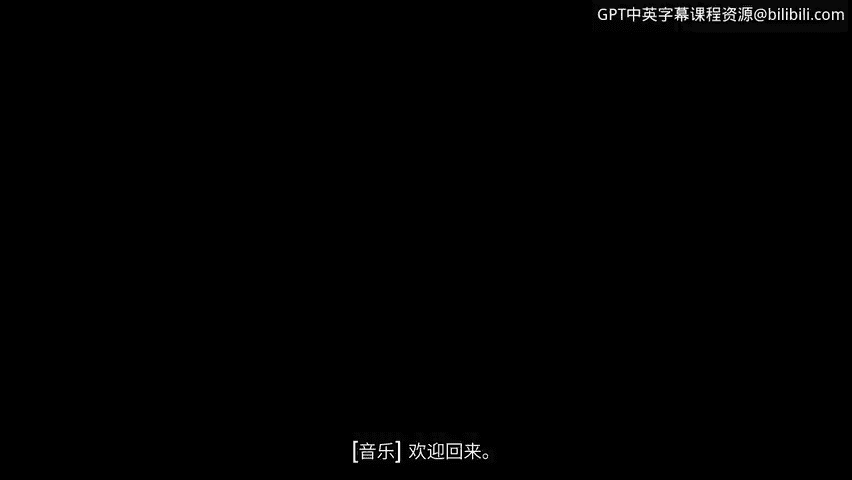
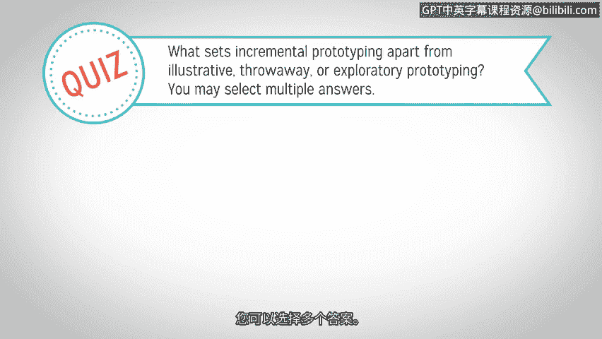

# 012：原型化

## 概述
在本节课中，我们将学习软件产品开发中的原型化方法。我们将探讨五种不同类型的原型，了解它们各自的目的、适用场景以及如何在实际开发过程中运用它们。理解原型化有助于我们更高效地验证想法、降低开发风险并构建更符合用户需求的产品。

---

## 回顾与引入
上一节我们介绍了统一过程和螺旋模型作为迭代与并行流程的例子。本节中，我们将看看一个适用于这些模型，并且在软件开发中极为重要的概念：原型。

原型化并不仅限于特定的流程模型，它作为一种通用技术，在未来的课程中也会频繁出现。我们将要介绍的五种原型类型是：示意型、探索型、抛弃型、增量型和演进型。

---

## 示意型原型
我们从最基础的原型开始：示意型原型。这类原型形式非常基础。

以下是示意型原型的常见形式：
*   可以是画在餐巾纸上的草图。
*   可以是一个简短的幻灯片演示。
*   甚至可以是在几张索引卡上画出组件。

无论形式如何，示意型原型的核心目的是**使用低保真、一次性的图像来分享一个想法**。它们有助于在投入大量时间和金钱开发产品之前，确定系统的外观和感觉。这可以为后续开发节省大量时间。

你可以将示意型原型用作筛选糟糕想法的方式，并作为开发的指南。它们为开发团队提供了创建解决方案的指引，而不是需要边想象边编程。

我个人喜欢在原型中模拟计划实现的功能。我最喜欢的方法之一是在绘图软件中勾勒关键功能，然后使用幻灯片编辑器将它们串联起来。这样，原型就能以更少的额外精力，成为产品外观的一个更真实的示例。

你也可以用画在纸上的功能实现类似效果。当最终用户选择某些元素时，你可以通过替换一张“纸屏幕”来演示想法。这种技术通常在时间紧迫、只需要一个基本概念来表达观点时使用。

这个概念可以发挥到极致。有些原型甚至通过让人类在幕后控制系统功能来“伪造”其功能，就像电影《绿野仙踪》中幕后的巫师一样。我曾在一个项目中看到这种方法取得成功，该项目以设备间的无线通信为关键功能。编写允许用户实际无线通信到另一台设备的代码需要很长时间。因此，开发团队发挥创意，在每个设备上运行一个幻灯片程序。当一台设备向另一台发送数据时，开发人员会巧妙地推进另一台设备上的幻灯片。开发团队的时机把握得恰到好处，看起来数据确实是在两台设备之间传输。

你大概能明白为什么示意型原型如此常见了。它只需要很少的时间就能勾勒出功能集，并能让你很好地了解产品完成后的样子。

---

## 探索型原型
如果你有更多时间，并且希望对产品的外观有更全面的了解，一些团队会转向我们所说的探索型原型。

探索型原型允许你专注于产品的**外观、感觉以及构建该产品所需的工作量**。你会编写可工作的代码，以便实际了解什么是可行的，并完全预期在从过程中学习后**抛弃**这个工作成果。这种方法昂贵吗？当然。但这比后来才发现产品解决方案根本不可行要好。

探索型原型背后的通常动机是产品开发者希望研究某个产品想法的可行性。这不再仅仅是看产品的外观，而是关于开发产品的可实现性，或者在投入更多精力之前产品可能有多有用。

---

## 抛弃型原型
任何产品的第一个版本，或者说几乎所有事物的第一个版本，通常都存在各种问题。既然如此，为什么不从头开始构建第二个版本，并抛弃第一个呢？你构建的第一个版本就是所谓的抛弃型原型。

你应该知道，第一个版本并非一无是处。从中学到的许多有用经验和需要避免的问题可以应用到第二个版本中。抛弃型原型让你有机会从过去的错误中学习，这使你有机会让你的发布软件产品看起来比从第一个版本不断演进而来更加稳固可靠。

---

## 增量型原型
卡莉刚刚构建了她的产品的第一个迭代版本，现在有了一个第一代可工作的产品原型。她打算在后续的增量中扩展这个原型。测试用户对初始原型提出了批评。在看到产品设计后，他们建议采用一种不同的方法，该方法会用到一些已经构建好的功能。卡莉使用的是哪种原型化方法？A. 可工作型 B. 示意型 C. 抛弃型 D. 增量型。

答案是 **D，增量型原型**。卡莉从一个可工作的原型开始，后来进行了扩展。初始原型是编码并保留的，所以它不是抛弃型原型或示意型原型。

希望你不会最终得到一个非计划内的抛弃型原型。我刚才描述的三种原型类型，最终都不会直接用于产品的最终版本。那么，在产品实际开发过程中重用原型阶段完成的工作，难道不合理吗？这就是增量型和演进型原型发挥作用的地方。它们让你在原型化阶段的努力能够延续到最终产品中。

关键思想是**为每个连续的原型都拥有可工作的软件**，其中任何一个都可以作为你软件产品的一个版本发布。当你创建增量型原型时，你一次一个增量地构建和发布你的产品。

增量型原型分阶段工作，基于一个**优先级排序系统**。这意味着你评估系统的每个组件并为其分配优先级。基于这个优先级，你然后从头开始开发产品。你会从最重要到最不重要地开发你的产品。

所以，你根据**必须做、应该做和可以做**来为软件产品的功能分配优先级。你将核心功能分配给“必须做”优先级，然后将所有支持产品但并非绝对关键的功能分配给“应该做”。其他所有看起来像是额外功能的东西则分配给“可以做”优先级。

基于这些评级，你将从分配给“必须做”优先级的功能开始开发你的产品。由此产生的软件产品包含核心功能，可以作为增量型原型发布。然后，随着资源允许，你开发“应该做”优先级下的功能，然后是“可以做”下的功能，从而产生一个功能更全面的增量型原型。

举个例子：你正在开发一个消息应用。首先，你希望你的用户能够通过应用相互交谈。任何与此相关的功能，比如集成查找其他用户、消息发送或接收功能，或文本编辑，都可能是你的最高优先级。因此，这些功能将被分配给“必须做”优先级。

你可能会想象用户希望能够添加个人资料图片或发布状态更新，也许还能向人群组发送消息。这些功能将被视为“应该做”的功能。任何像能够更改消息字体、向其他用户发送自定义绘图或发布链接等功能，可能会被分配给“可以做”。

有了所有这些，剩下的就是构建你的应用了。由于你对产品功能进行了优先级排序，你可以轻松地规划和安排你的开发。事实上，这种对功能进行优先级排序并按照计划工作的基本概念，是你在敏捷软件规划课程中将会反复看到的概念。

---

## 增量型原型知识测试
你刚刚学习了增量型原型。让我们测试一下你的知识，看看你记住了什么。是什么将增量型原型与示意型、抛弃型或探索型原型区分开来？你可以选择多个答案。

*   A. 增量型原型采用优先级排序系统。
*   B. 增量型原型在创建后会被丢弃。
*   C. 增量型原型不包含任何代码。
*   D. 增量型原型可能包含最终产品的可工作软件。

正确答案是 **A 和 D**。增量型原型与我们之前讨论的其他原型不同，因为它允许你的开发团队创建一个**潜在可发布的产品**。这是通过开发那些已经使用优先级排序系统确定优先级的功能来实现的。

---

## 演进型原型
我要讨论的最后一种原型类型是演进型原型。在增量型原型中，你从一组核心功能开始，并随着时间的推移添加新功能。在演进型原型中，你从**所有功能的基本形式**开始，并随着时间的推移**改进或演化**它们。无论哪种情况，最终产品都是一个功能丰富的产品。

让我们用我之前概述的消息应用示例来比较一下。在增量型原型中，我们使用优先级排序系统对软件产品的功能进行优先级排序，然后构建包含从最重要到最不重要功能的连续增量型原型。

在演进型原型中，你将拥有所有功能的早期版本，并通过不断完善这些功能直到它们完全成熟来构建连续的原型。例如，后期的演进型原型可以使现有功能更易于使用或更灵活。

以消息应用中的添加个人资料图片功能为例。最初，用户可能必须指定要添加到个人资料的图片路径，这不是一种非常高效的方式，但它能工作。在另一个原型中，开发者可能允许用户从可用照片的下拉菜单中选择照片。更好一点，但在下一个原型中，你可能会想象系统允许拖放功能。通过这种方式，你的产品从一个基本的工作原型演变为功能丰富且健壮的产品。

增量型和演进型原型都是制作可工作软件的方法，这些软件可以定期展示以获得进一步的反馈。在实践中，你可以混合使用这两种方法。对于你的开发团队来说，看到产品随着时间的推移逐渐成型，是一个真正的士气提升。

---

## 原型与流程模型的结合
好了，现在你知道了一些不同类型的流程。现在，回想一下你在前几节课中学到的关于螺旋模型和统一过程的知识。你能想象原型如何融入这些模型吗？

在螺旋模型中，想象一下你会从哪里开始。通常起点是创建一个原型，对吧？你可能会通过螺旋模型的第一次迭代，仅仅创建一个示意型原型。你可以在纸上涂鸦几幅画，了解你的系统将如何工作。对于统一过程的初始阶段，不也可以这样说吗？通过创建原型，你可以更好地可视化你的产品功能，从而根据产品可能的样子做出功能决策。

但这还不止。我敢打赌你已经想到了将示意型原型与增量型或演进型原型结合的可能性。这很有道理，对吧？你的第一个版本只是写在几张纸上的想法。然后，为了进一步测试你的想法，你勾勒出一些关键功能并开始构建。不久之后，你最终可能会得到一个原型。然后，你可以将该原型带给客户或潜在投资者，以证明该产品在概念上是可行的。这确实是任何类型原型化背后的核心思想：获取对你产品版本的反馈。

你可以从花费最少的时间开发初始原型开始，以最有效地利用你的资源。

---

## 总结
本节课中，我们一起学习了软件产品开发中的五种原型化方法：示意型、探索型、抛弃型、增量型和演进型。我们了解了每种原型的目的、特点以及它们如何帮助我们在不同阶段验证想法、管理风险并逐步构建出功能完善的产品。原型化是连接创意与可交付产品的重要桥梁，灵活运用这些方法能显著提升开发效率和产品成功率。