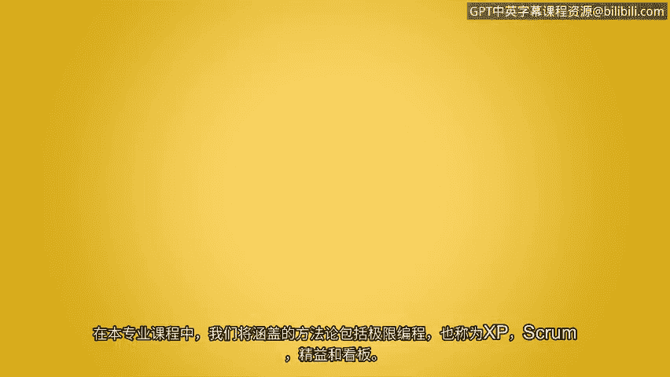

**软件产品管理课程2：《软件流程与敏捷实践》：2.3.1：在流程模型中使用敏捷**

在本节中，我们将深入探讨敏捷实践，并分析它们如何与之前介绍的各种软件流程模型相结合。你将了解哪些模型更兼容敏捷思想，以及为什么。

---

在课程进行到目前阶段，你已经研究了许多不同的流程模型。在第一模块中，我们也介绍了采用敏捷实践的一些动机。现在，我们将更深入地探讨一些敏捷实践。这些实践在你作为软件产品经理工作时会经常用到。

如果你参加了先导课程，会记得我们讨论过《敏捷宣言》。这份宣言概述了软件开发的四个核心价值以及应遵循的12条原则。如果你没有学习先导课程或需要复习，可以访问相关课程或通过课程资源中的链接阅读《敏捷宣言》的内容。

首先，我们来回顾一下前几课中涉及的一些术语。
*   **流程**：是你用来将开发组织成不同阶段的模型。
*   **实践**：是你可以用来帮助管理和跟踪开发的技术或行动。
*   **方法论**：是定义好的一组实践。

基于《敏捷宣言》的实践和方法论，被称为**敏捷实践**和**敏捷方法论**。

现在，我们来看看敏捷原则如何与你上一个模块中研究过的一些流程模型相关联。

《敏捷宣言》中涵盖的原则之一提到了“早期和持续交付”。让我们尝试将此原则应用到你在上一模块中研究的线性生命周期流程模型中，它们分别是瀑布模型、V模型和Sashimi模型。

你会发现，在这些模型中，产品只有在完整的开发过程结束时才真正交付给客户。这既不是早期集成，也不是持续交付。

瀑布模型也严重依赖文档。如果你还记得，《敏捷宣言》的核心价值之一指出，全面的文档不是敏捷开发的首要任务。此外，在瀑布模型中，一个阶段的主要输出文档需要在进入下一阶段前获得批准。这种要求合同或签字的做法也不是敏捷开发的重点。因此，瀑布流程模型与敏捷实践不太兼容。

V模型与瀑布模型有许多共同的缺点。然而，V模型确实鼓励验证以确保产品按预期工作。验证是敏捷开发的重要组成部分，但该模型的线性特性与敏捷实践不太契合。

在敏捷开发中，客户与开发团队之间的关系非常重要。Sashimi模型认识到了这种关系的价值，因为开发团队会向客户提供几个原型。这比之前的流程模型更接近敏捷，因为它允许反馈。然而，仅仅几个原型是不够的。没有足够的机会进行紧密协作和反馈，以纳入对产品的改进或变更建议，这并不非常“敏捷”。

迭代流程模型与敏捷实践更兼容，因为它们具有迭代。**迭代是敏捷的核心概念**。重复的循环为反思和改进创造了大量机会。迭代模型也鼓励频繁和持续的发布以收集反馈，这些发布会在下一次迭代中重新设计和改进。短迭代也是敏捷的一个特点。

在上一个模块中，Bradley向你展示了螺旋模型。螺旋模型降低了风险，因为它不断迭代，并且在每次迭代中识别和审查风险。风险管理也是敏捷规划中的一个关键考虑因素。在传统的螺旋流程中，迭代往往较长，与客户的协作也不频繁。但是，你绝对可以将敏捷实践与螺旋模型结合使用，因为它确实有迭代。你可以缩短迭代周期，并在迭代结束时举行客户会议并重新评估产品。

在我们回顾的所有流程模型中，统一过程与敏捷价值观和原则最为兼容。统一过程具有短迭代，类似于我们在敏捷方法论中看到的情况。一些敏捷方法论也采纳了统一过程对架构的关注。甚至有一种方法论被创建出来，它结合了统一过程并用敏捷实践加以补充，这种混合方法论被称为**敏捷统一过程**。

---

现在，让我们通过一个场景来应用所学知识。

你被要求去帮助一个陷入困境的开发团队。该团队正在为一家职业棒球俱乐部开发一款移动票务应用，但未能按时交付可用的产品。他们认为自己大约比计划晚了两周，但由于没有进行任何跟踪，很难确定。他们需要帮助，而且需要快速帮助。

你从其他产品经理那里听说，敏捷实践在过去曾帮助过他们的项目。你只想实施遵循《敏捷宣言》的实践。

你会实施以下哪种实践？
A. 任务一开始，就显示给整个团队看。
B. 客户在初始规划完成后不能添加新功能。
C. 开发计划定期重新评估。
D. 软件产品经理充当客户和开发团队之间的信使。

如果你想实施敏捷实践，定期重新评估开发计划是一个很好的起点。这遵循了敏捷“适应变化”的价值观。因此，答案C是正确的。

A不正确，因为在敏捷中，你希望通过可工作的软件或已完成的任务来跟踪进度，而不是已开始的任务。答案B不允许客户协作或适应变化。D不正确，因为你希望你的开发团队和客户之间保持持续、开放的沟通。

---

基于《敏捷宣言》的价值观和原则，许多不同的软件实践被确立下来。这些实践是你可以作为软件产品经理使用的指南和规则，以使开发过程更有效。这些实践被组织成方法论。你可能听说过其中一些方法论，甚至可能使用过其中一个。

我们将在本专项课程中涵盖的方法论是：极限编程（也称为XP）、Scrum、精益和看板。我们将在接下来的两个模块中介绍这些方法论的一些要点。

所有Scrum实践都从《敏捷宣言》中提取价值观和原则，并将它们转化为用于软件开发的指南和规则。这就是为什么Scrum被归类为一种敏捷方法论，而Scrum内的实践被归类为敏捷实践。

现在，是时候研究你的第一个方法论了。在下一课中，我们将一起看看极限编程。