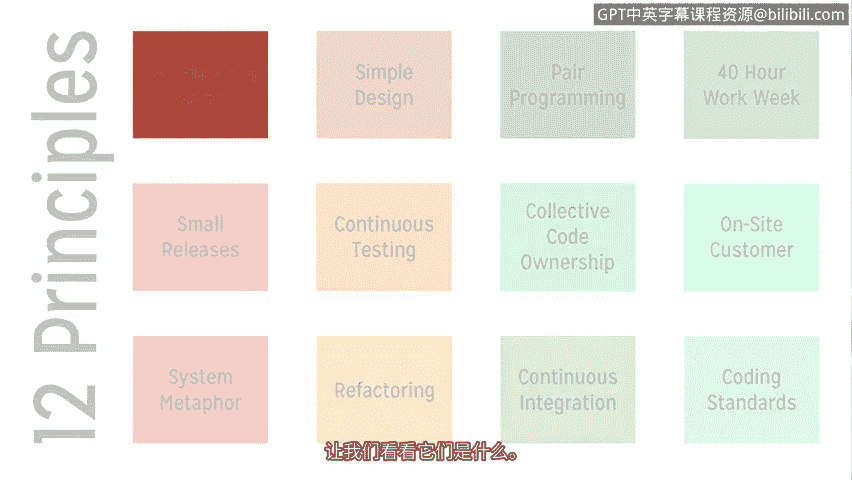
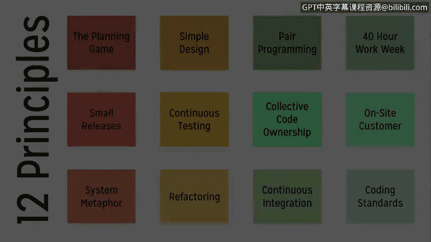
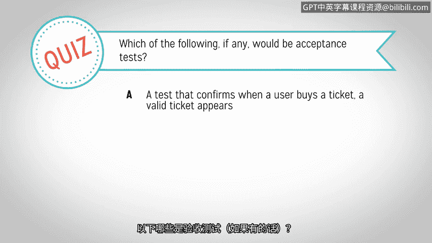
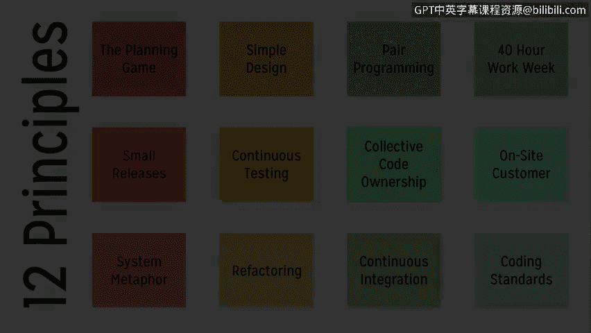
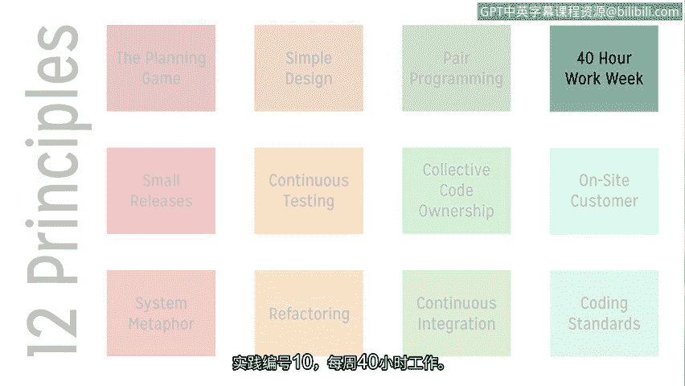

# 015：极限编程 🚀

在本节课中，我们将要学习极限编程的核心实践。极限编程是一种敏捷软件开发方法，它强调客户满意度、团队协作和快速响应变化。我们将逐一探讨其12项基本实践，并理解它们如何共同作用以提升软件开发的效率与质量。

## 极限编程简介

极限编程通常简称为XP。它之所以被称为“极限”，是因为它将许多良好的软件开发实践推向了极致。XP的核心目标是实现客户满意，这意味着开发团队的首要任务是尽可能让客户感到高兴。同时，它也重视持续交付软件、响应变化、高效团队合作和自我组织，这些原则都体现在敏捷宣言中。

## 极限编程关注的五个方面

极限编程着重于改进开发的五个方面：沟通、简单性、反馈、尊重和勇气。沟通、简单性和反馈在敏捷宣言中已有涉及。而“尊重”意味着在XP中，客户、产品经理和开发团队的所有成员都被视为平等的，每个人的贡献都受到重视。“勇气”则意味着团队要坦诚面对进度和估算，不畏惧变化，并且因为团队协作而敢于承担经过计算的风险。

## 极限编程的12项实践

以下是构成极限编程框架的12项基本实践。它们像拼图一样，单独看可能意义不大，但组合在一起就能形成高效的工作流。

### 实践一：计划游戏

这是指客户与开发团队共同规划产品的过程。它可以发生在不同规模上，例如在开发初期有一次大型计划会议，而在每次迭代后则可能有更小型的会议。

计划游戏的规则通常如下：
1.  客户和开发团队共同列出产品的新功能列表，每个功能都以用户故事的形式表达。
2.  开发团队估算在下一个迭代中可以投入的工作量，以及完成每个用户故事所需的工作量。
3.  客户和开发团队共同对用户故事进行优先级排序，并决定每个功能的可工作版本的发布时间。

### 实践二：小版本发布

在极限编程中，我们希望版本发布尽可能小而频繁。开发团队需要与客户一起规划哪些功能具有商业价值并可以尽早发布。目标是尽早开发重要功能，以便有更多时间进行完善。发布版本尽可能小，也使得估算更容易，因为预测一两周的工作比预测一个月的工作要简单得多。

### 实践三：系统隐喻

系统隐喻旨在让你的系统更容易向他人解释。你应该能够轻松地向没有技术经验的第三方解释你的产品。一个好的隐喻能够清晰地传达产品的核心功能。例如，一个人脸识别应用可以被比喻为“派对上的社交达人，认识在场的每一个人并了解他们的所有信息”。

### 实践四：简单设计

这意味着你的设计应尽可能简单。由于需求会不断变化，为那些可能不会持久的东西做详细设计是没有意义的。只设计你今天正在处理的需求所需的内容，不要为可能不会到来的未来进行过度设计。

### 实践五：持续测试

在极限编程中，测试是在编写源代码之前为功能或需求编写的。其核心思想是将这些测试作为需求的可执行形式。这样，当测试通过时，你就知道相应的需求得到了满足。这被称为测试驱动开发。

XP中有两种测试方式：
*   **验收测试**：由客户执行，用于测试产品的每个功能是否按规范工作。这些测试覆盖产品的较大范围，可以是自动化的，也可以是人工遵循的用户界面操作脚本。
*   **单元测试**：由开发人员编写的自动化测试，用于测试较低层次的功能。例如，对于一个允许用户创建、编辑和删除帖子的社交媒体应用，需要有测试来确认这些操作是否成功执行。

### 实践六：重构

重构是指在不改变代码行为的前提下，重新调整代码的设计结构。它改善了设计，使得新功能可以更容易地添加，从而鼓励团队响应新的变化。例如，重构包括移除重复和不必要的代码。由于开发人员编写了单元测试，他们可以自信地删除代码而不会破坏产品。如果删除后测试仍然通过，就说明那是多余的代码。

### 实践七：结对编程

结对编程是XP广为人知的实践之一，指两名开发人员并排坐在一台计算机前共同编写代码。这将代码审查推向了极致——代码时刻都由配对的另一人进行审查。虽然这看似需要双倍人力资源，但实际上，两名程序员合作产生的成果通常超过两名程序员独立工作的总和，且质量更高。这也反过来培养了“勇气”，因为程序员在一起工作时更愿意承担经过计算的风险。

### 实践八：集体代码所有权

这项实践鼓励整个开发团队为产品的任何部分贡献新想法。这意味着任何人都可以向产品的任何部分添加代码。当出现问题时，这是团队的结果，而非个人的责任；同样，当成功时，也是团队的成功。

### 实践九：持续集成

持续集成要求开发人员频繁地合并代码。这可能每天至少发生一次，但要达到“极限”的程度，发生的频率应该更高。在集成之前和之后，所有的测试都应该100%通过。

### 实践十：每周40小时工作制

尊重开发人员的工作与生活平衡似乎显而易见，但对于一群充满热情的开发者来说，可能很难让他们离开键盘。XP允许在项目紧要关头有一周的加班时间。如果连续数周都需要加班，那就是项目管理出现问题的危险信号。

### 实践十一：现场客户

这项实践邀请客户成为开发团队的一部分。客户始终在场，可以澄清和回答开发过程中出现的任何问题。他们参与到开发的每个阶段中。

### 实践十二：编码标准

这意味着所有开发人员都遵循相同的编码标准。你不应该通过看代码就能分辨出是谁写的。相反，你应该鼓励开发团队遵循共同的编码约定，并以相同的方式格式化代码。这个标准应在开发初期就达成一致。这不仅使代码更易于阅读，也鼓励了集体所有权。

## 总结

本节课中，我们一起深入学习了极限编程的核心理念与12项关键实践。从强调客户合作的“计划游戏”和“现场客户”，到追求技术卓越的“简单设计”、“持续测试”、“重构”和“结对编程”，再到保障团队可持续性的“小版本发布”、“集体代码所有权”、“持续集成”和“每周40小时工作制”，这些实践共同构建了一个高效、响应迅速且以人为本的敏捷开发框架。理解并应用这些实践，将帮助你作为软件产品经理更好地领导团队，交付令客户满意的高质量软件产品。