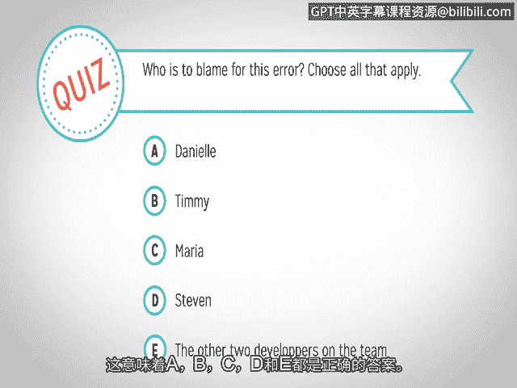

# 016：极限编程实践与反思

在本节课中，我们将通过一个具体的案例来探讨极限编程的核心实践，分析其背后的管理原则，并审视这种敏捷方法在实际应用中的优势与挑战。

---

丹妮尔是一名产品经理，她与一个五人开发团队合作，共同开发一款允许小企业主向员工支付工资的薪酬应用程序。在交付了一个原型后，客户向开发团队发送了一封措辞严厉的电子邮件，指出应用程序中存在一个计算工资错误的缺陷。客户对此非常不满，因为这个错误会让企业主损失大量金钱，并导致员工获得超出其应得的报酬。

编写此功能单元测试的程序员是蒂米和玛丽亚。结对编写源代码的程序员是斯蒂芬和玛丽亚。产品经理丹妮尔在产品发布前进行了验收测试。

谁应该为这个错误负责？请选择所有适用项。
A. 丹妮尔
B. 蒂米
C. 玛丽亚
D. 斯蒂芬
E. 团队中的其他两名开发人员

极限编程的一项实践是**集体所有制**。这意味着团队所有成员都对发生的错误负有责任。因此，每个人都有过错。这意味着 A、B、C、D 和 E 都是正确答案。如果客户对产品非常满意，整个团队也将共享成功的荣誉。

---

上一节我们通过案例理解了集体所有制的含义，本节中我们来看看极限编程实践的其他表述方式。

我之前提到，极限编程传统上由12项基本实践来描述。然而，根据你查阅的资料，这些实践可能有不同的表述方式。唐·威尔斯是极限编程规则第一版的作者。他没有列出12项实践，而是提出了29条极限编程规则。其中许多规则与我们刚刚讨论的12项实践重叠，或者结合了Scrum中的许多实践。不过，也有一些管理实践不属于上述任何类别，值得注意。

以下是其中几项关键的管理实践：

*   **提供专用的开放式工作空间**：回想一下你以前工作过的环境。你认为它们提升了你的生产力和团队合作吗？极限编程建议工作空间应配备多台不属于任何个人的电脑，这些电脑应放在房间中央而不是靠墙。这鼓励开发团队一起工作。还应该有一个配备白板的会议桌，供团队协作和头脑风暴。

*   **轮换人员**：这鼓励沟通和灵活的工作关系。这意味着每个人都了解如何开发和操作产品的所有部分。试想，如果只有一个人知道某个功能如何工作，将对项目造成多大的损害。当他们离开时会发生什么？你的开发工作将出现空白。轮换人员的替代方案是对功能进行大量文档记录，但这不是敏捷的方式。你不会组建一支没有替补守门员的职业足球队。同样，项目的成功不应依赖于某一个人。在体育或开发中，最有用的团队成员是那些掌握多种技能的人。

*   **适时修正极限编程本身**：即“当它出问题时，就修复它”。你可能注意到这里说的是“当”而不是“如果”，因为它必然会出问题。它不会在你产品的整个生命周期中都一帆风顺。并非所有极限编程实践都适合你的团队。当某些方法不奏效时，就改变它。你应该让团队遵循规则，直到规则不再适用。频繁的项目回顾会议是确定哪些方法有效、哪些无效的好方法。

---

现在，让我们通过另一个场景来检验对极限编程实践的理解。

你被一家自称已精确实施极限编程方法的公司聘用。你走进工作场所，看到的是一片隔间迷宫。你在工作区走动并向隔间内窥视，看到成对的程序员在一起工作。你走进一个隔间，询问开发人员在哪里可以找到客户。一名开发人员递给你一张印有客户电话号码的名片。他说你可以在那里留言，客户会回复你。

你走进下一个隔间，询问在那里工作的两名程序员下一次发布何时到期。他们告诉你每两个星期五发布一次，本周五就有一个发布。你问这些程序员他们在做什么，他们解释说他们是数据库团队，专门负责维护和构建数据库。

你意识到他们在许多方面都没有正确遵循极限编程。为了让极限编程在这个办公室精确运行，你需要改变哪些开发领域？
A. 工作空间
B. 结对编程
C. 客户可用性
D. 小型频繁发布
E. 开发人员多能性

极限编程的工作空间环境是开放的，鼓励协作。隔间迷宫不符合这项实践。客户也应随时可用。难以联系的客户不利于有效沟通。最后，开发人员应该轮换工作，而不是专攻某一功能。让两名开发人员专门负责数据库工作不符合极限编程。因此，A、C 和 E 是正确答案。这家公司并非完全偏离轨道，他们确实进行了结对编程并交付小型频繁发布，这些都是良好的极限编程实践。

---

既然你已经熟悉了极限编程的规则，现在我们来谈谈它的一些缺点。

极限编程的一个缺点是**需要全有或全无的方法**。如果你为开发团队采用极限编程，鼓励你采用所有规则以获得全部收益。是的，我确实提到可以改变不起作用的方面，但到什么程度它仍然算是极限编程？当一半的实践都不适合你的团队时会发生什么？单个实践的价值不如整体方法论。但有时实施所有实践既不实际也不可能。

极限编程的另一个弱点是**它专为小型开发团队设计**。当你的开发团队超过20人时会发生什么？你会在集体所有制和集成方面遇到许多问题。

此外，极限编程**缺乏前期规划**。与其他方法论相比，极限编程不鼓励真正的软件架构前期规划，这可能导致未来大量的返工。

还有**结对编程**。它确实有很多好处，但并未像其他实践那样被广泛采用。我可以保证它不会适用于所有团队，性格冲突将是一个重要因素。

最后，**安排现场客户很困难**。让客户按照极限编程要求的时间全程参与并不常见。期望客户在每次出现问题或疑问时都在场通常是不现实的。在理想世界中，客户始终在场当然很棒，但这是真实的软件开发，事情往往远非理想。

---

极限编程为软件开发概述了许多优秀的实践，但这个过程也有许多缺点。作为一名产品经理，你需要找到适合你团队的实践。你需要进行实验。也许极限编程完全适合你，也许不适合。这就是为什么你必须研究多种方法论，以便为你的团队找到合适的方法。你需要收集数据来支持哪些实践对你有用。

基于这一点，在下一课中，你将转向另一种名为Scrum的方法论。

---

本节课中我们一起学习了极限编程的集体所有制原则、关键管理实践（如开放式工作空间和人员轮换），并通过案例分析识别了正确与错误的实施方式。最后，我们客观地探讨了极限编程的潜在缺点，包括其对全盘采纳的依赖、团队规模限制以及客户参与的挑战。理解这些优缺点有助于你作为产品经理在实践中做出更明智的决策。