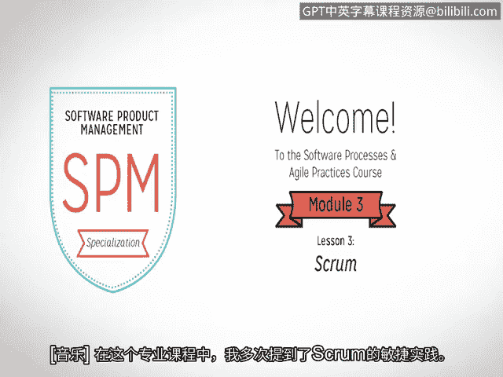
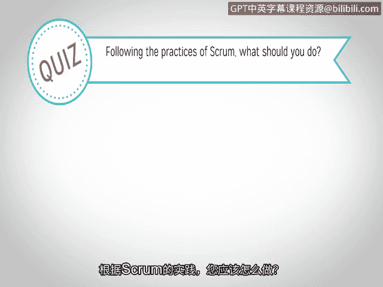
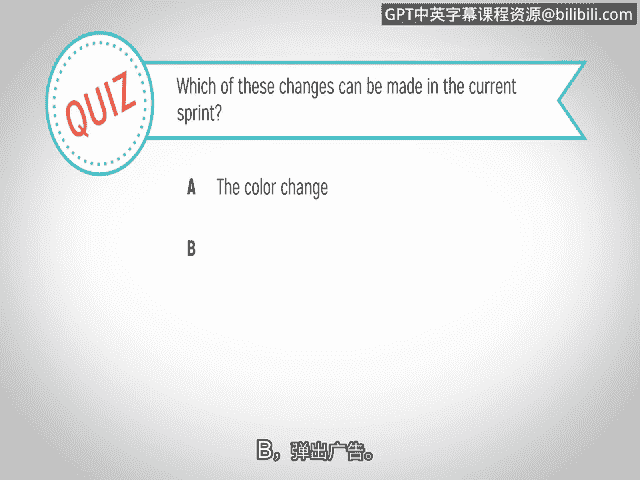
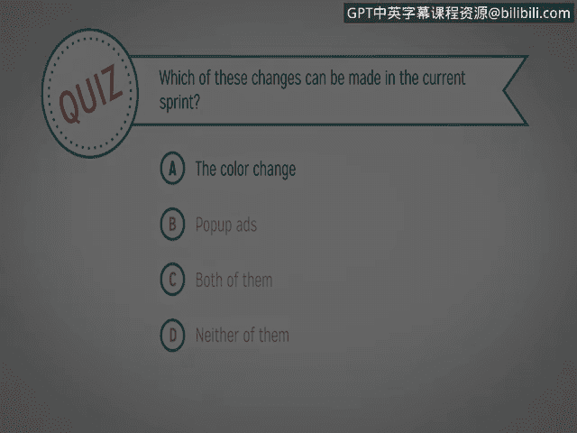

# 017：Scrum敏捷实践

在本节课中，我们将学习Scrum的基本结构和实践。Scrum是一种轻量级的敏捷实践方法，在本专项课程中已被多次提及。你将获得对Scrum框架的基本理解，并了解其核心角色与事件。后续课程将深入探讨具体的Scrum技术。

## 什么是Scrum？🤔

Scrum是一种轻量级的实践方法，它不会占用太多生产时间，管理开销也相对较小。Scrum易于理解，但难以精通。

Scrum采用**迭代**和**增量**式的方法。这意味着团队会频繁评估产品进展，从而增强可预测性并降低风险。

Scrum建立在三大支柱之上：**透明**、**检视**和**适应**。

## Scrum的三大支柱 🏛️

上一节我们介绍了Scrum的基本概念，本节中我们来看看支撑Scrum的三大核心支柱。

### 1. 透明

透明意味着项目的每个部分对所有人都是可见的。这种可见性不仅限于Scrum团队内部，也适用于团队外部人员。透明的一个重要部分是就项目的通用标准达成一致，包括在整个开发过程中使用统一的术语，以及对“完成”的定义达成共识。我们将在本节课后面讨论“完成”的含义。

### 2. 检视

Scrum鼓励频繁检视工作产品和进度，以便及时发现与预期的偏差。Scrum培训师兼作者肯·施瓦伯曾比喻说，Scrum就像你的岳母，它会指出你所有的缺点。开发人员有时对采用Scrum犹豫不决，正是因为它会指出所有做得不对的地方。这些检视应该频繁进行，但不能频繁到干扰开发任务。

### 3. 适应

在检视过程中，如果发现产品开发开始偏离愿景，团队必须进行调整和适应，以防止进一步偏离。Scrum为检视和适应规定了四种具体的技术，它们分别是：**冲刺计划**、**每日站会**、**冲刺评审**和**冲刺回顾**。你将在关于敏捷规划、评审和度量的课程中学习这些技术。

## Scrum团队的角色 👥

前面提到了Scrum团队，现在我们来详细了解其中的一个关键角色：产品负责人。

产品负责人的主要任务是什么？A. 从商店购买产品；B. 为产品的创建付费；C. 负责做出关于产品的决策；D. 组织开发团队以提高效率。

产品负责人是Scrum中的一个角色，我们将更详细地研究它。他们的主要任务是就产品和产品待办事项列表做出决策。因此，C是正确答案。

一个Scrum团队由**产品负责人**、**开发团队**和**Scrum主管**组成。

你刚刚了解到，产品负责人负责对产品和产品待办事项列表做出决策。他们对产品待办事项列表中的需求进行优先级排序，并决定实际要构建什么。你将在关于客户需求和软件需求的课程中学习产品待办事项列表。

产品负责人是一个人，而不是一个委员会。产品负责人可以代表一个委员会，但只有产品负责人才能对产品实施变更。产品负责人的职责是为Scrum团队提供明确定义的产品待办事项列表，并对其进行优先级排序。产品负责人指定的优先级必须得到尊重并按该顺序进行开发。他们对开发什么拥有最终决定权。产品负责人还有责任确保开发团队理解待办事项列表中各项功能的预期要求。

## 实践场景：如何处理变更请求？💼

假设你是一名软件产品经理，受雇于一家大型运动服装公司，为其开发一款跑步应用。在第一次与开发团队及公司代表Penny的会议中，团队决定使用Scrum，Penny被任命为产品负责人。

开发进行到一半时，你收到了公司CEO的电子邮件，他要求增加预制的跑步歌单功能，供用户跑步时收听。你知道开发团队已经和Penny讨论过这个功能，并且团队共同决定不实现这个功能，而选择实现另一个功能。

遵循Scrum实践，你应该怎么做？A. 回复邮件说“不，你在这个项目中没有发言权”；B. 告诉你的开发团队将该功能添加到待办事项列表中；C. 告诉你的开发团队在当前迭代中开发该功能；D. 回复邮件，要求所有功能请求都通过Penny提出。

在Scrum中，所有关于产品的决策都必须来自产品负责人。这是否意味着你要拒绝公司CEO？不，那不符合商业常识。最好的做法是礼貌地回复CEO，并抄送产品负责人Penny，要求所有功能请求都通过产品负责人提出。设置单一联系点的目的是减少沟通失误。来自多个来源的过多指示会导致开发团队困惑，并很可能浪费开发时间和资源。在确认产品负责人确实需要此功能之前，你不应将其提交给开发团队。因此，D是正确答案。

## Scrum开发团队的特点 🛠️

现在，让我们看看Scrum开发团队的一些特点。

Scrum开发团队是**自组织**的。这意味着没有人，甚至是Scrum主管，都不能告诉团队如何将他们的功能待办事项转化为可工作的软件增量。

Scrum开发团队也是**跨职能**的。这意味着团队拥有完成产品所需的所有人员和一切资源。这可能包括来自不同领域的专家。团队不应依赖任何非团队成员。此外，团队成员承担多种任务，例如同时进行编码和测试，而不是有专门的编码人员和测试人员。

因此，开发团队的成员没有头衔。他们只应被称为“开发者”或直呼其名，无论他们是否负责特定任务。Scrum开发团队中也没有子团队。开发者可能在团队内拥有专业技能，但责任属于整个团队。

Scrum开发团队规模较小。理想情况下，团队规模大于3人，小于9人。Scrum主管和产品负责人不计入此人数，除非他们也参与开发工作。一个经验法则是，你应该能用两张披萨喂饱整个团队。披萨也有助于提升团队士气。

## 实践场景：识别真正的Scrum团队 🧐

假设你在一个关于Scrum实践的会议上，与几位其他软件产品经理谈论他们的开发团队。

*   第一位SPM名叫Kelsey。她描述她的团队有四名程序员、两名测试员和一名用户界面设计师。
*   接下来，你遇到了Jim。他说他目前的团队由20名开发人员组成。
*   然后你遇到了Billy。他简单地说他有一个由七名开发人员组成的才华横溢的团队。
*   接着你遇到了老朋友Carrie。她说她的团队有九名开发人员，其中五人在开发团队，四人在测试团队。
*   最后，你遇到了一位新的软件产品经理Hillary。她说她的团队只有三名开发人员，并且他们将测试工作外包了。

这些软件产品经理中，谁拥有真正的Scrum开发团队？A. Kelsey；B. Jim；C. Billy；D. Carrie；E. Hillary。

这些都是你常见的开发团队例子。然而，只有Billy拥有真正的Scrum开发团队。他的团队没有头衔或子团队，并且是跨职能的，规模也合适。Kelsey的团队有头衔，Jim的团队规模太大，Carrie的团队有子团队，Hillary的团队不是跨职能的，因为他们将测试外包了。因此，C是唯一正确答案。

## Scrum主管的角色与Scrum事件 ⏰

最后，我们来谈谈Scrum主管的角色。Scrum主管的职责是确保Scrum团队遵循Scrum理论、实践和规则。他们对产品负责人和开发团队都有具体的职责。

Scrum主管对产品负责人的职责包括：寻找管理待办事项列表的技术；帮助Scrum团队理解清晰简洁的待办事项列表的必要性；确保产品负责人知道如何对待办事项列表进行优先级排序以获得最大价值；以及促进Scrum事件。

Scrum主管对开发团队的职责包括：指导团队自组织；移除开发障碍；以及促进Scrum事件。

那么，Scrum主管负责促进的这些Scrum事件是什么呢？这些Scrum事件包括之前提到的用于检视和适应的四种技术：**冲刺计划**、**每日站会**、**冲刺评审**和**冲刺回顾**。同样，你将在专项课程中更详细地了解这些事件。

所有这些事件都是**时间盒**的，这意味着你需要为这些事件的持续时间指定一个最长时间，并遵守它。这背后的理念是保持分配的时间并调整范围，而不是保持范围并最终延迟发布。

另一个Scrum事件是**冲刺**。冲刺是一个特定时间段的开发阶段，在此阶段内向客户交付一个可工作的原型。这些冲刺也是时间盒的，但执行更严格。一个冲刺持续一个月或更短时间，通常是一到两周。一旦你的Scrum团队确定了冲刺的长度，在整个开发过程中必须始终保持这个长度。冲刺不能变长或缩短。在每个冲刺结束时，向客户交付一个可工作的原型。每个冲刺包含我前面提到的四个Scrum事件。

*   **冲刺计划**发生在当前冲刺开始时，以确定在该冲刺中将完成什么。
*   **每日站会**是每天举行的会议，通常在每个工作日的开始进行，以便开发人员讨论他们将做什么任务以及需要什么来完成这些任务。
*   **冲刺评审**和**冲刺回顾**在冲刺结束时进行。

在冲刺期间，不能进行会影响**冲刺目标**的变更。冲刺目标是对该冲刺将要完成内容的大局观。会改变冲刺目标的建议将进入待办事项列表，如果产品负责人决定，可以在下一个冲刺中实施。

## 实践场景：冲刺中的变更管理 🔄

假设你的团队正在开发一款移动应用，允许用户搜索当地餐厅的食品和饮料特价。本次迭代的冲刺目标是设置用户界面，即最终用户将看到并与之交互的一切。

冲刺进行到一半时，客户发来电子邮件说他们改变了主意。他们希望应用程序的主色调是蓝白色，而不是红黑色。这对开发团队来说是一个快速的修改。客户还要求应用程序现在支持在屏幕上弹出广告。

这些变更中哪些可以在当前冲刺中进行？A. 颜色变更；B. 弹出广告；C. 两者都可以；D. 两者都不可以。

更改应用程序颜色是一个不影响冲刺目标的微小变更。因此，该变更可以在冲刺中期实施。添加弹出广告需要更多的开发工作，并且不符合冲刺目标。这应该被添加到产品待办事项列表中，并在未来的冲刺中重新考虑。因此，A是正确答案。

## “完成”的定义与Scrum实践要点 ✅

Scrum的一个重要部分是**“完成”的定义**。在冲刺结束时交付的可工作原型必须是“完成”的。定义决定产品何时“完成”的质量标准是开发团队的责任。

通常，当一个功能被**编码**、**测试**和**文档化**后，才被认为是完成的。团队必须就“完成”的含义完全达成一致。如果你回想一下敏捷宣言，进度应该通过已完成的功能来跟踪。这样做的目的是避免工作处于半完成状态。这可能导致团队独立工作，看起来很忙，却没有完成任何可用的东西。完成一个功能需要沟通、集成和同步。这有时要求开发进展缓慢，以确保每个功能真正完成。

与极限编程类似，Scrum的支持者推荐一种“全有或全无”的方法。然而，Scrum实践可以单独实施，因为它们比一些XP实践更具独立性。但如果你单独实施这些实践，那么你并不是在实践Scrum。真正的Scrum要求完整地实践其全部内容。

正如我在介绍性课程中提到的，许多大型科技公司如Adobe、Amazon、Microsoft和Yahoo都使用Scrum。如果你想了解更多关于Scrum的信息，可以访问scrumguides.org。请查看课程资源以获取最新链接。

尽管Scrum是一种流行的方法论，但它仍然存在一些缺陷。你认为Scrum有哪些缺点？请在课程讨论中谈谈你的看法。在下一个模块中，你将继续研究更多的实践和方法论。

## 总结 📝

本节课中，我们一起学习了Scrum敏捷实践的核心内容。我们了解了Scrum的三大支柱（透明、检视、适应），认识了Scrum团队的三个关键角色（产品负责人、开发团队、Scrum主管）及其职责，探讨了Scrum开发团队自组织、跨职能和小规模的特点。我们还学习了关键的Scrum事件，如冲刺、冲刺计划、每日站会等，以及“完成”的定义的重要性。通过几个实践场景，我们加深了对Scrum原则在实际中如何应用的理解。Scrum是一种强大的框架，但需要完整实施才能发挥其最大效用。