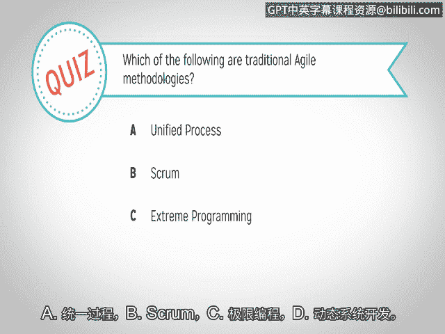
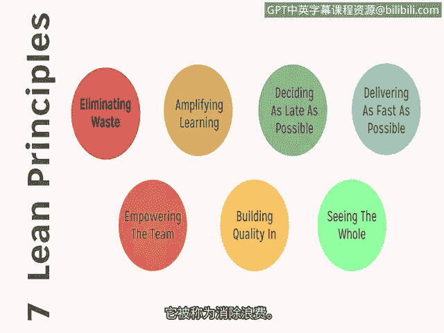
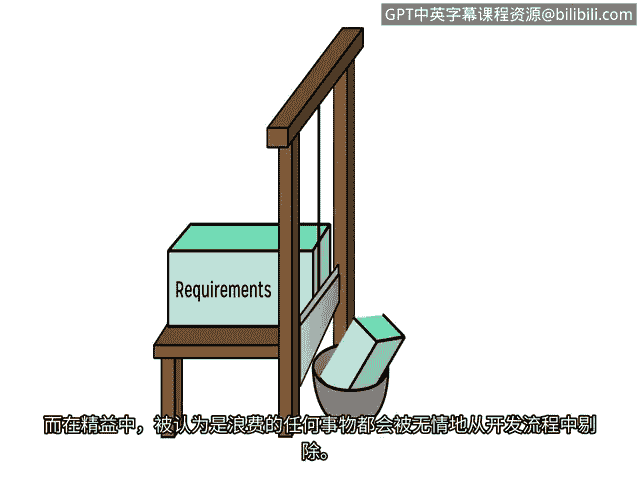
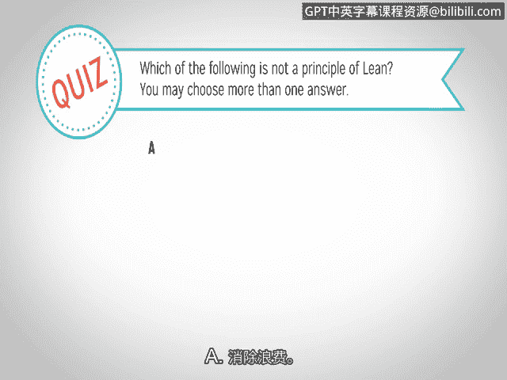

# 018：敏捷变体与精益软件开发 🚀

在本节课中，我们将要学习敏捷开发方法的一些变体，并重点介绍一种日益流行的实践——精益软件开发。上一模块我们讨论了极限编程和Scrum等主流敏捷实践。本节中，我们将看看其他敏捷变体，并深入了解精益软件开发的核心原则。

## 敏捷的演变与变体

敏捷方法始终在变化和演进。总会有新的实践或变体出现，以改进先前方法的不足之处。虽然Scrum目前应用广泛，但在未来几年或特定领域，其他敏捷变体也可能变得流行。

以下是几种从敏捷思想中演化出来的其他实践：

*   **敏捷统一过程**：如其名称所示，它结合了统一过程和敏捷实践。它使用并行开发阶段，同时融入敏捷理念以提高开发人员士气和项目协作。它注重遵循流程而非特定工具，强调简洁性、赋能团队以及根据项目需求定制方法。
*   **动态系统开发方法**：这是另一种敏捷变体。
*   **特性驱动开发**：同样属于敏捷变体范畴。
*   **ScrumBan和行为驱动开发**：也是敏捷的变体。

关键在于，敏捷存在许多变体。如果在流程中遇到问题，敏捷允许你根据需求进行调整，以适应特定的流程、方法或实践。例如，如果你发现现有方法在软件产品架构或测试方面效果不佳，可以尝试上述变体，看看是否更适合你的团队。

## 精益软件开发简介

近年来，有一种敏捷开发方法论获得了极大的关注，预计其流行度在未来几年将持续增长。这种方法论就是**精益软件开发**。

精益软件开发起源于制造业。“精益思维”的概念在90年代中期被提出，旨在通过减少浪费、仅在必要时开始新工作、减少流程瓶颈以及只专注于为项目增加价值的工作来降低项目风险。丰田公司采用了这种方法，“精益制造”一词自此与其制造流程紧密相连。

2003年，Mary和Tom Poppendieck撰写了一本书，致力于将精益制造原则应用于软件开发。这本书被广泛认为是精益软件开发普及的重要原因。

那么，什么是精益？**精益是一种思维方式**。它是一套核心原则，旨在降低项目风险，并快速向客户交付高质量产品。

## 精益软件开发的七大原则

精益软件开发包含七项原则。我们将逐一探讨这些原则。

第一项精益原则受到的关注最多，它被称为**消除浪费**。

在精益中，任何不增加价值的事物都被视为浪费。而在精益实践中，任何被视为浪费的事物都会被无情地从开发流程中移除。

为了理解软件中可能存在的浪费，让我们回顾一下精益的制造业起源，做一个类比。假设你是一家汽车制造厂的经理。工厂的每个部分专门制造汽车的每个部件。如果每个部件都以其最大产能持续生产，很快你就会拥有大量过剩的部件（例如车轮），它们会占用存储空间，并且当车型更新时可能变得完全无用。这显然是巨大的浪费。

如果认为这种情况不适用于软件开发，那就太天真了。你的“生产”是基于代码，你的“机器”是软件开发者。如果团队中的每个开发者时刻都处于忙碌状态，你可能会发现他们变得低效。通过让开发团队不断编写新代码，而不是专注于核心功能，你可能会得到大量额外功能。这些功能可能会降低最终产品的质量、引发主要产品的问题，或者最终根本不会被整合到产品中。这是软件生产可能造成浪费的一个关键例子。

除了过度生产，软件开发的浪费还可能通过以下方式产生：
*   流程延迟
*   不必要的会议
*   不清晰的需求
*   产品缺陷

---

第二项原则是**强化学习**。软件开发是一个探索和发现的过程。团队需要通过短迭代、持续集成和反馈循环来快速学习和适应。

第三项原则是**尽可能延迟决策**。在掌握足够信息之前，避免做出不可逆转的决策。这允许团队保持灵活性，并根据最新的知识和市场变化做出更明智的选择。

第四项原则是**尽可能快速交付**。快速交付可工作软件可以尽早获得客户反馈，验证假设，并实现价值。这通常通过小批量工作和缩短周期时间来实现。

第五项原则是**赋能团队**。信任并授权给开发团队，让他们自我组织并做出技术决策。管理者扮演服务型领导的角色，移除障碍，为团队成功创造条件。

第六项原则是**内建质量**。质量不是后期检查出来的，而是应该在开发过程的每一步中构建进去。这可以通过实践如测试驱动开发、持续集成和自动化测试来实现。

第七项原则是**整体优化**。关注整个系统和价值流，而不是局部优化。确保所有部分协调工作，共同为最终客户创造最大价值。

## 总结

本节课中，我们一起学习了敏捷方法的各种变体，并深入探讨了精益软件开发的七大核心原则。我们了解到，敏捷是一个不断发展的领域，除了Scrum和极限编程，还有如敏捷统一过程等多种实践。精益软件开发则从制造业汲取智慧，强调通过消除浪费、快速交付、延迟决策、赋能团队、内建质量和整体优化来高效、高质量地交付价值。理解这些不同的方法论和原则，将帮助你在管理软件项目时做出更明智的选择。