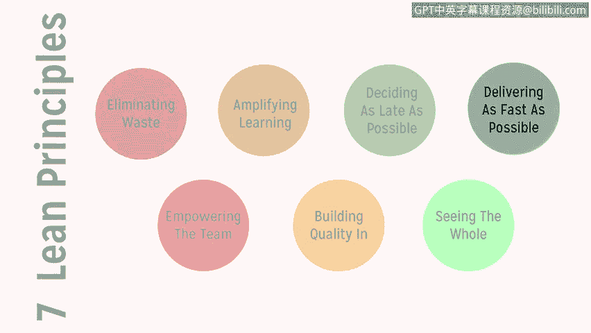

# 019：敏捷变体与精益软件开发

在本节课中，我们将要学习精益软件开发的核心原则，特别是“放大学习”、“尽可能晚做决策”和“尽可能快交付”这三个原则。我们将探讨这些原则如何帮助团队更有效地构建满足客户需求的软件产品。

## 放大学习原则

上一节我们介绍了精益软件开发的基础，本节中我们来看看其第二个原则：**放大学习**。这个原则的核心思想是，在深入投入一个想法之前，不要过早地锁定它，而应充分探索多种可能性。

这个原则相当简单。在你彻底探索另一个想法之前，不要过于深入地专注于一个想法。

在采取行动之前，通过思考各种替代方案来彻底探索想法。

以下是它在现实场景中的体现。

你的开发团队创建一个非常基础的用户需求列表，以便快速启动项目。

然后，他们可以非常简要地规划出产品的一种可能方法，并开始开发该基础功能。

当然，这在大多数流程中都很常见。然而，为了放大学习，一个好的做法是在这个阶段停下来，不要在这个版本上做更多工作。😡，问问自己，这件事可以用另一种方式完成吗？如果可以，你的开发团队也应简要规划和开发这些替代方案。

通过允许产品的功能集以这种方式进行调整，你的产品就有最大机会以最令人满意的方式满足客户的需求。😊。

但这并非在软件产品中放大学习的唯一方式。

精益软件开发鼓励在产品每次构建后运行集成测试和单元测试。

这里的理由不仅是为了确保代码编写良好。

测试也可以是学习产品应如何运行的绝佳方式。

测试可以为你的团队带来关键见解，这些见解可用于指导产品的其他版本和未来规划。

在精益软件开发中，这发生在非常短的迭代中。

这里的理念是快速失败并快速学习。此外，如果你在一个设计或一个功能上花费太多时间，你可能会很容易发现自己对一个设计投入过多，以至于无法真正看到其缺陷并考虑其他更好的方法。

精益软件团队被鼓励放大学习的另一种方式，是以一种特殊的方式让客户参与整个开发过程。

开发团队不仅应在专注于一个版本之前创建产品的不同版本，还应不断将这些版本呈现给客户。

这使得开发团队能够通过试错来了解客户的真实需求。

这也让客户能够学习他们希望产品如何解决其特定问题。

在开发过程中，这些需求应不断细化，以保持可行性。

这类似于自然选择，因为许多潜在方法被呈现给客户。

这使他们能够决定希望在产品中构建哪些功能，从而为最终产品带来聚焦和精炼。

因此，通过让客户参与尝试不同的方法，你的开发团队学会了如何最好地解决他们的特定问题。

这带来了更好的软件和更满意的客户。这比你的开发团队不考虑替代设计而直接埋头苦干要好得多。

所以，放大学习的要点是确保你的团队通过开发替代方案、持续反馈和精炼来构建正确的产品。

奥黛丽正在与她的开发团队使用精益软件开发实践构建一个软件产品。她要求她的开发团队在为客户创建不同替代方案时，一次只专注于项目的一个方面。

通过要求她的团队一次只专注于项目的一个方面，奥黛丽正在实施精益的哪个原则？A. 开发小型增量发布。B. 放大学习。C. 专注于频繁交付。或 D. 消除浪费。

答案是 D. 消除浪费。让团队构建不同替代方案是奥黛丽正在做的**放大学习**。

开发小型增量发布和专注于频繁交付是敏捷的原则，而非精益的原则，尽管精益项目当然可以利用它们。

## 尽可能晚做决策原则

接下来，我们探讨第三个精益软件开发原则：**尽可能晚做决策**。现在，这看起来可能像是为争取更多开发时间而延迟产品的借口。但我向你保证，事实恰恰相反。这个原则实际上很好地承接了“放大学习”的理念。

想象一个软件团队为客户构建了一个基础的软件片段。客户看到这个原型后说，是的，这正是我需要的。就按这个做。

很明显，沿着这个初始原型设定的路线继续下去会满足客户，对吧？然而，在你决定之前，请考虑这一点。作为一个精益软件开发团队，开发团队探索了不同的方法以放大学习。

他们知道客户认为他们的原型足以满足需求。因此，团队询问客户这个原型的哪些特性具有吸引力？

基于这些信息，团队继续构建产品的替代版本，整合客户喜欢原型的地方。

在完成了产品的几个更多版本后，客户审视一切并判断原始原型已不再适用。它有一些对最终产品很好的特定功能，但一个替代版本将更好地满足他们的需求。

因此，开发团队回到工作岗位，利用这个反馈将原始原型的特性整合到新版本中。现在，团队拥有了比最初更精炼的产品版本。

客户审视后比以前任何时候都更满意。这个版本似乎真的切中要害。开发继续进行，团队学到了获得正确产品所需的经验教训。

如果开发团队将客户最初决定构建第一个原型视为最终决定，而不是开发更能满足客户需求的替代方案，会发生什么？

开发团队可能会构建出一个糟糕的产品。不仅如此，他们甚至不会知道自己正在构建一个糟糕的产品。

这就是“尽可能晚做决策”背后的核心理念。它不是关于延迟任何事情或争取时间，而是关于在所需数据和信息可用时才做出决策。

例如，你努力确保存在许多替代方案。在信息不足时做出的决策必然导致糟糕的结果。

尽可能晚做决策确保你先拥有所需的信息。

## 尽可能快交付原则

还记得我说过“尽可能晚做决策”与延迟开发恰恰相反吗？这个原则真正巩固了这一理念。实际上，“尽可能快交付”这一原则与“尽可能晚做决策”密切相关。

我的意思是：当尽可能晚做决策时，开发团队向客户呈现了许多不同的方法。这使得开发团队能够获得必要的客户反馈，从而专注于客户的需求。

然而，如果开发团队花费三个月来开发每个潜在的原型，会发生什么？假设有四个替代方案，每个耗时三个月。那是在做出任何最终产品或决策之前整整一年的时间。谁愿意等待一整年才做出最终决定？

这就是为什么精益软件开发以短而快速的迭代运作。构建一个基础产品，确保它能工作，然后将其交付出去，再考虑下一步。没有填充物，没有不必要的工作，没有浪费。

通过以短周期运作，你的产品不仅以快速的速度演进，还允许客户在整个过程中频繁地提供反馈。

当客户改变对某个功能的看法时会发生什么？如果构建包含该功能的原型需要三个月，那么该功能在那整个时间段内都是错误的。谁知道还有什么其他部分可能依赖于它。然而，如果开发以快速迭代进行，这个问题就能及早发现并纠正。

这最大限度地减少了浪费，并快速提高了构建到产品中的质量。因此，通过快速构建产品，你的软件得以快速成长。😊。但它也通过专注于最终会保留的产品部分，确保你高效地做到这一点。

## 总结

本节课中我们一起学习了精益软件开发的三个关键原则：“放大学习”、“尽可能晚做决策”和“尽可能快交付”。我们了解到，**放大学习** 鼓励探索多种方案并从反馈中学习；**尽可能晚做决策** 强调在信息充分时再做关键决定，以避免错误；而 **尽可能快交付** 则通过短周期迭代来加速产品演进、减少浪费并快速响应变化。这些原则共同作用，帮助团队更灵活、更高效地构建出真正满足客户需求的优质软件产品。