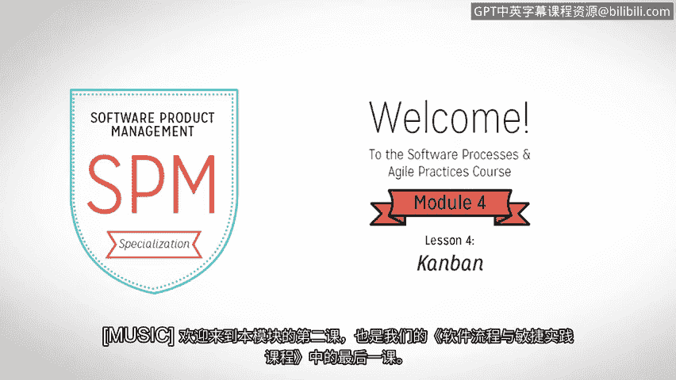
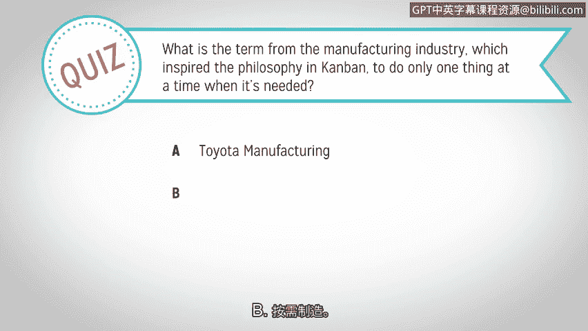
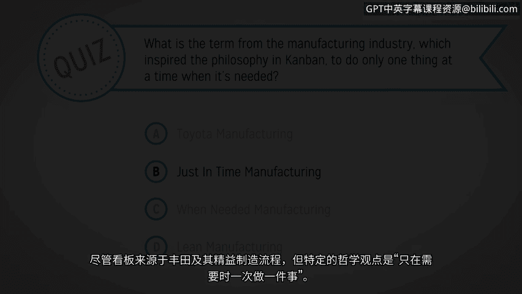
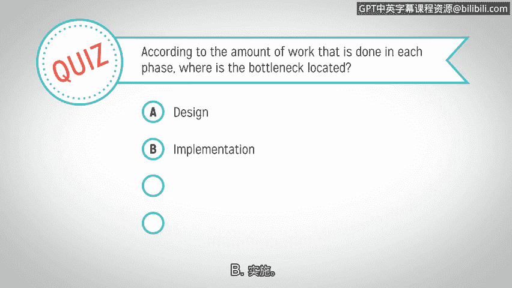

# 022：看板 🗂️

在本节课中，我们将学习看板方法。看板是一种源自精益制造的实践，旨在实现“准时化生产”，并通过可视化工作流程、限制在制品数量来优化效率。我们将了解其核心概念、运作方式以及如何应用于软件开发。

---

在上一节中，我们介绍了精益软件开发的主要主题和原则。本节中，我们将探讨精益开发中使用的一种具体方法——看板。

看板是与精益制造共同发展起来的一种方法。它旨在与精益制造配合使用，但也可以独立使用。精益制造始于丰田，旨在提高产品质量，同时减少生产时间和成本。看板帮助精益流程量化系统状态，实现准时化生产的理想。

在丰田的生产车间，每个部件都有记录，并关联一个唯一的ID。当一个部件被取走用于车辆组装时，其状态会通过ID更新，相关支持流程会收到通知。这种ID系统是看板方法有效的核心。

你刚刚了解了看板的起源及其在精益软件开发中的作用。那么，看板哲学中“只在需要时一次做一件事”的理念，是受制造业哪个术语的启发？

*   A. 丰田制造
*   B. 准时化制造
*   C. 按需制造
*   D. 精益制造

答案是 **B. 准时化制造**。看板源于丰田及其精益制造流程，而“一次只做一件事，只在需要时做”的具体理念就是准时化。

---

想象车间里有一组箱子，每个箱子装一个部件，例如轮胎。在看板中，每个轮胎都被分配一个唯一的ID。工人取走一个轮胎安装到新车上，并扫描其ID。部件被取走后，箱子就空了，等待补充。

在传统车间，空箱子会直接从现有轮胎堆中补充。但正如上节课所说，这种系统效率低下，容易导致过度生产等浪费。在看板中，当一个部件被使用时，补充该部件的流程会收到通知，以便尽快制造新部件放入箱子。这种制造方法因此被称为“准时化制造”——所有事情都在需要前的最后一刻完成。

这种持续使用和补充车间箱内物品的策略，被称为“拉动式方法”。当一个箱子清空时，就产生了一个空缺，这个空缺信号会拉动后续流程。将这种方法应用于车间的所有活动，通过拉动部件，你就能洞察系统的状态。在任何时候，你都能看到需要什么、在哪里、何时需要。

如果你跟踪一项工作从一个阶段进入下一个阶段的时间，就能确定制造每个阶段完成所需的时间。由此，你可以轻松计算一项工作走完整个制造流程所需的时间。有了这些知识，你就能发现延迟所在，做出有效改变，并跟踪这些改变随时间产生的效果。

---

你可能已经猜到，看板很容易转化到软件开发领域。只需做一些改变。例如，将“箱子”替换为任务板，用任务板上的列来可视化你的流程，每一列代表一个软件开发活动。

最左边的列包含待办事项列表中的所有任务。板上接下来的列可以是开发、验收测试、内部发布阶段和生产发布阶段。这个板被称为**看板板**，是辅助看板方法可视化的常用工具。

你正在为客户开发一个连接移动应用和数据库的软件产品。每个组件都有一套基础功能和一套可以在基础功能之上构建的高级功能。移动应用的发布依赖于数据库，但一个概念验证版的移动应用可以仅使用基础功能，无需数据库连接。

根据准时化制造原则，开发该产品的最佳策略是什么？

*   A. 先开发数据库的所有功能，再开发移动应用的所有功能。
*   B. 先开发移动应用的所有功能，再开发数据库的基础功能。
*   C. 先开发数据库基础功能，再开发移动应用基础功能，然后开发数据库和移动应用的高级功能。
*   D. 先开发移动应用基础功能，再开发数据库基础功能，然后开发移动应用和数据库的高级功能。

答案是 **D**。准时化制造强调只在需要时构建组件。因此，如果你能在没有数据库的情况下创建一个可运行的移动应用原型，你的首要任务就是先做这个。如果原型证明成功，你可以在其上构建数据库和其他高级功能。这样做的理由是在设计早期发现缺陷。如果你在能够测试基础功能之前就构建了整个产品，你可能会发现那些基础功能从一开始就不需要。如果是这样，之前的所有工作就都浪费了。

---

在看板中，所有这些阶段都是协调的。如果一项工作在某列完成，它就准备好被下一列“拉动”。然而，下一列必须形成一个空位，才能允许这项工作被拉入该阶段，继续循环。这就引出了“在制品”的概念。

**在制品** 顾名思义，就是每个阶段当前正在开发的工作量。在实践看板方法时，你会发现某些阶段产生工作的能力超过了其后续阶段。这些流程中较慢的部分被称为**瓶颈**，了解如何处理它们很重要。当某个阶段无法跟上其前一阶段产生的工作速度时，就会发生瓶颈。

在我们的汽车例子中，如果安装轮胎的工人花费的时间比制造轮胎的工人多，那么轮胎安装阶段就会出现瓶颈。

那么如何解决这个瓶颈？主要有两种方法：在瓶颈处提高产量，或在瓶颈前减少产量。

在瓶颈处提高产量当然是非常有效的方式。然而，提高产量的唯一方法是向该阶段分配更多资源。我们不能假设执行该阶段活动的人能神奇地产出更多工作。我们必须假设他们已在满负荷运转，并据此进行调整。所以，不是要求轮胎安装工工作更快，而是必须分配更多的轮胎安装工来完成任务。

你正在使用看板开发一个软件产品。开发阶段按顺序依次进行：设计、实现、验收测试和交付。每周每个阶段可以完成的工作量如下：设计5个单位，实现6个单位，验收测试3个单位，交付10个单位。每个单位是完成工作量的一个一致度量（例如，一个单位对应一个需求）。

根据每个阶段完成的工作量，瓶颈位于何处？

*   A. 设计
*   B. 实现
*   C. 验收测试
*   D. 交付

答案是 **C**。由于验收测试阶段每周完成的工作量少于流入它的阶段，因此瓶颈在验收测试阶段。

---

你刚刚了解到，增加验收测试阶段的资源可以缓解这个瓶颈，但还有另一种方法。除了在瓶颈处提高产量，你还可以消除在瓶颈之前完成的不必要工作。减少在安装前制造的轮胎数量。这被称为**设置在制品限制**。实际上，你限制了必须等待被拉入下一阶段的工作量。

现在我们来到我最喜欢的看板部分。那些被告知不要制造更多轮胎的工厂工人现在做什么？在软件团队中，这就是为什么多功能团队如此重要。如果你在测试阶段遇到瓶颈，拥有能在需要时从功能开发转向测试的开发人员会非常有帮助。因此，设置在制品限制是管理多功能团队瓶颈的最佳方式。平衡分配，你将看到生产力的提升。

你如何知道你的改变是否对项目产生了真正的影响？这就是**周期时间**的作用。周期时间是看板中的关键指标。它是一项工作完成一个完整工作周期所需的总时间。例如，周期时间是汽车轮胎从制造到安装所需的时间。

要测量每个阶段的周期时间，你需要知道一项工作何时开始、何时结束。然后计算这两个时间戳之间的小时数，你就得到了周期时间。这不是开发人员积极工作所花费的时间，而是从开始工作到完成工作之间的全部时间，包括所有人睡觉的时间。这样做的原因是，它消除了个人努力的变化，并适应了现实情况，例如因缺陷而重新开始工作。它是衡量流程处理能力和实践质量的指标，而不是衡量团队努力的指标。如果你的周期时间在减少，而产品质量保持稳定或提高，那么你就做对了。

---

在结束之前，我想谈最后一件事：你如何知道何时开始一项工作？在Scrum中，这是在冲刺计划会议期间通过计划完成的。在看板中，情况不同。没有计划会议。因为工作以其自身的节奏推进，所需的工作会不断地从产品待办事项列表的顶部被取走。只要需求始终被正确排序，产品自然会按照功能优先级顺序构建。看板中相当于Scrum产品负责人的人，确保产品待办事项列表始终处于正确的顺序。因此，当下一个工作项从待办列表中拉出时，它已准备就绪。

看板与精益软件开发配合得非常好，正是因为它为精益制造而生。它允许团队跟踪其随时间推移的进展，并确保遵循准时化开发策略。这减少了浪费，并确保决策尽可能晚地做出。

---

以上就是看板的概要。如果你想了解更多关于此策略的信息，请查看课程资源中包含的参考资料。

至此，你已经完成了本课程的学习，恭喜你！🎉

在本课程中，Morgan和我介绍了当今行业中使用的一些软件开发流程和实践的基础知识。在第一模块，Morgan定义了流程、阶段、活动和任务是什么，以及它们之间的关系。她区分了生命周期流程和子流程，并举例说明了它们如何由阶段、活动和任务组成。然后她详细介绍了软件工程活动，展示了典型生命周期流程每个阶段的活动示例。

在第二模块，我向你展示了生命周期流程如何随时间演变。我从线性流程开始，逐步介绍了螺旋、统一和持续交付过程模型。我还涉及了一些不同类型的原型设计。

在第三模块，Morgan开始深入探讨敏捷实践。她介绍了一些在敏捷中使用的流行方法，如极限编程和Scrum，以及它们实施的实践。

在本模块，我讨论了一些敏捷的变体，以及一种新兴的软件实践——精益软件开发。我们讨论了看板如何在精益中使用，以跟踪团队进度并确保每个人都遵循准时化生产策略。

Morgan和我非常享受教授这门课程，我希望你也同样享受学习的过程。😊

本课程是Coursera上软件产品管理专项课程的一部分。正如我们在介绍课程中所说，本课程以及我们的“客户需求与软件需求”课程，设计为可以按你选择的任何顺序学习。无论你计划继续学习需求课程，还是已经完成它并准备进入敏捷规划课程，我都期待与你继续这段旅程，共同创造更好的软件和更满意的客户。

我们很快再见。😊