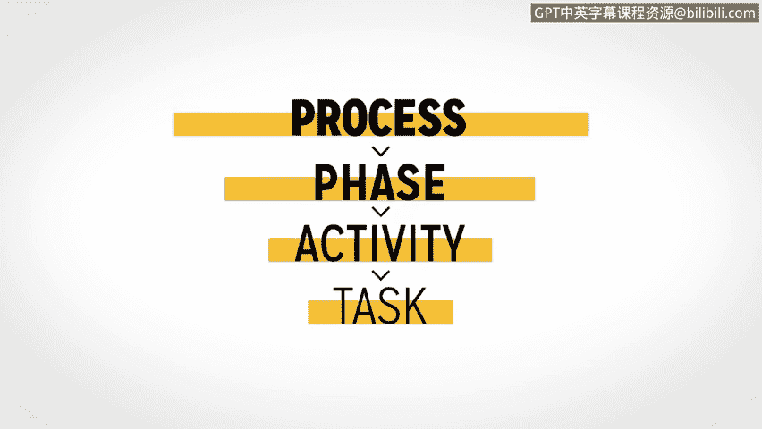
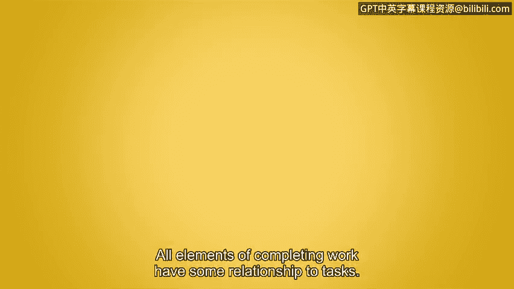

# 025：流程与实践 🚀

在本节课中，我们将学习软件开发中的核心概念：**流程**。我们将探讨什么是流程、流程的结构，以及它如何组织软件产品的开发工作。

---

## 什么是流程？

流程是软件开发的重要组成部分。事实上，流程往往会自然出现。在高层次上，流程将软件产品的开发组织成不同的**阶段**。通常，你可以将产品视为从一个阶段进入下一个阶段，每个阶段都有特定类型的工作。

正如我们将在本课程中发现的，软件开发流程并非像从头到尾遵循食谱那样简单。你需要进行改进、优化想法、尝试实验，甚至可能需要回溯，才能得到一个可接受的、可工作的产品。

软件可以持续很长时间并经历许多变化。想想你的智能手机应用需要更新的频率。每次你收到更新应用的通知，那就是产品的一个新版本正在发布。由此可见，即使在初始发布一个可工作的产品之后，进一步的开发和测试仍在继续。

---

## 生命周期流程

我们在本专项课程中讨论的许多流程都是**生命周期流程**。这意味着它们组织软件从最初构想到最终产品退役的整个生命周期。

然而，流程并不必须代表产品的整个生命周期。在生命周期流程中，可以存在**子流程**。例如，你可以有一个用于在产品中查找和修复错误的子流程。

无论是生命周期流程还是子流程，其结构都是相同的。现在让我们来看看这个结构。

---

## 流程的结构

流程被组织成**阶段**。多年来，人们提出了许多不同的生命周期流程模型。对于生命周期流程，根据流程模型的不同，这些阶段可能有不同的名称。这些阶段可以组织成顺序执行、迭代执行或并行执行。

生命周期流程的阶段示例如下：
*   **规格说明阶段**：构思产品想法、获取和表达需求的阶段。
*   **设计与实现阶段**：进行产品设计和开发的阶段。
*   **验证与确认阶段**：评估产品以确保其按预期工作并满足客户需求的阶段。

---

### 阶段示例

假设你和你的开发团队受委托为一家大型银行开发数据库。出于显而易见的原因，你的客户非常关注安全性。你和你的团队提出了许多可以集成到产品中的安全功能。

**这个任务会出现在软件生命周期流程的哪个阶段？**
A. 规格说明
B. 设计与实现
C. 验证与确认

**答案：A. 规格说明**
定义将要实现到产品中的功能是规格说明阶段的一部分。

---

## 阶段、活动与任务

上一节我们介绍了流程的阶段，本节中我们来进一步分解流程。

**阶段由活动组成**，而**活动是相关任务的集合**。一个活动的例子是“创建测试”。所有与创建测试相关的任务都将归入该活动。这些任务可能包括编写测试框架代码，以及设计和编写测试用例。我们将在下一课中详细查看软件工程活动的示例。

正如刚才所说，活动是一组相关的任务，现在让我们具体看看这些**任务**。

**任务是真正完成工作的地方**，无论使用什么流程。任务是项目中需要完成的、小而可控的步骤。它们是完成一个活动，并最终完成流程整个阶段的基石。

所有完成工作的元素都与任务有某种关系。任务的例子包括：
*   编写一段源代码
*   设计一个功能
*   编写文档
*   安装一个库
*   测试一个功能

---

### 任务的依赖关系

任务之间可能存在**依赖关系**。也就是说，一个依赖于另一个任务的任务必须等待那个任务完成。依赖关系意味着任务之间存在必要的顺序。

例如：
*   你不能遛狗，除非狗戴着狗绳。
*   你不能系上狗绳，除非狗戴着项圈。
*   因此，遛狗依赖于你系上狗绳，而系上狗绳依赖于你戴上项圈。

在软件开发的语境中：
*   你无法通过某个功能的测试，除非源代码已经编写完成。
*   你无法编写源代码，除非该功能已经设计完成。
*   因此，通过功能测试依赖于源代码的编写，而源代码编写又依赖于功能的设计。

---

## 总结

本节课中，我们一起学习了软件开发**流程**的基本概念。我们了解到流程将工作组织成**阶段**（如规格说明、设计、验证），阶段由**活动**构成，而活动则是相关**任务**的集合。我们还探讨了任务之间可能存在的**依赖关系**，这决定了工作的执行顺序。理解这些基础概念是掌握后续更具体的流程模型和敏捷实践的关键。