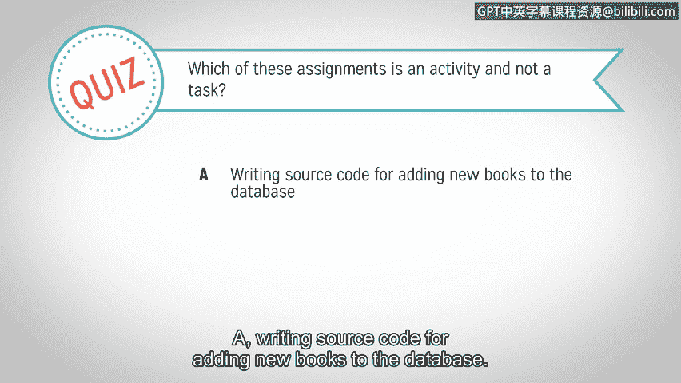

# 026：3_02_2-1-1a-流程与实践

在本节中，我们将学习软件工程中的核心概念：任务、角色、工作产品和资源。我们将探讨它们如何相互关联，共同构成软件开发流程的基础。

## 任务与角色

任务也与角色相关。角色是一个人承担或扮演的职责。

软件工程中一些角色的例子包括程序员、测试员、首席执行官、客户或产品经理。

一个实际的人可以扮演一个角色，并执行与该角色相关的任务。简而言之，**角色执行任务**。团队中的每个人在担任某个角色时，都有特定的责任或任务需要执行。

例如，程序员可能承担为某个功能编写代码的任务。测试员可能被分配去测试该功能。而产品经理可能会在该功能完成后进行审查，以确保其工作方式符合客户的期望。

你可以看到角色如何帮助根据所涉及的团队成员来组织工作。

## 概念应用示例

考虑一个用户可以分享和查看食谱的应用程序。用户可以选择创建带有个人资料的账户或使用访客账户。账户持有者和访客都可以浏览食谱，但用户必须登录其个人账户才能发布食谱。两种类型的用户也可以从主页浏览和搜索食谱。

以下是访客角色可以执行的任务：
A. 向个人资料添加可选信息。
B. 创建账户。
C. 搜索食谱。
D. 浏览食谱。
E. 发布食谱。

根据之前的说明，用户需要登录账户才能发布食谱。因此，选项E不正确。同样，要拥有个人资料，用户需要拥有账户，因此答案A也不正确。说明中提到两种用户类型都可以搜索和浏览食谱，这意味着这些任务可以由访客角色执行。此外，访客将能够创建账户以成为账户持有者。

因此，正确的答案是 **B、C 和 D**。

## 工作产品

接下来我们将要探讨的元素是工作产品。

工作产品是任务产生的输出。这个输出可以是开发过程中涉及的任何东西，而不仅仅是最终产品。工作产品确实包括最终产品，但也包括其他中间输出，例如设计、需求、源代码、测试用例和内部文档。

由于工作产品是任务的输出，我们可以说 **任务产生工作产品**。

然而，有时任务也会使用工作产品作为输入。例如，为某个功能编写源代码的任务会参考该功能的设计。该设计是先前创建设计任务的输出。因此，**任务也使用工作产品**。

## 资源

最后，任何任务要完成，都需要资源。

资源是任何能够改进、推进或资助待完成工作的东西。这些可以是时间、金钱、技术、知识或人员等。因此，我们可以说 **任务消耗资源**。

为了更直观地理解这个关系图，让我们看一个例子。

## 综合示例

假设我们正在开发一个应用程序，你的客户要求用户能够上传个人资料图片、更改姓名和更新个人描述。这些就是我们的需求。

我们必须做的一项任务是编写上传个人资料图片的测试。包含此任务的活动是“创建测试”。这个任务将由测试员角色执行。该任务消耗许多资源，如时间、金钱和技术。该任务产生的工作产品是测试用例。该任务也使用需求文档作为工作产品，因为你希望验证产品是否符合其中指定的需求。在本例中，我们希望测试用户能够上传个人资料图片。

## 练习：区分活动与任务

你被分配到一个新项目。在这个项目中，你的团队正在为当地图书馆开发一个新的数据库和借阅系统。它使用一个移动应用程序将书籍借阅到用户的账户。

西奥多是你的开发团队中的一名程序员。他被分配了以下工作：为向数据库添加新书编写源代码、建立数据库、为帮助页面编写文本，以及执行创建账户的测试。

在这些分配的工作中，哪一项是活动而不是任务？
A. 为向数据库添加新书编写源代码。
B. 建立数据库。
C. 为帮助页面编写文本。
D. 执行创建账户的测试。

答案B是最正确的答案，因为建立数据库涉及许多任务。西奥多将不得不执行诸如设计数据库、为数据库编写代码、托管数据库以及将当前数据库转移到新数据库等任务。任务是指像A、C和D中那样的低层次具体行动。在“建立数据库”这个高层次活动中，可能包含许多低层次的任务。

## 总结

在本节中，我们一起学习了软件工程中的几个核心概念及其关系。我们明确了**角色执行任务**，**任务产生工作产品**，同时也**使用工作产品**作为输入，并且**任务消耗资源**。理解任务、角色、工作产品和资源之间的这些联系，是掌握软件流程管理和组织团队工作的基础。