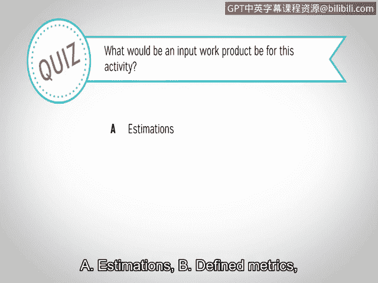

# 029：软件工程活动

## 概述
在本节课程中，我们将学习软件工程中的核心项目管理活动与需求规格说明阶段。我们将了解如何分配资源、进行度量、改进流程，并深入探讨需求阶段的各项具体活动。

---

## 项目管理活动

上一节我们介绍了软件工程的基本框架，本节中我们来看看其中几项关键的项目管理活动。

### 分配资源
分配资源是接下来的活动。我在本课程的第一个模块中提到，资源是指任何能够改进、推进或资助项目的事物。

资源可以是时间、资金或设备等。分配资源活动包括规划和安排人力资源。这意味着分解工作计划并分配任务。

### 进行度量
进行度量是另一项重要的项目管理活动，它涉及定义、计算和分析度量数据等任务。

度量用于跟踪和评估产品和/或流程。这些度量可以衡量产品中的缺陷密度、团队完成任务的速度、已完成的功能数量等等。您将在关于软件改进的评审和度量的课程中了解更多关于度量的知识。

### 改进流程
这引出了下一项活动：改进流程。您必须认识到，就像产品一样，流程本身也可以进行改进。

对流程进行测试和评审，与您的开发团队对产品进行测试和评审同样重要。您可以在此应用一些度量数据的结果，以便在下一次计算时，您的流程能获得更好的评分。

---

## 案例分析：凯文的项目管理

凯文是一个开发团队的软件产品经理，该团队正在为本地外卖餐厅开发一个订餐应用。他上周因流感在家休息。当他返回时，他想知道在他离开期间，哪些项目管理活动已经完成。

他环顾办公室，看到了一份待完成的任务日程表，以及一份标有昨天日期的风险计划。然后他登录电脑，看到新的任务开发速率已被录入，并且进度跟踪图表是最新的。

凯文需要完成以下哪项活动？
A. 分配资源。
B. 管理风险。
C. 执行估算。
D. 进行度量。

**解析**：当所有输入工作产品被消耗且所有输出工作产品被生产出来时，一项活动才算完成。迭代日程表、风险计划和进度跟踪图表都是项目管理活动的输出工作产品。任务时间估算是执行估算活动的输入工作产品。由于凯文只更新了任务开发速率而没有估算，因此该活动尚未使用其所有输入并产生所有输出。所以，正确答案是 **C**。

---

## 需求规格说明阶段

接下来，我们来谈谈需求规格说明阶段。这个阶段通常被视为初始阶段。产品的要求在此阶段确定。

但这并不意味着它只发生在开发初期。需求规格说明阶段会经常被重新审视，以更新和改进产品在后续开发中的需求。需求规格说明阶段的活动在关于软件需求和客户需求的课程中有详细讲解。

以下是需求规格说明阶段包含的活动：

*   **识别想法或需求**：这是软件开发中一项非常重要的活动。没有想法，就没有产品可开发。花时间认真思考产品将有助于创造出优秀的软件。
*   **需求获取**
*   **需求表达**
*   **需求优先级排序**
*   **需求分析**
*   **需求管理**
*   **制定潜在方案**

一旦有了想法，下一步就是处理需求。共有五项需求活动：需求获取、需求表达、需求优先级排序、需求分析和需求管理。您将在软件需求和客户需求的课程中更详细地重温这些需求活动。

一旦需求就位，就可以准备制定潜在方案了。

---

## 案例分析：制定潜在方案

您是一家连锁咖啡店的产品经理。您的客户希望您的开发团队创建一个应用程序，允许最终用户通过该应用支付咖啡费用。您正在与您的开发团队一起进行“制定潜在方案”活动。

以下哪项会是此活动的输入工作产品？
A. 估算
B. 已定义的度量
C. 内部文档
D. 需求待办列表

**解析**：在开发过程中的某个阶段，您会使用所有这些工作产品。估算通常在创建日程表时用作输入。已定义的度量在您计算和分析度量时用作输入工作产品。内部文档在开发可执行代码和测试时使用。您将使用**需求待办列表**来制定潜在方案，因为您需要确切知道正在开发什么。因此，**D** 是正确答案。

---

## 总结
本节课中，我们一起学习了软件工程中的几项核心项目管理活动：分配资源、进行度量和改进流程。我们还深入探讨了需求规格说明阶段，了解了从识别想法到制定潜在方案的一系列关键活动。理解这些活动和阶段是有效管理软件项目的基础。