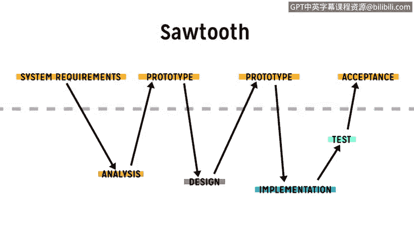

# 031：线性模型 🏗️

在本节课中，我们将要学习软件工程发展史上几种重要的线性过程模型。我们将探讨它们的工作原理、各自的优缺点，并理解它们为何被开发出来，以及为何后来在行业中变得不那么常见。

## 概述

上一模块中，摩根介绍了什么是流程与实践，以及它们为何对组织工作有用。她还解释了什么是软件工程活动，并详细介绍了该领域中常见的活动。

在本模块中，我们将稍微退一步，讨论一些在过去被证明有用的流程，以及它们如何演变成我们今天看到的更常见的流程。我们将从一些简单的流程开始，然后探讨流程如何演变以解决这些简单流程的缺陷。

请记住，就像大锤和打桩机一样，一个流程更先进、更高级，并不意味着另一个流程就变得无用或过时。理解所有可用的选项及其优缺点非常重要，否则你可能会陷入使用不适合当前任务的流程的陷阱。

## 线性过程模型简介

在入门课程中，你已经瞥见了在学习软件工程流程时可能遇到的不同流程。线性过程模型遵循一个模式：各个阶段一个接一个地完成，不重复之前的阶段。产品在设计、开发和发布过程中，不会重新审视早期阶段。

在本课中，我们将更详细地探讨这些线性生命周期过程模型。我将讨论它们的工作方式，以及各自的优缺点。这将让你了解线性模型为何被开发出来，以及它们最终为何在领域中变得不那么常见。

在继续之前，让我们测试一下你对线性过程模型的理解。

以下是关于线性过程模型定义的选项：
*   A. 每个阶段按顺序发生，当所有阶段完成后，循环回到开始。
*   B. 每个阶段与其他阶段并行发生，直到产品完成，阶段之间或阶段内没有重复。
*   C. 每个阶段按顺序发生，从不循环或重复。
*   D. 每个阶段可以重复，直到产品完成。

正确答案是 **C**。线性过程模型不支持流程阶段内或阶段之间的循环。允许循环的流程模型称为迭代模型。线性模型还要求阶段按顺序完成，阶段之间没有重叠。允许重叠的流程模型称为并行模型。你将在本模块后面学到更多关于迭代和并行过程模型的知识。

## 瀑布模型

首先，我们来谈谈你可能听得最多的一个模型：瀑布过程模型。如果你正在研究软件工程，你可能听说过这个。旧的瀑布模型因其低效和限制性而受到批评。让我们更详细地讨论瀑布模型，以便了解它的优点和缺点。

你可能已经在生活的许多方面使用过类似瀑布的过程。实际上，它只是一个基本的线性过程：一件事接一件事地发生。它之所以被称为瀑布，是因为流程的每个阶段都由前一个阶段批准的工作产物输入。

例如，在需求阶段结束时，你会得到一份产品需求文档。这份文档被批准后，输入到下一个阶段——设计阶段。在这个阶段结束时，你将完成一组模型、架构和业务规则。然后，这项工作被签署，并输入到瀑布的下一个阶段，依此类推。

这个模型允许开发人员快速开始构建产品。它允许他们通过早期确定范围并坚持执行来避免需求变更的问题。瀑布模型非常强调记录需求和架构等内容，以便开发团队对软件达成共同的书面理解。

然而，瀑布模型对变化的适应性不强。也就是说，它不是很敏捷。瀑布模型的一个主要缺点是它不允许开发团队审查和改进他们的产品。正如我们之前告诉你的，软件是一个非常动态的东西。瀑布模型的设计初衷就不是为了应对可能需要重新审视早期阶段的中途变更。

因此，存在一些瀑布模型的变体，允许对早期阶段及其活动进行反馈，以支持某些变更。但是，如果你的客户在需求文档批准后需要变更呢？不幸的是，客户直到最后才能看到产品，这可能是许多个月之后。可以理解，这种缓慢的响应常常导致客户失望。

瀑布模型有其作用，但它无法确保正在进行的工作得到适当的验证，这是一个严重的缺陷。

## V模型

为了解决这个问题，软件开发的V模型应运而生。这与瀑布模型非常相似，事情按顺序一件接一件地发生。不同之处在于，它强调验证活动，以确保实现与设计行为相匹配。这也确保了实现的设计符合需求。其理念是将每个验证级别组织到相应的阶段，而不是一次性全部进行。

V模型与瀑布模型的不同之处在于，V模型明确地将自己分为两个分支，因此得名V。与瀑布模型一样，V模型从需求开始，输入到系统架构和设计。这个分支由V的左侧表示，从上到下进行。在这个分支的末尾，重点从设计转移到实现，这是V的底部。一旦实现完成，模型的重点就转移到验证活动，这由V的右侧表示，从下到上进行。

右侧的每个阶段都旨在检查V左侧的相应阶段。

这里有一个例子。在V模型的左侧，你的开发团队计划稍后要实现的单元测试。这些单元测试旨在确保你编写的代码确实解决了你试图解决的问题。当处于V右侧的单元测试阶段时，这些单元测试会在代码中运行，以确保在一切编写完成后，所有代码都能正常运行。测试运行完毕且一切顺利后，流程进入集成测试阶段。这样，V的右侧验证了左侧。

V模型具有与瀑布模型相同的优点和缺点。它应用起来很直接，但没有考虑到软件开发的重要方面，比如变更的必然性。然而，V模型确实允许开发团队验证流程构建阶段的工作。所以我们有所进展，但客户仍然要等到最后一切完成时才能看到成品。

让我们研究一下描述软件开发V模型的图表。如果你处于集成测试阶段，当你运行测试时，你正在验证哪个阶段？
*   A. 单元测试
*   B. 编码
*   C. 高层设计
*   D. 操作测试

答案是 **C，高层设计**。当你在高层设计阶段时，你创建测试，然后在集成测试阶段运行这些测试。你不会运行来自下一个或最后一个阶段的测试，也不会运行来自编码阶段的测试。

## SA/SD模型

现在我们需要一个流程，允许我们在过程中让客户参与进来，而不是只在产品被认为完成时才让客户参与。这就是SA/SD模型（结构化分析与结构化设计模型）的用武之地。这个模型与前两个非常相似，因为它也是软件开发的线性模型。然而，它也改进了它们，因为它为你提供了在整个过程中非常需要的客户互动。

SA/SD模型的独特之处在于它区分了客户和开发团队。在这个模型中，需要客户在场的任务和只需要开发团队的任务被区分开来。这些客户任务穿插在整个过程中，以便在有意义的时刻收集反馈。

与前两个概念相似，你可能已经领先于我了。是的，SA/SD模型也遭受与前两个线性模型相同的缺点。它应用起来非常容易，但不能很好地应对变化。

## 总结

在本节课中，我们讨论了软件开发历史上三个重要的敏捷宣言发布前的流程模型：瀑布模型、V模型和SA/SD模型。它们都有共同点，也有不同之处。

这些模型的主要共同点是，它们都包含按顺序一个接一个发生的阶段。每个人都很清楚接下来要做什么。这个共同特征是它们共享优点和缺点的主要原因。它们各自允许开发以一种直接的方式进行，但它们也极大地限制了项目以适应流程。

本质上，这些早期的线性过程模型遵循一种软件产品的制造观：即根据特定要求进行机械加工和组装。一旦生产出来，产品只需要轻微的维护保养，有点像家用电器。因此，重点在于前期正确获取需求，之后不再更改。

实际上，开发软件产品是一项创造性的工作，需要实验和不断的返工。此外，在过去，与人力相比，计算机时间很昂贵。重点是使编程等任务对计算机高效，但不一定对人高效。对于软件开发来说，编写代码和看到结果之间的周期时间可能很长。这不利于开发人员尝试小型编程实验来快速测试他们的想法。然而，这确实把重点放在了试图第一次就做对并避免返工上。线性过程模型符合这种早期的思维方式。

尽管如此，在为新的开发人员记录软件产品内部结构时，你可能仍然会通过阶段和相关文档以线性方式描述项目，即使它可能遵循了其他一些流程。这提供了一种秩序的表象，使得新开发人员不需要重历整个项目来初步了解其当前实现。这类似于你在教科书中找到的数学证明和科学理论的干净、理性的版本。

在下一课中，我将介绍下一代的软件流程：迭代模型。在那里，我将告诉你一个叫做螺旋模型的过程及其优点。我们下节课见。