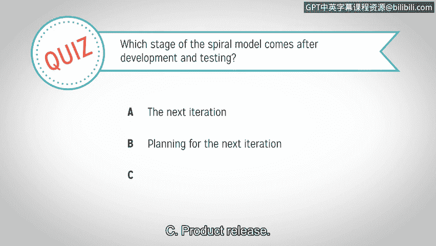
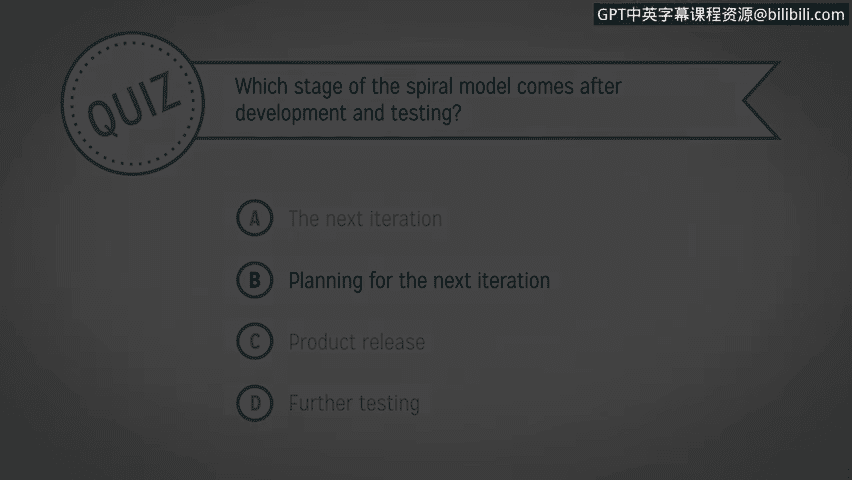

# 032：螺旋模型 🌀

在本节课中，我们将学习一种迭代式软件开发过程模型——螺旋模型。我们将了解其基本结构、核心阶段、关键特性以及优缺点。通过对比上一课介绍的线性模型，你将理解迭代模型如何通过循环往复的步骤来改进软件开发过程。

## 概述

上一节我们介绍了一些最早的线性软件开发过程模型。本节中，我们将探讨一种迭代式模型——螺旋模型。与线性模型不同，迭代模型允许重复过程的某些阶段，形成循环。螺旋模型是这类模型的典型代表，它通过周期性的迭代来逐步构建和完善软件产品。

## 螺旋模型简介

螺旋模型由巴里·博姆于1986年提出。它概述了一个通过重复访问已完成的阶段来设计和实现软件系统的基本过程。请注意，其中一些概念可能涉及技术细节。如果你需要澄清某个概念，请查阅本课的相关课程资源，那里提供了所有讨论内容的参考资料。

## 模型的基本结构

以下是螺旋模型的一个简化解释。你可以立刻明白它为何被称为“螺旋”模型。

从基本层面看，该模型由四个象限组成。当你推进这个过程时，你需要从一个象限移动到另一个象限。可以将这四个象限中的每一个视为一次迭代中的一个阶段，而一次迭代是指完成一个完整螺旋（即所有四个象限阶段被完成一次）的持续时间。

每个阶段都包含摩根在第一模块中定义的活动。

## 螺旋模型的四个阶段

以下是螺旋模型一次迭代中四个象限（阶段）的核心活动：

1.  **确定目标与方案**：在此阶段，你为当前迭代制定目标、明确需求，并生成解决方案。
2.  **评估风险与方案**：在此阶段，你识别并评估风险，同时评估上一步生成的解决方案。
3.  **开发与测试**：在此阶段，你根据选定的方案，开发和测试当前迭代的产品。
4.  **规划下一迭代**：当你获得一个满足目标的产品后，你便进入此阶段，为下一次迭代制定计划。

如果每个象限是迭代的一个阶段，那么完成一次迭代后，你便进入下一次迭代。这就是螺旋模型的基本流程。你通过重复这个阶段循环来逐步构建产品。

## 工作流程示例

例如，你可能会通过确定客户和用户需求来启动一个螺旋模型项目。然后，你会构思满足这些需求的潜在解决方案。之后，你可能会选择评估这些方案。接着，你可能会构建产品的初始原型，并评审下一次迭代需要完成的工作。这便是一次迭代。

在下次迭代中，你可能会重新开始，定义本次迭代的目标（例如，为你刚刚构建的原型添加新功能）。然后，你会评估这些功能，并着手构建你认为合适的功能。接着，你评审下一次迭代需要完成的工作，并继续推进，直到项目完成并令客户满意。

因此，与上一课描述的线性模型不同，像螺旋模型这样的迭代模型倾向于在整个过程中重复某些环节。这意味着螺旋模型允许开发团队在每次螺旋迭代结束时评审他们的产品。这样做可以更好地确保产品是按照规格构建的。

## 知识检查

乔纳森正在使用螺旋模型构建他的软件。他在穿孔卡编程和使用瀑布模型方面拥有丰富经验，因此螺旋模型的迭代对他而言是一个重大转变。他刚刚完成了产品的开发和测试，但不记得模型的下一个阶段是什么。

**问题**：在螺旋模型中，开发和测试阶段之后是哪个阶段？
A. 下一次迭代
B. 规划下一次迭代
C. 产品发布
D. 进一步测试

**答案**：B，规划下一次迭代。因为螺旋模型是迭代式的，你会循环回去，再次开始确定目标并完善设计。但只有在迭代结束时首先规划了设计之后，你才会这样做。

## 螺旋模型的不变式

尽管遵循螺旋模型的项目在某些方面可能因项目而异，但有六个条件几乎总是保持不变。这些被称为螺旋模型的“不变式”。博姆在其2000年发表的后续论文中首次描述了它们。有趣的是，在大多数情况下，这些不变式实际上也适用于许多其他过程模型。

这些不变式可能相当技术性，因此我们不会详细讨论所有六个，而只涵盖几个关键不变式的核心概念。如果你想了解每个不变式的更多细节，请查阅课程资料，那里有每个不变式的详细描述。

以下是几个关键不变式的核心概念：

1.  **并发创建**：螺旋模型的第一个不变式指出，软件项目的所有工作产品都应**同时**创建。这听起来可能有些奇怪，但其基本思想是，如果不**同时**定义各项内容，就会使项目面临风险。这是因为，如果使用瀑布模型通常的顺序方法，意味着你只能基于有限的信息做出决策。
2.  **象限完整性**：螺旋模型的第二个不变式非常简单：必须处理模型的所有象限，不能跳过任何步骤。这是因为模型的每个象限都带来价值。如果跳过一个，就会不必要地使项目面临风险，因为你很可能是在对项目做出假设，而假设当然可能是错误的。你不希望基于错误的假设来构建项目。
3.  **基于风险调整与产出导向**：最后几个不变式相当技术性，因此我们不会深入细节。本质上，它们说明：实施螺旋模型的每个项目，在任何特定活动上花费的时间量，应基于执行该活动所涉及的风险量。它非常注重确保你的决策基于风险数据。其他不变式还提到，螺旋的每次迭代都应产生一个有形的工作产品，并且过程的重点应放在改进整个过程上。

所有这些不变式共同构成了螺旋模型，有助于定义该模型。但你能看出任何问题吗？

## 螺旋模型的优缺点

尽管螺旋模型在许多方面明显优于线性过程，但它也有其缺点。

**缺点之一**：规划倾向于在每次螺旋开始时预先进行。根据螺旋的持续时间长短，这可能使得做出准确的估算变得困难。

**缺点之二**：该过程所阐述的、以计算方式最小化风险的能力，需要大量的分析专业知识。试想一下，为了确切知道在处理一项活动时花费多少时间是过多还是过少，你需要多少数据。这类风险评估任务需要消耗大量资源才能正确完成。

如果你所在的组织使用螺旋模型，很可能你正在处理大型项目，并且拥有多年的经验、数据和技术专长可供使用。

## 总结

本节课我们一起学习了螺旋模型，这是一个迭代过程的绝佳例子。它以允许在特定间隔修订产品的方式完成任务。与其他过程模型一样，它有其缺点。但它显然与我们之前看到的模型不同，对吗？在下一课中，我们将讨论统一过程模型。请尝试将本课所学内容与下一课的内容进行比较。