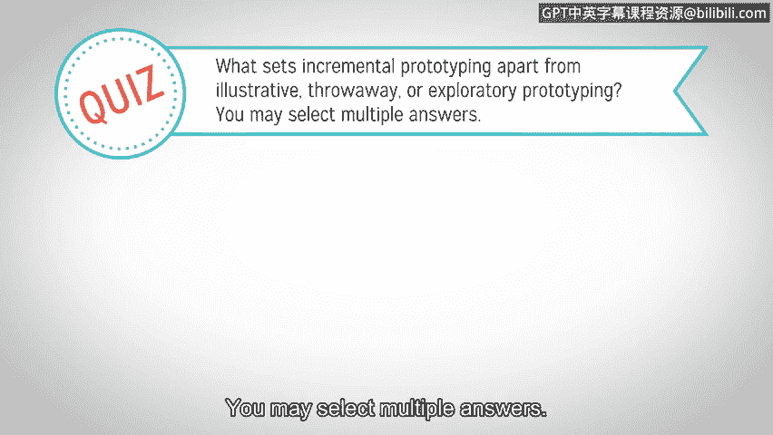

# 034：原型设计

## 概述
在本节课中，我们将要学习软件开发中的原型设计。我们将探讨五种不同类型的原型，了解它们各自的目的、适用场景以及如何在实际开发过程中运用它们。理解原型设计对于高效沟通、验证想法和降低开发风险至关重要。

在上一节中，我们介绍了统一过程和螺旋模型作为迭代与并行流程的例子。本节中，我们来看看一个在这些流程中都非常重要的实践：创建原型。

原型并不仅限于我们刚讨论过的流程，在未来的课程中你会越来越多地看到它们的身影。以下是本节课将介绍的五种原型类型。

## 五种原型类型

### 图示原型
图示原型是最基础的原型形式。它们可以是画在餐巾纸上的草图、一个简短的幻灯片演示，甚至是几张画有组件的索引卡。无论形式如何，图示原型的核心目的是使用低保真度、一次性的图像来分享想法。

图示原型有助于在投入大量时间和金钱开发产品之前，确定系统的外观和感觉。它们可以为开发团队提供创建解决方案的指导，而不是凭空想象和编程。这种方法通常在时间紧迫、只需要传达基本概念时使用。

**示例**：你可以将关键功能在绘图程序中画出草图，然后使用幻灯片编辑器将它们链接起来，形成一个无需花费太多精力就能展示产品外观的、更逼真的示例。

### 探索性原型
如果你有更多时间，并且希望对产品外观有更全面的理解，一些团队会转向我们所说的探索性原型。

探索性原型允许你专注于产品的外观和感觉。你还能通过它来确定构建该产品所需的工作量。你会编写可工作的代码，以便真正了解什么是可行的，并完全预期在学习过程后会丢弃这些工作成果。这种方法昂贵吗？是的，但这比之后才发现产品方案根本不可行要好。

探索性原型背后的常见动机是产品开发者希望研究某个产品想法的可行性。这不再仅仅是看产品长什么样，而是关于开发产品的可实现性，或者在投入更多精力之前产品可能有多大用处。

### 抛弃型原型
任何产品的第一个版本，或者说几乎所有事物的第一个版本，通常都存在各种问题。因此，为什么不从头开始构建第二个版本，并丢弃第一个呢？你构建的第一个版本就是所谓的抛弃型原型。

你应该知道，第一个版本并非一无是处。从第一个版本中可以学到许多有用的经验教训，并在第二个版本中避免一些问题。抛弃型原型让你有机会从过去的错误中学习，这使你有机会让你的发布软件产品看起来比从第一个版本不断演化而来更加稳固可靠。

### 增量原型
那么，有没有可能在产品开发过程中重用原型阶段完成的工作呢？这就是增量原型和演化原型发挥作用的地方。它们让你在原型设计上的努力能够延续到最终产品中。

关键思想是让每个后续原型都拥有可工作的软件，其中任何一个都可以作为你软件产品的一个版本发布。当你创建增量原型时，你一次一个增量地构建和发布你的产品。

增量原型分阶段工作，基于一个优先级排序系统。这意味着你需要评估系统的每个组件并为其分配优先级。基于这个优先级，你从零开始开发产品，从最重要到最不重要。

**示例**：假设你正在开发一个即时通讯应用。
*   **必须做**：用户能够通过应用相互交谈。任何与此相关的功能，如查找其他用户、发送/接收消息或文本编辑，都属于最高优先级。
*   **应该做**：用户可能希望添加个人资料图片、发布状态更新或群发消息。这些功能属于“应该做”的范畴。
*   **可以做**：能够更改消息字体、向其他用户发送自定义绘图或发布链接等功能，可能被归为“可以做”。

有了这些分类，剩下的就是构建你的应用。由于你对产品功能进行了优先级排序，你可以轻松地规划和安排开发工作。

### 演化原型
我要讨论的最后一种原型是演化原型。

在增量原型中，你从一组核心功能开始，并随着时间的推移添加新功能。在演化原型中，你从一组具备基本形态的所有功能开始，并随着时间的推移对它们进行改进或演化。无论哪种情况，最终产品都是一个功能丰富的产品。

**示例**：继续以即时通讯应用为例。考虑“添加个人资料图片”这个功能。
*   **初始版本**：用户可能需要指定要添加到个人资料的图片路径，这种方式效率不高，但能用。
*   **后续版本**：开发者可能允许用户从可用照片的下拉菜单中选择照片。
*   **再下一个版本**：你可能会设想系统允许拖放功能。

通过这种方式，你的产品从一个基本的工作原型演变为功能丰富且健壮的产品。

增量原型和演化原型都是创建可工作软件的方法，可以定期展示以获得进一步的反馈。在实践中，你可以混合使用这两种方法。对于开发团队来说，看到产品随着时间的推移逐渐成型，是一个极大的士气鼓舞。

## 原型在流程模型中的应用
现在，回想一下你在之前课程中学到的关于螺旋模型和统一过程的知识。你能想象原型如何融入这些模型吗？

在螺旋模型中，想象一下你从哪里开始。通常起点就是创建一个原型，对吧？你可能会通过螺旋模型的第一次迭代，仅仅创建一个图示原型。你可以在纸上涂鸦几幅画，了解你的系统将如何工作。对于统一过程的初始阶段，也可以这样说，不是吗？

通过创建原型，你可以更好地可视化产品的功能，从而根据产品可能的样子做出功能决策。但这还不止于此。我敢打赌你已经想到了将图示原型与增量或演化原型结合的可能性。这很有道理，对吧？你的第一个版本只是写在几张纸上的想法。然后，为了进一步测试你的想法，你勾勒出一些关键功能并开始构建。不久之后，你可能会得到一个原型。然后，你可以将该原型带给客户或潜在投资者，以证明产品在概念上是可行的。

这确实是任何类型原型设计的核心理念：获取对你产品版本的反馈。你可以从花费最少的时间开发初始原型开始，以最有效地利用你的资源。

## 总结
本节课中，我们一起学习了软件原型设计的五种主要类型：**图示原型**、**探索性原型**、**抛弃型原型**、**增量原型**和**演化原型**。我们了解了每种原型的目的、适用场景以及它们如何帮助团队验证想法、降低风险并逐步构建出功能丰富的产品。理解这些原型方法，对于在螺旋模型或统一过程等迭代开发流程中进行有效规划和沟通至关重要。

在下一节课中，我将讨论软件开发中的持续交付，以及它与微软的每日构建有何关联。我们下节课见。