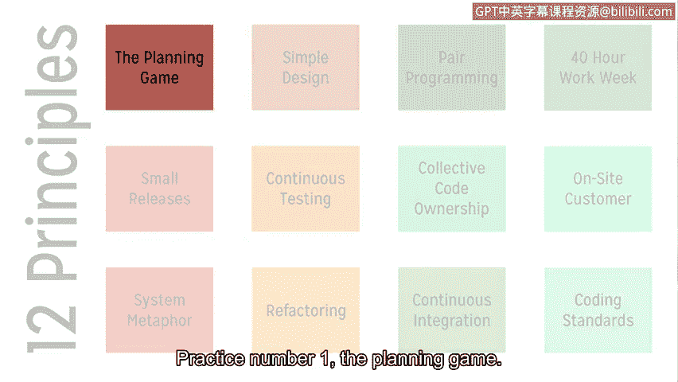
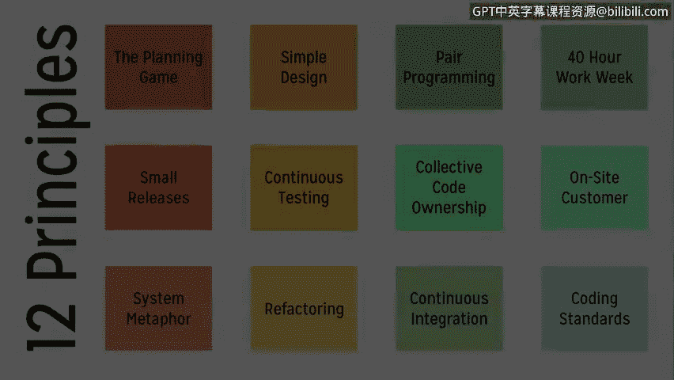
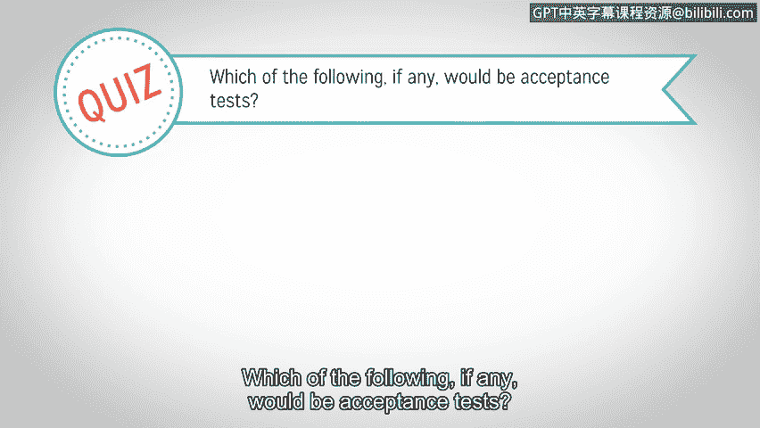
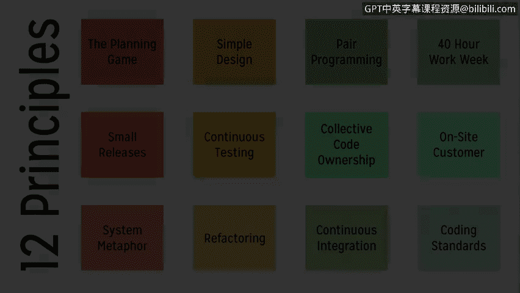
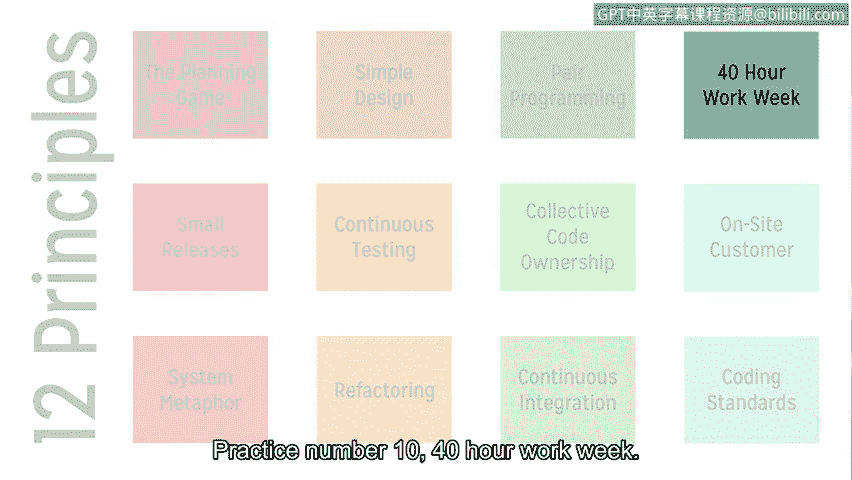

# 037：极限编程实践

## 概述
在本节课中，我们将学习极限编程（Extreme Programming， 简称XP）的核心实践。极限编程是一种敏捷软件开发方法，它强调客户满意度、频繁交付、团队协作和快速响应变化。我们将逐一解析其12项基本实践，并理解它们如何共同作用以提升软件开发效率与质量。

极限编程之所以被称为“极限”，是因为它将许多在其他方法论中使用的良好实践推向了极致。它的核心目标是实现客户满意，这意味着开发团队的首要任务是尽可能让客户感到高兴。

极限编程同样重视持续交付软件、响应变化、高效团队合作和自我组织，这些原则都包含在敏捷宣言中。它主要关注改进开发的五个方面：沟通、简单性、反馈、尊重和勇气。其中，沟通、简单性和反馈已在敏捷宣言中涵盖，而尊重和勇气则强调团队中每个成员的平等价值与敢于说真话、适应变化的团队文化。

## 极限编程的五大价值
以下是极限编程旨在提升的五个方面：

1.  **沟通**：确保信息在客户、产品经理和开发团队之间顺畅流动。
2.  **简单性**：设计尽可能简单的解决方案，避免过度工程。
3.  **反馈**：通过频繁交付和测试，快速获得并响应反馈。
4.  **尊重**：团队所有成员（包括客户）因其贡献而受到平等尊重。
5.  **勇气**：团队敢于面对进度和估算的真相，不畏惧变化，并能共同承担风险。

## 实践解析：结对编程
为了理解这些价值如何体现，让我们看一个具体实践的例子。假设你是一家小型初创公司的软件产品经理，正在开发一款匹配家长与本地保姆/育儿师的应用程序。你的开发团队决定采用极限编程方法，并组织成两人一组，在单个工作站前协同工作。

这种实践被称为**结对编程**。你认为它主要提升了上述哪个（或哪些）价值？

*   **A. 沟通**
*   **B. 简单性**
*   **C. 反馈**
*   **D. 尊重**
*   **E. 勇气**

**答案：A, B, C, D, E**

结对编程实际上涵盖了所有五个方面。它鼓励两名程序员沟通协作以解决问题（**沟通**）；两个视角通常能产生更简单、更高质量的代码（**简单性**）；由于直接与他人合作，你能获得即时反馈（**反馈**）；它利用程序员的互补技能解决问题，促进了相互**尊重**；最后，因为程序员不是独自工作，他们更愿意承担经过计算的风险（**勇气**）。

## 极限编程的12项基本实践
极限编程由一系列规则构成，这些规则像拼图一样，单独看可能意义不大，但组合起来就能形成完整的开发图景。传统上，XP以其12项基本实践而闻名。

### 实践一：计划游戏（Planning Game）
这是客户与开发团队共同规划产品的环节。规划可以发生在不同规模上，例如在开发初期有一次大型规划会议，而在每次迭代后则进行较小规模的规划。

初始会议决定了可工作产品的发布频率。无论规模大小，规则通常一致：
1.  客户和开发团队共同列出产品的新功能列表，每个功能都以**用户故事**的形式表达。
2.  开发团队估算在下一个迭代中可以投入的工作量，以及完成每个用户故事所需的工作量。
3.  客户和开发团队共同对用户故事进行优先级排序，并决定每个功能的可工作版本的发布时间。

### 实践二：小版本发布（Small Releases）
在极限编程中，你希望发布尽可能小且频繁。开发团队将与客户一起规划哪些功能具有良好的商业意义，并可以在项目早期发布。你希望尽早开发重要功能，以便有更多时间进行完善。团队需要在客户希望完成的功能与可以早期开发的功能之间找到平衡点。

### 实践三：系统隐喻（System Metaphor）
系统隐喻旨在让你的系统更容易向他人解释。你应该能够轻松地向没有技术经验的第三方解释你的产品。

**例如**：假设客户有一个面部识别应用的想法，该应用可以告诉你一个人的姓名和信息。一个好的隐喻可能是：“这个应用就像一个派对上的社交达人，认识那里的每个人并了解他们的一切。” 一个好的隐喻能让人在了解具体功能前就大致理解应用的用途。

### 实践四：简单设计（Simple Design）
这意味着你的设计应尽可能简单。由于需求会不断变化，为可能不会持久的东西制作详细设计没有意义。只设计你今天正在处理的需求所需的内容，不要为可能不会到来的未来进行过度设计。

### 实践五：持续测试（Continuous Testing）
在极限编程中，测试是在编写源代码之前为功能或需求编写的。通常，这些测试被用作需求的**可执行形式**。这样，当测试通过时，你就知道相应的需求得到了满足。这被称为**测试驱动开发（Test-Driven Development）**。

在XP中，功能或需求通过两种方式测试：
1.  **验收测试（Acceptance Tests）**：由客户执行，用于测试产品的每个功能是否按规范工作。这些测试覆盖产品的较大范围，可以是自动化的，也可以是人工遵循的用户界面操作脚本。
2.  **单元测试（Unit Tests）**：由开发人员编写的自动化测试，用于测试较低层次的功能。

### 实践六：重构（Refactoring）
重构是指在**不改变代码行为**的前提下，重新构建代码的设计。它改进了设计，使得新功能可以轻松添加，从而鼓励响应新的变化。例如，重构包括移除重复和不必要的代码。由于开发人员创建了单元测试，他们可以自信地删除代码而不会破坏产品。如果删除后测试仍然通过，就说明那是多余的代码。

### 实践七：结对编程（Pair Programming）
这是XP广为人知的规则之一，意味着两名开发人员在一台计算机旁并肩工作以编写代码。这将代码审查推向了极致：代码不是定期审查，而是由配对的另一人持续审查。两名程序员一起工作实际上比两名程序员分开独立工作能产出更多、质量更高的代码。

### 实践八：集体代码所有权（Collective Code Ownership）
这项实践建议鼓励整个开发团队为产品的任何部分贡献新想法。这意味着任何人都可以向产品的任何部分添加代码。当出现问题时，这是团队的结果，而非个人的责任；同样，当成功时，也是团队的成功。

### 实践九：持续集成（Continuous Integration）
持续集成要求你的开发人员经常合并代码。这可能至少每天发生一次，但要达到“极限”的程度，发生的频率应该更高。所有测试在集成前后都应100%通过。

### 实践十：40小时工作周（40-Hour Week）
尊重开发人员的工作与生活平衡似乎显而易见，但如果团队充满热情，可能很难让他们离开键盘。在紧要关头，XP允许最多一周的加班。如果连续多周加班，那就是项目管理出现问题的危险信号。

### 实践十一：现场客户（On-Site Customer）
这项实践邀请客户成为开发团队的一部分。他们始终在场，以澄清和回答可能出现的任何问题。他们参与开发的每个阶段。

### 实践十二：编码标准（Coding Standards）
这意味着所有开发人员都遵循相同的编码标准。你不应该通过看代码就能分辨出是谁写的。相反，你应该鼓励开发团队遵循通用的编码约定，并以相同的方式格式化代码。这个标准应在开发初期达成一致，这不仅使代码更易于阅读，也鼓励了集体所有权。

## 总结
在本节课中，我们一起深入学习了极限编程（XP）的核心理念与12项基本实践。我们了解到XP通过将沟通、简单性、反馈、尊重和勇气等价值推向极致，来追求客户满意和高效交付。从“计划游戏”、“小版本发布”到“结对编程”、“持续集成”，每一项实践都像拼图的一块，共同构建了一个适应性强、协作紧密的敏捷开发框架。掌握这些实践，将帮助你作为软件产品经理，更好地引导团队应对变化，交付高质量的软件产品。