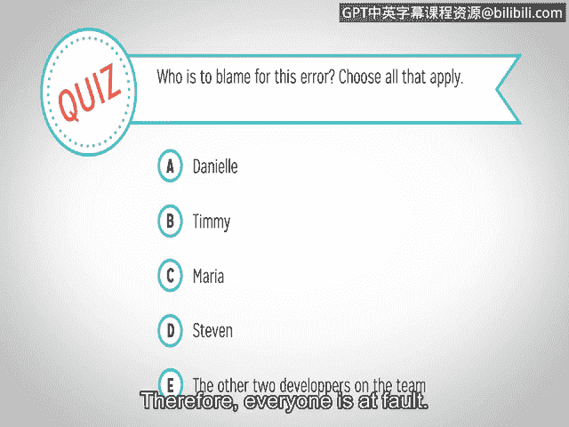

# 038：极限编程实践案例与反思

在本节课中，我们将通过一个具体的案例来深入探讨极限编程的核心实践，并分析其在实际应用中的优势与挑战。我们将学习如何识别团队是否遵循了极限编程的原则，以及当实践出现偏差时应如何调整。

---

## 案例背景

Danielle 是产品经理，她与一个五人开发团队合作，共同开发一款允许小企业主向员工支付工资的薪酬应用程序。

在交付一个原型后，客户向开发团队发送了一封措辞严厉的电子邮件，指出他们在应用程序中发现了一个错误，该错误会导致工资计算不正确。客户对此非常不满，因为这个错误会让企业主损失大量资金，并导致员工获得超出其应得的报酬。

团队成员分工如下：
*   Timmy 和 Maria 是为该功能共同编写单元测试的程序员。
*   Stephen 和 Maria 是结对编程编写源代码的程序员。
*   Danielle，产品经理，在发布前对产品进行了验收测试。

那么，谁应该为这个错误负责？请选择所有适用项：A. Danielle, B. Timmy, C. Maria, D. Stephen, E. 团队中的其他两名开发人员。

## 极限编程的核心实践：集体所有权

极限编程的一项实践是 **集体所有权**。这意味着团队的所有成员都对发生的错误负责。因此，**每个人都是有责任的**。

这意味着 A, B, C, D 和 E 都是正确答案。如果客户对产品非常满意，整个团队也将共享成功的荣誉。

## 极限编程的其他管理实践

之前我们提到，极限编程传统上由12项基本实践描述。然而，根据不同的资料，其表述方式可能有所不同。Don Wells 是极限编程规则第一版的作者，他列出了29条极限编程规则，其中许多与我们刚讨论的12项实践重叠或结合了Scrum的实践。但也有一些有趣的管理实践不属于上述类别，值得注意。

以下是其中几项关键的管理实践：

**1. 为团队提供专用的开放式工作空间**

回想一下你以前工作过的环境。你认为它们提高了你的生产力和团队合作吗？极限编程建议工作空间应配备多台不属于任何个人的电脑，这些电脑应放在房间中央，而不是靠墙。这鼓励开发团队一起工作。还应该有一个配有白板的会议桌，供团队协作和头脑风暴。

**2. 轮换人员**

这项实践鼓励沟通和灵活的工作关系。这意味着每个人都应知道如何开发和操作产品的所有部分。试想，如果只有一个成员知道某个功能如何工作，当他离开时，项目将受到多大损害。轮换人员的替代方案是进行大量文档记录，但这不符合敏捷方式。你不会让一支职业足球队没有替补守门员，同样，项目的成功也不应依赖于某一个人。在体育或开发中，最有用的团队成员是那些掌握多种技能的人。

**3. 适时调整极限编程本身**

即 **当极限编程出现问题时，修复它**。你可能注意到，这里说的是“当”而不是“如果”，因为它**必定**会出现问题。极限编程的所有实践不可能在你的产品整个生命周期中都运行顺畅。并非所有实践都适合你的团队。当某项实践不起作用时，就改变它。你应该让团队遵循规则，直到规则被打破。频繁的项目回顾会议是确定哪些做法有效、哪些无效的好方法。

## 实践场景分析

现在，让我们应用所学知识分析一个场景。

假设你被一家公司聘用，该公司声称已尝试精确实施极限编程方法论。你走进工作场所，看到的是一排排迷宫般的隔间。当你环顾工作区并向隔间内窥视时，你看到程序员们正在结对编程。

你走进一个隔间，询问开发人员在哪里可以找到客户。一名开发人员递给你一张印有客户电话号码的名片，并说你可以留言，客户会回复你。

你走进下一个隔间，询问正在那里工作的两名程序员下一次发布何时到期。他们告诉你，发布定于每隔一个周五进行，本周五就有一个发布。你问这些程序员他们在做什么，他们解释说他们是数据库团队，专门负责维护和构建数据库。

你意识到他们在许多方面都没有正确遵循极限编程。为了在这个办公室精确运行极限编程，你需要改变哪些开发领域？选项：A. 工作空间， B. 结对编程， C. 客户可用性， D. 小型频繁发布， E. 开发人员多能性。

**分析如下：**
*   极限编程的工作空间环境是开放的，鼓励协作。迷宫般的隔间不符合这一实践。
*   客户也应随时可用。难以联系的客户不利于有效沟通。
*   开发人员应轮换工作，而不是专攻某一功能。让两名开发人员专门负责数据库工作不符合极限编程。

因此，**A、C 和 E 是正确答案**。这家公司并非完全偏离轨道，他们确实进行了结对编程并交付小型频繁发布，这些都是良好的极限编程实践。

## 极限编程的潜在弱点

既然你已经熟悉了极限编程的规则，现在我们来谈谈它的一些缺点。

**1. “全有或全无”的方法**
如果你为开发团队采用极限编程，鼓励你采用所有规则以获得全部收益。虽然前面提到可以改变不起作用的方面，但到什么程度它仍然算是极限编程？如果一半的实践对你的团队都不起作用怎么办？个别实践的价值不如整体方法论大，但有时实施所有实践并不现实或可能。

**2. 适用于小型团队**
极限编程是为小型开发团队设计的。当你的开发团队超过20人时，你会在集体所有权和集成方面遇到许多问题。

**3. 缺乏前期规划**
与其他方法论相比，极限编程不鼓励真正的前期软件架构规划，这可能导致未来大量的返工。

**4. 结对编程的局限性**
结对编程固然有很多好处，但并未像其他实践那样被广泛采用。可以保证它不会适用于所有团队，性格冲突将是一个重要因素。

**5. 安排现场客户的困难**
让客户按照极限编程要求的时间全程参与是不常见的。期望客户在每次出现问题或疑问时都在场通常是不现实的。在理想世界中这很棒，但真实的软件开发往往远非理想。

---

## 总结

本节课中，我们一起学习了极限编程的**集体所有权**原则，并通过案例分析了责任归属。我们还探讨了极限编程的其他关键管理实践，如**开放式工作空间**、**人员轮换**和**过程调整**。通过一个公司场景，我们识别了实践中常见的偏差。最后，我们客观地审视了极限编程的潜在弱点，包括其对小型团队的适用性、前期规划的不足以及实践中的现实挑战。

极限编程为软件开发概述了许多优秀的实践，但该过程也存在许多不足。作为一名产品经理，你需要找到适合你团队的实践。你需要进行实验。也许极限编程完全适合你，也许不适合。这就是为什么你必须研究多种方法论，以便为你的团队找到正确的方法。你需要收集数据来支持哪些实践对你有效。

基于此，在下一课中，你将转向学习另一种名为 **Scrum** 的方法论。