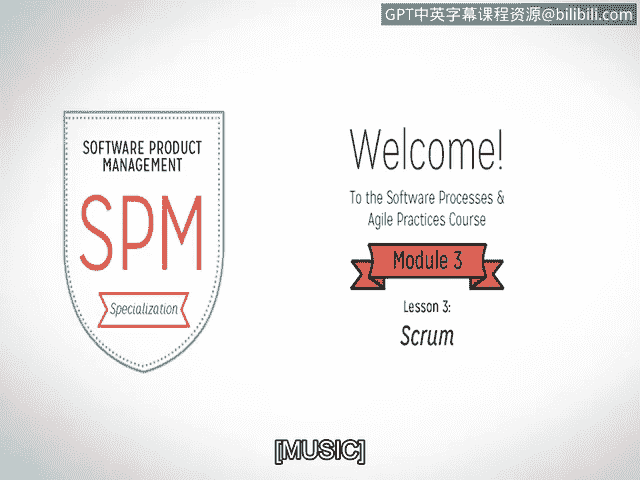
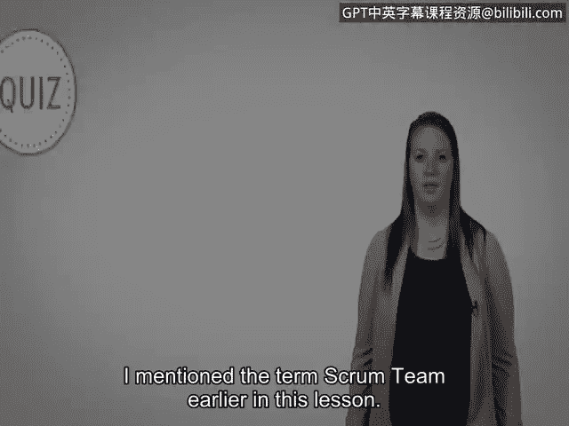
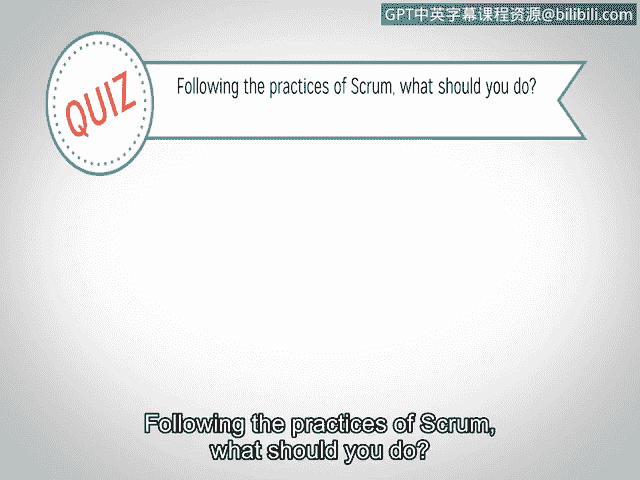
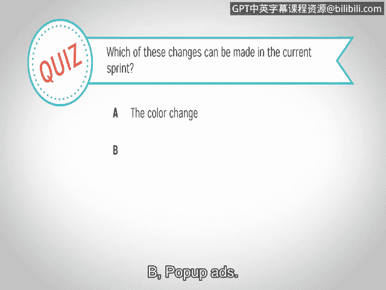
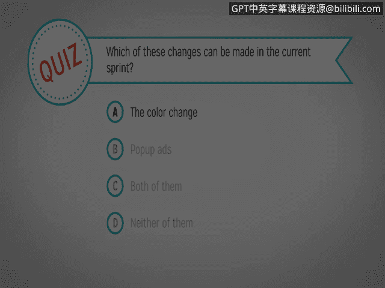

# 039：Scrum基础入门

在本节课中，我们将学习敏捷开发中的核心实践之一：Scrum。我们将了解Scrum的基本结构、核心支柱、团队角色以及关键实践。通过本课，你将掌握Scrum的基本框架，为后续深入学习具体的Scrum技术打下基础。

---

## 🏗️ Scrum的核心支柱

上一节我们提到了Scrum是一种敏捷实践，本节中我们来看看支撑Scrum的三个核心支柱：**透明度**、**检视**和**适应**。

**透明度**意味着项目的每个部分对所有人都是可见的。这种可见性不仅限于Scrum团队内部，也向团队外部人员开放。透明度的一个重要部分是就项目的通用标准达成一致，这包括在整个开发过程中使用统一的术语，以及对“完成”一个功能意味着什么达成共识。

**检视**是指Scrum鼓励频繁地检查工作产品和进度，以便及时发现与期望不符的偏差。这些检查应该足够频繁，但又不能过于频繁以至于干扰开发任务。

**适应**是指在检视过程中，如果发现产品开发开始偏离既定目标，团队必须进行调整和适应，以防止进一步的偏离。

Scrum为检视和适应规定了四种具体的技术，它们是：
*   **冲刺规划**
*   **每日站会**
*   **冲刺评审**
*   **冲刺回顾**

你将在关于敏捷规划、评审和度量的课程中深入学习这些技术。

---

## 👥 Scrum团队的角色

在了解了Scrum的支柱后，我们来看看构成Scrum团队的三个核心角色：**产品负责人**、**开发团队**和**Scrum Master**。

### 产品负责人

产品负责人的主要任务是**对产品和产品待办事项列表做出决策**。他们负责对产品待办事项列表中的需求进行优先级排序，并决定实际要构建什么内容。产品负责人是**一个人**，而不是一个委员会。他们可能代表一个委员会，但只有产品负责人有权对产品进行变更。

以下是产品负责人的关键职责：
*   为Scrum团队提供清晰定义的产品待办事项列表。
*   对该列表进行优先级排序，团队必须尊重并按照该顺序进行开发。
*   确保开发团队理解待办事项列表中每个功能的预期要求。

### 开发团队

Scrum开发团队具有以下几个关键特征：

**自组织**：这意味着没有人（甚至包括Scrum Master）可以命令团队如何将他们的功能待办事项转化为可工作的软件增量。

**跨职能**：团队拥有完成产品所需的所有技能和人员，可能包括来自不同领域的专家。团队不应依赖团队之外的任何人。成员通常会承担多种任务（例如既编码又测试），而不是有专门的编码员和测试员。

**无头衔与子团队**：开发团队的成员没有头衔，只应被称为“开发者”或其姓名。团队内也没有子团队。开发者可能在团队内有专长，但责任属于整个团队。

**规模小**：理想的团队规模大于3人且小于9人（不包括Scrum Master和产品负责人，除非他们也参与开发）。一个经验法则是，能用两张披萨喂饱整个团队。

### Scrum Master

Scrum Master的职责是确保Scrum团队遵循Scrum的理论、实践和规则。他们对产品负责人和开发团队都有具体的职责。

以下是Scrum Master对产品负责人的职责：
*   寻找管理待办事项列表的技术。
*   帮助Scrum团队理解清晰、简洁的待办事项列表的必要性。
*   确保产品负责人知道如何对列表进行优先级排序以获得最大价值。
*   促进Scrum事件。

以下是Scrum Master对开发团队的职责：
*   指导团队实现自组织。
*   移除开发过程中的障碍。
*   促进Scrum事件。

---

## ⏱️ Scrum事件与冲刺

Scrum Master负责促进的Scrum事件，正是之前提到的四种检视与适应技术。所有这些事件都是**时间盒**的，意味着需要为这些事件的持续时间设定一个最大时限并严格遵守。其理念是保持分配的时间，调整范围，而不是保持范围最终导致发布延迟。

另一个核心的Scrum事件是**冲刺**。冲刺是一个特定时间长度的开发阶段，在此阶段结束时，会向客户交付一个可工作的产品增量。冲刺也是时间盒的，但执行更严格。一个冲刺持续一个月或更短时间，通常为一到两周。一旦Scrum团队确定了冲刺的长度，在整个开发过程中就必须始终保持这个长度，不能随意延长或缩短。

每个冲刺都包含之前提到的四个Scrum事件：
*   **冲刺规划**：发生在当前冲刺开始时，用于确定在该冲刺中将完成什么工作。
*   **每日站会**：每天举行（通常在每天开始时），开发者讨论他们将做什么任务以及需要什么来完成这些任务。
*   **冲刺评审与回顾**：发生在冲刺结束时。

在冲刺进行期间，**不能做出会影响冲刺目标的变更**。冲刺目标是对该冲刺要完成工作的大局观。那些会改变冲刺目标的建议将进入产品待办事项列表，如果产品负责人决定，可以在下一个冲刺中实施。

---

## ✅ “完成”的定义

Scrum的一个重要部分是**“完成”的定义**。在冲刺结束时交付的可工作产品增量必须是“完成”的。由开发团队负责定义决定产品何时“完成”的质量标准。

通常，一个功能在**已编码、已测试和已文档化**时才被认为是完成的。团队必须就“完成”的含义完全达成一致。根据敏捷宣言，进度应该通过已完成的功-能来跟踪。这样做的目的是避免工作处于半完成状态，这可能导致团队各自为政，看起来很忙却没有完成任何可用的东西。

完成一个功能需要沟通、集成和同步。这有时要求开发进度放慢，以确保每个功能都真正完成。

---

## 💡 总结与注意事项

本节课中我们一起学习了Scrum敏捷实践的基础知识。我们了解了Scrum的三大支柱（透明度、检视、适应），认识了Scrum团队的三个核心角色（产品负责人、开发团队、Scrum Master），并探讨了关键的Scrum事件（如冲刺）以及“完成”的定义。

与极限编程类似，Scrum的倡导者推荐“全有或全无”的实施方式。虽然Scrum的某些实践可以单独实施，但如果你单独实施这些实践，那么你并不是在实践真正的Scrum。真正的Scrum要求完整地实践其全部内容。

尽管Scrum是一种流行的方法论，但它仍然存在一些缺陷。你可以在课程讨论中谈谈你认为Scrum有哪些不足之处。在下一个模块中，你将继续研究更多的实践和方法论。