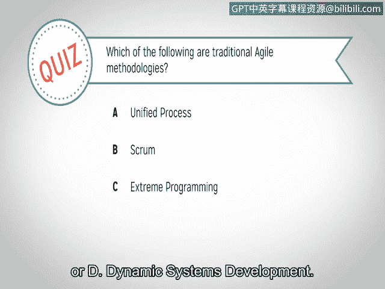
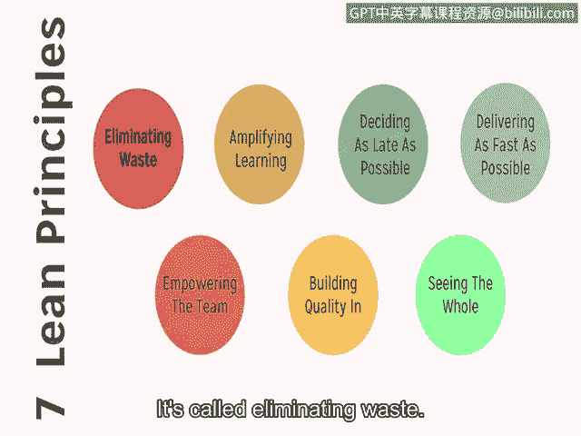
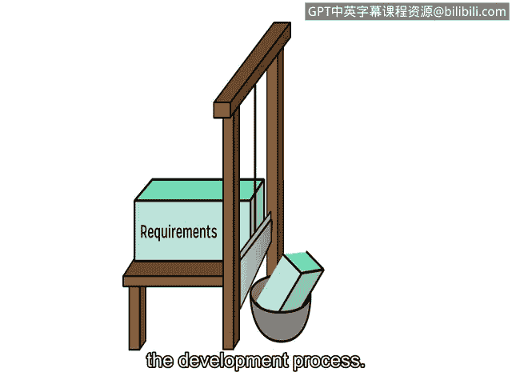
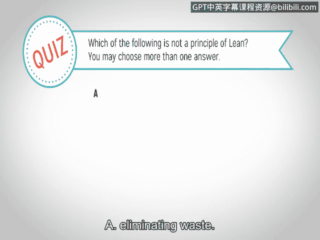

# 040：敏捷变体与精益软件开发 🚀

在本节课中，我们将要学习敏捷开发方法的一些变体，并重点介绍一种日益流行的实践——精益软件开发。上一模块我们讨论了极限编程和Scrum等主流敏捷实践，本节中我们来看看其他同样遵循敏捷原则但形式不同的方法。

## 概述

敏捷方法始终在变化和演进。虽然Scrum目前应用广泛，但软件行业不断涌现新的实践变体，以改进原有方法的不足。了解这些变体有助于你根据项目具体情况，做出更明智的流程选择。

## 敏捷实践的其他变体

除了Scrum和极限编程，还存在多种敏捷实践变体。以下是其中一些例子：

*   **敏捷统一过程**：结合了统一过程的并行开发阶段与敏捷的核心理念，注重流程而非工具，强调简洁性、团队赋能和方法定制。
*   **动态系统开发方法**
*   **特性驱动开发**
*   **ScrumBan**
*   **行为驱动开发**

关键在于，敏捷框架允许你根据项目中遇到的具体问题（例如需要对架构或测试更严格），灵活调整和适配流程与实践。

## 精益软件开发的兴起

有一种敏捷开发方法论近年来获得了极大关注，即**精益软件开发**。它起源于制造业，其核心是通过减少浪费、只在必要时开始新工作、消除流程瓶颈以及只做能为项目增加价值的事情，来降低项目风险。

2003年，Mary和Tom Poppendieck撰写了将精益制造原则应用于软件开发的专著，推动了精益软件开发的发展。

## 精益的七项原则

精益是一种思维模式，包含七项核心原则，旨在降低项目风险并快速向客户交付高质量产品。

以下是这七项原则：

1.  **消除浪费**：任何不增加价值的活动都被视为浪费，应坚决从开发过程中移除。
2.  **强化学习**：通过短迭代、反馈和持续改进来促进团队学习。
3.  **尽可能延迟决策**：在掌握足够信息后再做决策，以保持灵活性。
4.  **尽可能快速交付**：通过小批量、持续流的方式加快交付速度，尽早获得反馈。
5.  **赋能团队**：信任并授权团队做出决策，激发其主动性和创造力。
6.  **内建质量**：在开发过程中持续保证质量，而非事后检查。
7.  **整体优化**：关注整个价值流和系统效率，而非局部优化。

## 深入理解“消除浪费”

第一项原则“消除浪费”最受关注。在软件开发中，浪费可能以多种形式存在。

为了理解软件中的浪费，我们可以类比制造业。假设一个汽车工厂同时全力生产车身（需5天）和车轮（需0.25天）。如果两者都持续满负荷生产，很快就会出现大量过剩的车轮积压在仓库，占用空间和成本，并且当车型更新时可能完全报废。

这种情形同样适用于软件开发。如果强迫所有开发人员时刻保持忙碌，他们可能会产出大量非核心的、甚至不必要的功能代码。这些代码可能拖累产品质量、引发问题，或者最终根本无法集成到产品中。这就是软件开发中一种关键的浪费形式。

其他浪费形式还包括流程延迟、不必要的会议、需求不明确以及产品缺陷等。

## 总结

本节课中我们一起学习了敏捷开发的各种变体，并深入探讨了精益软件开发的起源及其七项核心原则。理解这些不同的方法有助于你构建更适合自身项目需求的开发流程。记住，没有一种方法是放之四海而皆准的，关键在于根据实际情况灵活选择和调整。