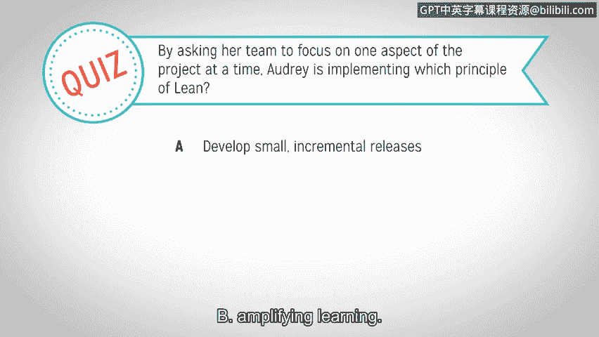
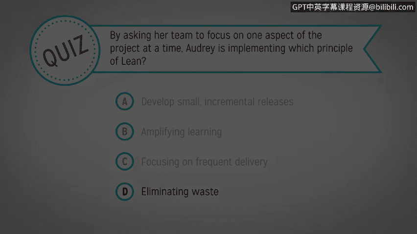
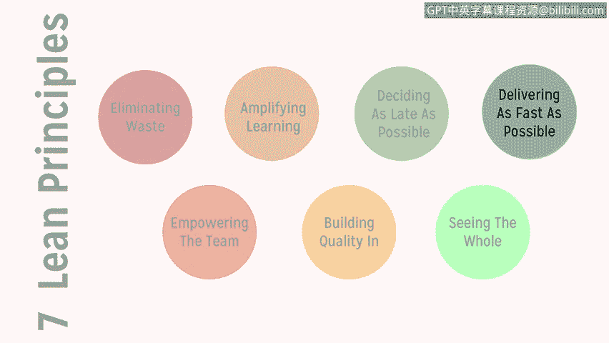

# 041：精益软件开发原则（第二部分）

在本节课中，我们将继续学习精益软件开发的核心理念，重点探讨“放大学习”、“尽可能晚做决策”和“尽可能快交付”这三个原则。我们将了解这些原则如何帮助团队更有效地构建满足客户需求的软件产品。

## 放大学习 📚

上一节我们介绍了精益软件开发的第一原则“消除浪费”，本节中我们来看看第二个原则：**放大学习**。

这个原则的核心很简单：在深入投入一个想法之前，不要过早地锁定它。在采取行动之前，应通过思考多种替代方案来彻底探索各种可能性。

以下是一个现实场景中的例子：

你的开发团队创建了一份非常基础的用户需求列表，以便快速启动项目。然后，他们可以简要规划出一种可能的产品方案，并开始开发其基本功能。这在大多数开发流程中都很常见。

然而，为了**放大学习**，一个好的做法是在这个阶段停下来，不再对这个版本做更多工作。相反，你应该问自己：**这件事是否可以用另一种方式完成？** 如果是，你的开发团队也应简要规划和开发这些替代方案。

通过允许产品的功能集以这种方式进行调整，你的产品就有最大机会以最令人满意的方式满足客户的需求。

但这并非在软件产品中放大学习的唯一方式。

精益软件开发鼓励在产品的**每次构建后**都运行集成测试和单元测试。这样做的理由不仅是为了确保代码质量良好，测试本身也是学习产品应如何运行的绝佳方式。测试可以为团队带来关键洞察，这些洞察可用于指导产品的其他版本和未来的规划。

在精益软件开发中，这一切发生在非常短的迭代周期内。其理念是**快速失败、快速学习**。此外，如果你在某个设计或功能上花费太多时间，很容易发现自己过于投入其中，以至于无法真正看到其缺陷，也无法考虑其他更好的方法。

精益软件团队被鼓励放大学习的另一种方式，是以一种特殊的方式让客户**全程参与**开发过程。

开发团队不仅应在专注于一个版本之前创建产品的不同版本，还应**持续将这些版本展示给客户**。这使得开发团队能够通过试错来了解客户的真实需求。同时，也让客户能够学习他们希望产品如何解决其具体问题。在开发过程中，这些需求应不断被细化，以保持项目的可行性。

这类似于自然选择：向客户展示多种潜在方案，让他们决定希望将哪些功能构建到产品中，从而为最终产品带来聚焦和优化。

因此，通过让客户参与尝试不同方案，你的开发团队能够学习如何最好地解决他们的具体问题。这比团队不考虑替代方案、埋头苦干更能带来更好的软件和更满意的客户。

**放大学习的要点**是确保你的团队通过开发替代方案、获取持续反馈和不断优化，来构建正确的产品。

---

## 小测验：识别原则

奥黛丽和她的开发团队正在使用精益软件开发实践构建一个软件产品。她要求开发团队在为客户创建不同替代方案时，**一次只专注于项目的一个方面**。

通过要求团队一次只专注于项目的一个方面，奥黛丽正在实施精益的哪个原则？

以下是选项：
A. 开发小型增量发布
B. 放大学习
C. 专注于频繁交付
D. 消除浪费

**答案是 D. 消除浪费**。奥黛丽让团队构建不同替代方案的做法，实际上是在**放大学习**。而“开发小型增量发布”和“专注于频繁交付”是敏捷开发的原则，并非精益独有的原则，尽管精益项目当然也可以利用这些实践。

---

## 尽可能晚做决策 ⏳

精益软件开发的第三个原则是**尽可能晚做决策**。这听起来可能像是为延长开发时间而找的借口，但我向你保证，事实恰恰相反。这个原则实际上与“放大学习”一脉相承。

想象一个软件团队为客户构建了一个基础软件原型。客户看到后说：“是的，这正是我需要的。就按这个做。” 看起来，沿着这个初始原型设定的路线继续下去就能满足客户，对吗？

但在你决定之前，请考虑一下：作为一个精益软件开发团队，他们为了放大学习，探索了不同的方法。他们知道客户认为原型足以满足需求，于是团队询问客户：“这个原型的哪些特性吸引您？” 基于这些信息，团队继续构建产品的替代版本，整合客户喜欢的原型特性。

在完成了几个更多版本后，客户审视所有方案，并意识到最初的**原型已经不够用了**。它有一些对最终产品很好的特定功能，但另一个替代版本更能满足他们的需求。于是，开发团队回到工作中，利用这些反馈将原始原型的特性整合到新版本中。现在，团队拥有了比最初更精炼的产品版本。客户审视后，比以往任何时候都更满意，这个版本似乎真正切中要害。开发继续推进，团队也学到了构建正确产品所需的经验。

如果开发团队将客户最初决定构建第一个原型的意见视为最终决定，而不是去开发更能满足客户需求的替代方案，会发生什么？团队可能会构建出一个糟糕的产品，而且他们甚至不会知道自己正在构建一个糟糕的产品。

这就是**尽可能晚做决策**背后的核心理念。它不是为了拖延或争取时间，而是为了在拥有所需数据和信息时才做出决策。例如，你努力确保存在多种替代方案。在信息不足时做出的决策，必然会导致糟糕的结果。尽可能晚做决策能确保你先获得所需的信息。

---

## 尽可能快交付 ⚡

精益软件开发的第四个原则是**尽可能快交付**。

还记得我说过“尽可能晚做决策”与拖延开发完全相反吗？这个原则真正巩固了这一理念。实际上，“尽可能快交付”与“尽可能晚做决策”是紧密相关的。

我的意思是：当“尽可能晚做决策”时，开发团队向客户展示了许多不同的方案。这使得开发团队能够获得必要的客户反馈，从而专注于客户的需求。

然而，如果开发团队花费三个月来开发每个潜在的原型，会发生什么？假设有四个替代方案，每个耗时三个月，那么在做出任何最终产品或决策之前，需要整整一年时间。谁愿意等待一整年才做出最终决定？

这就是为什么精益软件开发以**短周期、快速迭代**的方式运作。构建一个基础产品，确保它能工作，然后交付出去，再考虑下一步。没有填充物，没有不必要的工作，没有浪费。通过短周期运作，你的产品不仅能以高速率演进，还能让客户在整个过程中频繁地提供反馈。

当客户对某个功能改变主意时会发生什么？如果构建一个包含该功能的原型需要三个月，那么在这整个期间，该功能都是错误的，而且谁知道还有什么其他部分依赖于它。然而，如果开发以快速迭代进行，这个问题就能被及早发现和纠正。这最大限度地减少了浪费，并快速提升了产品的内置质量。

因此，通过快速构建产品，你的软件得以高速成长，同时也通过专注于最终能保留下来的产品部分，确保了效率。

---

## 总结

本节课中，我们一起学习了精益软件开发的三个关键原则：

1.  **放大学习**：通过探索替代方案、持续测试和客户反馈来深化对问题和解决方案的理解。
2.  **尽可能晚做决策**：在获得足够信息（尤其是通过“放大学习”获得的信息）之前，推迟关键决策，以避免基于不完整信息做出错误选择。
3.  **尽可能快交付**：通过短周期、快速迭代的方式构建和交付产品，以便及早获得反馈、减少浪费并加速产品演进。

这三个原则相互关联、相辅相成，共同构成了精益软件开发快速响应变化、高效构建价值、持续优化产品的核心方法论。