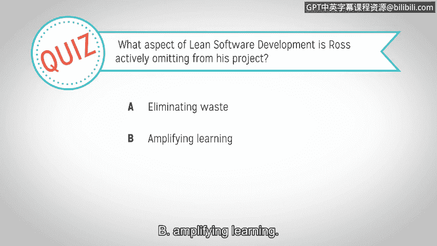

# 042：精益软件开发原则（下）

在本节课中，我们将继续学习精益软件开发的剩余核心原则，包括赋能团队、内建质量与整体看待。这些原则旨在提升团队效率与产品质量。

上一节我们介绍了精益软件开发的前四个原则，本节中我们来看看剩下的三个重要原则。

## 赋能团队 👥

精益软件开发的第五个原则是“赋能团队”的概念。

以下引用自西奥多·罗斯福，它总结了我们即将阐述的一切：

> 最好的管理者，是有足够的智慧去挑选合适的人来完成他想要做的事，并有足够的自制力在他们做事时不加以干涉。

这就是“赋能团队”这一原则的全部内涵。如果你相信你的开发团队具备正确完成工作所需的技能，那么你为何还要花时间告诉他们具体怎么做呢？作为软件产品经理，你的精力最好用在其他事情上，例如理解客户需求。移除开发者的障碍，然后让开道路。

这听起来是否与传统管理方式相悖？通常，当我们想到管理时，会想到一个专横的人，事无巨细地告诉团队需要做什么以及如何去做。这很大程度上说明了那些管理者对团队缺乏信任。当然，团队成员也能感觉到这一点。日复一日地被微观管理和告知该做什么，是令人心力交瘁的。这就是为什么精益软件开发旨在赋能遵循其实践的团队。

精益软件开发鼓励管理者倾听开发者的意见，而不是告诉他们如何做事。作为软件产品经理，你应该鼓励你的开发者构思满足客户需求的解决方案。你的目标应该是倾听开发者的想法并提供建议。毕竟，他们应该是你的盟友。这种信任开发团队的实践，能让团队以他们希望的方式工作。相信他们能做出正确的技术决策。这不仅确保了开发者使用对他们而言最高效的方法，也极大地提升了他们的士气。当开发团队感觉他们能掌控工作，并被赋予在没有微观管理的情况下完成任务的自由时，事情会顺利得多。这就是赋能团队背后的逻辑。一个快乐的开发团队，也是一个高效且多产的团队。

让我们测试一下你对这些原则的理解。在开发软件产品时，软件开发团队和客户应尽可能晚做决定的主要原因之一是什么？

以下是选项：
A. 这为他们争取了更多开发时间。
B. 这允许他们探索其他产品设计。
C. 客户从来不知道他们想要什么。
D. 这允许团队快速构建可工作的软件。

正确答案是 **B**。尽可能晚做决定，可以让你的开发者和客户探索其他可能更好的产品设计。这并不会延长产品截止日期或让任何事情变得更快，也绝不意味着你的客户从来不知道他们想要什么。请记住，即使你通过晚做决定向客户呈现了最佳可能选项，也不意味着你可以不按时交付。

## 内建质量 🛡️

精益软件开发的第六个原则是“内建质量”原则。这是一个广泛而全面的原则。其真正目的是确保你的开发团队使用可用的最佳实践来避免错误。

那么这具体是怎样的呢？我在之前模块中简要提到过测试驱动开发的实践。这意味着在实际需要测试之前就编写测试。与其先构建产品再进行测试（即开发者在现有代码周围编写测试），不如聚焦于代码旨在解决的实际问题。基本上，先构建测试意味着你实际上是在测试你的代码是否解决了问题，而不仅仅是代码是否能运行。

另一种内建质量的方法借鉴了极限编程，摩根在上一个模块中讨论过：**结对编程**。如果你需要复习，我鼓励你重新观看那节课。然而，我要说的是，结对编程是开发者真正提高产品质量的一种方式。基本上，这就像在你构建时身边有一位智能向导。我要提醒你，结对编程在开发者时间方面成本也很高。因此，虽然它是开发优秀软件的绝佳工具，但不要依赖它来构建整个产品。否则，你可能最终会违反“尽可能快交付”的原则。

还有其他方法可以为你的产品内建质量。例如：
*   **代码注释清晰**
*   **文档完善**
*   **重构代码以提高效率**
*   **自动化测试**

这些都是你可以采用的方式。如果你想获得关于这些主题的更多具体信息，请参阅课程资源，我已包含一些参考资料供你参考。

所有这些都服务于让你的产品更好的目的。精益的核心价值观之一是尽可能消除浪费。因此，通过减少开发者修复代码所需的时间，你就减少了项目中存在的浪费。通过内建质量，你可以大幅减少发布后的缺陷和修复数量。所以，通过内建质量，你就能大幅减少产品中存在的浪费。

## 整体看待 🧩

本课程将涵盖的精益最后一个原则是“整体看待”原则。“整体看待”意味着将你的软件视为不仅仅是许多小部件的组合。毕竟，最终用户看到的不仅仅是串联在一起的一些功能，最终用户应该看到一个具有逻辑且流畅地相互衔接的组件的、连贯的产品。

因此，在精益软件开发中，在发布前将产品视为一个整体来思考非常重要。这意味着你的开发者必须不断意识到他们负责的部分如何融入大局。大局可能是整个产品，但也可能是该产品如何与同一制造商的其他产品相配合。没有这种视角，产品可能会变得脱节、不合逻辑或仅仅是笨拙。整体看待能让你的开发团队构建出一个连贯、设计精良的整体产品。

让我们通过一个案例来巩固理解。罗斯正在为医学研究构建一个软件产品。由于他的日常工作拯救生命，他不断尝试改进软件开发流程。他最近接触到了精益软件开发，并开始实施其中一些原则。他尝试鼓励团队将项目视为更大目标的一部分，并让他们在最终确定前创建软件的多个不同版本，同时专注于快速构建。为了节省时间，他要求开发团队不要编写单元测试、编写代码文档或使用任何特定的编程实践。罗斯在他的项目中主动忽略了精益软件开发的哪个方面？

以下是选项：
A. 消除浪费。
B. 放大学习。
C. 尽可能晚做决定。
D. 内建质量。

答案是 **D**，内建质量。通过主动避免这些编程最佳实践，罗斯主动选择了不内建质量。间接来看，这可能会产生浪费，但并非直接相关。

本节课中我们一起学习了精益软件开发的三个关键原则：赋能团队以提升自主性与士气，内建质量以减少浪费并提升产品健壮性，以及整体看待以确保产品作为连贯的整体交付。掌握这些原则将帮助你更好地管理软件项目，平衡速度与质量。